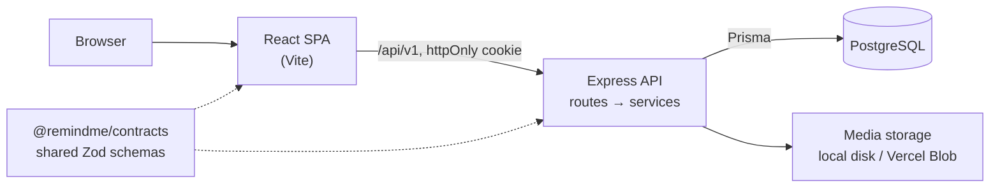

<p align="center">
  
</p>

<h1 align="center">RemindMe</h1>

<p align="center">
  A spaced-revision app: build your own library of notes, code snippets, images, lists and links,<br />
  then revise it one card at a time so nothing you learned slips away.
</p>

<p align="center">
  <a href="https://github.com/roman-ua89/remindme/actions/workflows/pipeline.yml"></a>
  
  
</p>

<!-- TODO: live demo link and demo account, once production is deployed -->

<!-- TODO: hero screenshot (Player or logged-in Home at 1280px), e.g. docs/images/player.png -->

## Features

- **Your own hierarchy.** Organise knowledge as **Category → Topic → Entity**, with search and pagination on every list.
- **Entity constructor.** An entity is a title plus up to 20 ordered blocks: rich text (TipTap), code (CodeMirror), image, list or link. Reorder blocks by drag and drop and preview before saving.
- **Player.** Revise entities in small packs, least-revised first, with a timer and pack progress. **Done** and **Skip** (keyboard: `D` / `S`) update each entity's revision counts.
- **Fair scheduling.** New entities join the current revision tier instead of jumping the queue.
- **Progress.** Monthly **Daily activity** and **Time in Player** charts, counted by your local day, plus a tree card with six growth stages (its score is a placeholder for now).
- **Visibility and markers.** Hide whole topics or single entities from the Player without deleting them.
- **Accounts.** Cookie-based login with roles and permissions; admins can manage users.

## Tech stack

### Frontend

-  **React 19**: UI library
-  **TypeScript**: type safety across the whole monorepo
-  **Vite**: dev server and build
-  **TanStack Router**: file-based, type-safe routing
-  **TanStack Query**: server state, caching and invalidation
-  **Tailwind CSS v4**: styling with design tokens
-  **shadcn/ui**: component source, built on Base UI
-  **Base UI**: accessible headless primitives
-  **React Hook Form**: forms, including the entity constructor
-  **Zod**: form and API schema validation
-  **Axios**: HTTP client with cookie auth
-  **TipTap**: rich-text block editor
-  **CodeMirror**: code block editor with syntax highlighting
-  **dnd kit**: drag-and-drop block reordering
-  **Recharts**: activity charts
-  **date-fns**: date formatting
-  **Lucide**: icons
-  **Vitest** +  **Testing Library**: unit tests
-  **ESLint** +  **Prettier**: linting and formatting

### Backend

-  **Node.js 26**: runtime
-  **TypeScript**: type safety, run in dev with tsx
-  **Express 5**: REST API as a modular monolith
-  **Prisma 6**: ORM and migrations
-  **PostgreSQL**: database
-  **Zod**: request validation, with schemas shared with the frontend
-  **JWT** + bcrypt: auth in an httpOnly cookie, roles and permissions
-  **Multer**: media uploads
-  **Vercel Blob**: cloud media storage (local disk in development)
-  **Pino**: structured logging
-  **Swagger UI**: API docs in development
-  **Vitest**: unit tests
-  **Docker Compose**: local PostgreSQL

## Architecture



- **npm workspaces monorepo:** `frontend`, `backend` and `packages/contracts`.
- **One source of truth for the wire format:** `@remindme/contracts` holds Zod schemas and the DTO types inferred from them. The frontend and backend both import them as TypeScript source, with no build step and no duplicated types.
- **Modular monolith backend:** each domain module has thin routes (validate → service → JSON) and a service that owns the business logic and maps database rows to DTOs. Routes are nested the same way as the data: `/categories/:id/topics/:id/entities/...`.
- **Feature-based frontend:** thin file-based routes render pages from `features/<domain>/`, each with its own API functions, one TanStack Query hook per file, form schemas and components.

More detail: [backend architecture](backend/docs/ARCHITECTURE.md), [frontend architecture](frontend/docs/ARCHITECTURE.md).

## Engineering highlights

- **Revision scheduling.** The Player picks the entities with the lowest `scheduleCount` in a scope. That count is the revision count plus a creation offset, so a new entity joins the current tier instead of taking over the queue.
- **Atomic entity save.** An entity, its blocks, its list rows and its media references are saved in one Prisma transaction, so nothing is saved half-way.
- **Three-layer authorization.** A JWT cookie identifies the user, a permission check guards the route (`content:manage_own`, `users:manage`…), and an ownership check confirms the row belongs to that user.
- **Timezone-aware activity.** Done and Skip upsert a per-user, per-day counter, where the day is the user's local day from the `X-Timezone` header.
- **Pluggable media storage.** Uploads go through a storage driver: local disk in development, Vercel Blob in the cloud, chosen by one environment variable.
- **Design system redesign.** The whole UI was redesigned in 10 incremental steps: colour tokens with AA contrast, pill buttons, brand SVG components, and restyled lists, Constructor and Player.

## AI-assisted development

**Agents propose, pipelines verify, humans decide.** The project is built with Claude Code, set up as a small team:

- **Orchestrator** (the main session) plans each task and writes short briefs: goal, files to read, files not to touch, and a command that proves the task is done.
- **`builder`** agents write the code; independent briefs run in parallel. The orchestrator re-runs each "done when" command itself before accepting.
- **`reviewer`** checks the finished changes against the briefs.
- **Skills** handle the git routine: cut a branch from the latest `dev`, draft the commit, push the branch. Commits and pushes happen only on my click.
- **Hooks** format and lint every file an agent edits, so style rules are enforced, not remembered.

Details: [orchestrator workflow](docs/orchestrator.md), [agentic CI/CD plan](docs/agentic-cicd-plan.md).

## Quality and CI/CD

- **Flow:** feature branch → pull request into `dev` → required checks → squash merge. A ruleset blocks merging while checks are red.
- **`quality` check:** typecheck, lint, format check, tests and build for every workspace (`npm run ci`).
- **`migrations` check:** applies all migrations to an empty PostgreSQL 16, fails on schema drift, and runs the seed twice to prove it's idempotent.
- **Tests:** 56 Vitest tests (39 frontend, 17 backend) covering entity form and save-payload conversion, Player session logic, contract schemas, pagination, daily-activity day logic and the storage driver.
- **Deployment:** prepared for Vercel Services (frontend and backend from one repo), with a `/api/v1/health` endpoint that reports the deployed commit. Automated production deploys are in progress.

## Getting started

Prerequisites: Node.js 26 and Docker.

1. Clone and install (from the repo root only):

   ```bash
   git clone https://github.com/roman-ua89/remindme.git
   cd remindme
   npm install
   ```

2. Create the env files. The defaults work for local development; set your own `JWT_SECRET` (16+ characters):

   ```bash
   cp backend/.env.example backend/.env
   cp frontend/.env.example frontend/.env
   ```

3. Start PostgreSQL, apply migrations and seed:

   ```bash
   docker compose -f backend/docker-compose.yml up -d
   npm run db:migrate
   npm run db:seed:base
   npm run db:seed:dev
   ```

4. Run the backend and the frontend in two terminals:

   ```bash
   npm run dev:backend
   npm run dev:frontend
   ```

Open http://localhost:5173 and log in as `admin@remindme.local` / `admin12345` (development seed only). Swagger UI is at http://localhost:3000/api/docs.

Run every check CI runs with `npm run ci`.

## Project structure

```text
remindme/
├── frontend/              React SPA
│   ├── src/routes/        file-based routes (thin)
│   ├── src/features/      one folder per domain: api, queries, schemas, components
│   └── docs/              product spec, architecture, wireframes
├── backend/               Express API
│   ├── src/modules/       one folder per domain: routes + service
│   ├── src/lib/           errors, ownership, storage, daily activity
│   └── prisma/            schema, migrations, seeds
├── packages/contracts/    shared Zod schemas and DTO types
├── docs/                  CI/CD plan, orchestrator workflow, progress log
├── .claude/               agents, skills and hooks for Claude Code
└── .github/workflows/     CI pipeline
```

## Documentation

- [Product spec](frontend/docs/PRODUCT.md): what the app does and how it behaves
- [Frontend architecture](frontend/docs/ARCHITECTURE.md) and [tech stack](frontend/docs/TECH_STACK.md)
- [Backend architecture](backend/docs/ARCHITECTURE.md) and [data flows](backend/docs/DATA-FLOWS.md)
- [Data model](frontend/docs/DATABASE.md)
- [Authentication](frontend/docs/AUTH.md)
- [Player](frontend/docs/PLAYER.md)
- [Wireframes](frontend/docs/WIREFRAMES.md)
- [Agentic CI/CD plan](docs/agentic-cicd-plan.md)
- [Decisions log](docs/agile/decisions.md)

## Roadmap

- Automated production deploys on Vercel, with smoke tests and rollback.
- A real score for the tree, earned through revision.

<!-- TODO: add your next items -->

## Author

**Roman Melnychenko**: [GitHub](https://github.com/roman-ua89) · <!-- TODO: LinkedIn link -->

<!-- TODO: one line on why you built RemindMe -->

<!-- TODO: licence, once a LICENSE file is added -->
