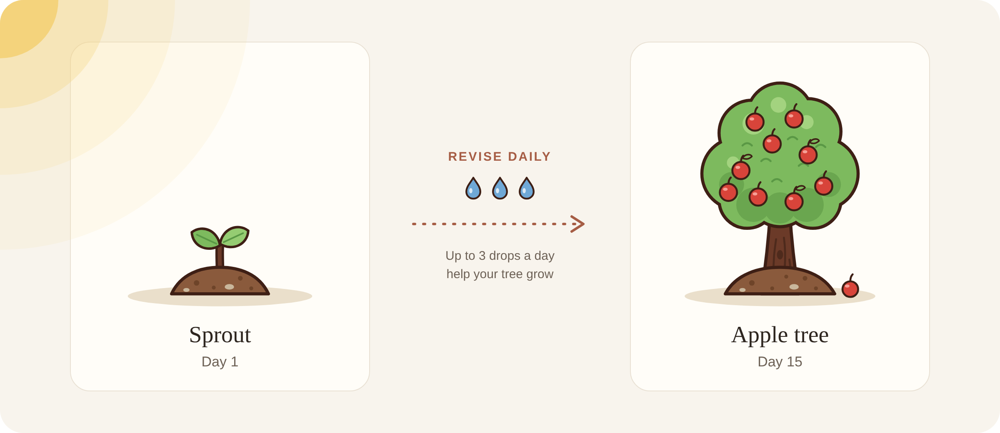
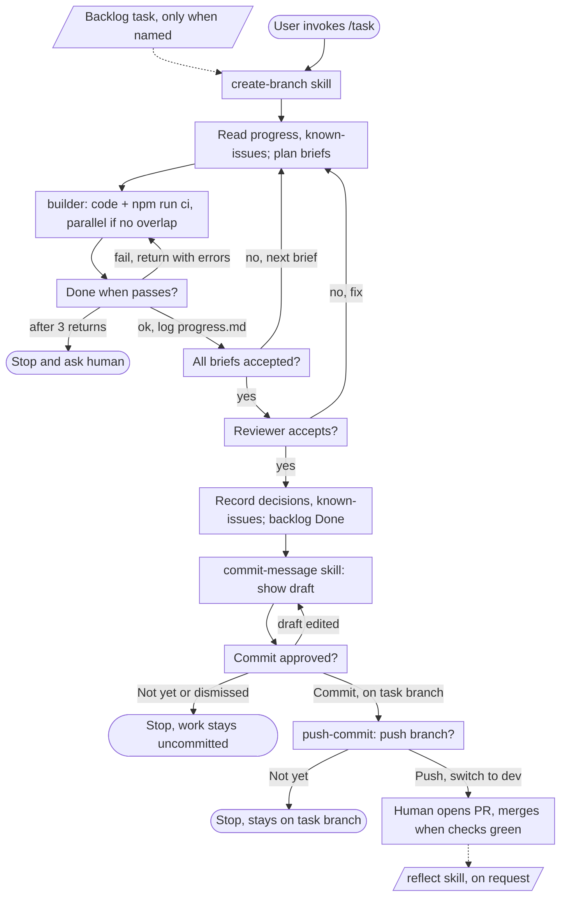
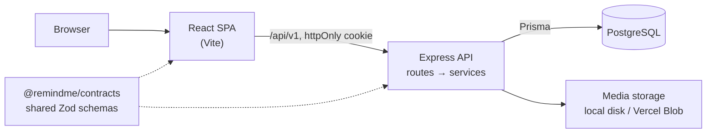
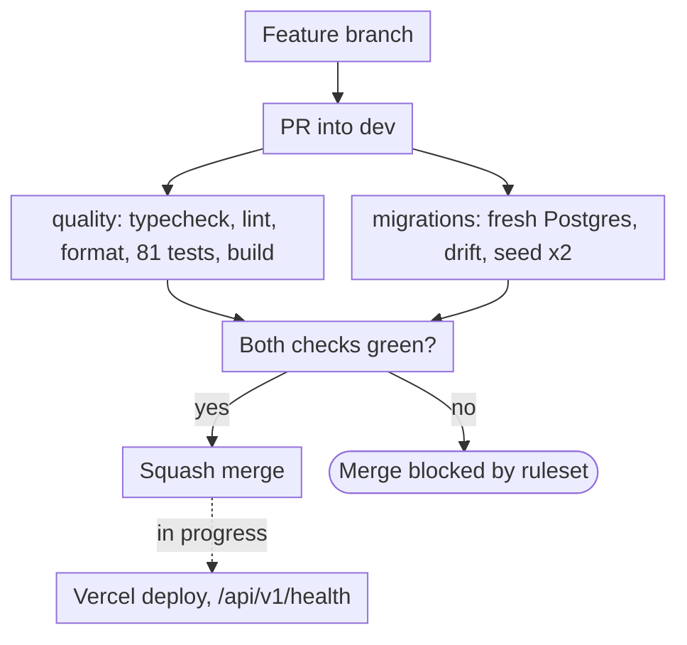

<p align="center">
  
</p>

<h1 align="center">RemindMe</h1>

<p align="center">
  A spaced-revision app: build your own library of notes, code snippets, images, lists and links,<br />
  then revise it one card at a time so nothing you learned slips away.
</p>

<p align="center">
  
</p>

<p align="center">
  <a href="https://github.com/roman-ua89/remindme/actions/workflows/pipeline.yml"></a>
  
  
</p>

<!-- TODO: live demo link and demo account, once production is deployed -->

<!-- TODO: hero screenshot (Player or logged-in Home at 1280px), e.g. docs/images/player.png -->

## Agentic workflow

How a task moves through the orchestrator (main Claude session), the `builder` and `reviewer` agents, and the skills `task`, `create-branch`, `commit-message`, `push-commit` and `reflect`.
The flow runs only when the user invokes `/task`; outside it, the main session edits directly on the current branch. Rules live in [CLAUDE.md](CLAUDE.md); the task lifecycle in the `task` skill; agents in `.claude/agents/`; skills in `.claude/skills/`.

### Process



### Roles

| Who | Does | Never does |
|-----|------|------------|
| Orchestrator | Runs each task through the `task` skill: plans, runs `create-branch` at task start (it pulls `dev` first), writes briefs, runs "Done when", accepts work, runs `commit-message` and `push-commit` (commits and pushes only after a click; push-commit then switches back to `dev`), updates `docs/` | Writes code (except 1-2 line fixes), opens PRs, merges, pushes `dev` |
| `builder` | Implements one brief, runs "Done when" and `npm run ci` unless only safe `.md` files changed (the check in `builder.md` step 3), reports | Touches "Don't touch" files |
| `reviewer` | Compares `git diff` with briefs and `docs/agile/decisions.md` | Changes anything |
| `reflect` | Lists what went wrong, proposes minimal edits | Changes anything before approval |
| Human | Invokes `/task`, clicks Commit or Push, opens PRs, merges them once checks are green, names backlog tasks, approves `reflect` edits, answers after 3 failed returns | |

Source: [docs/orchestrator.md](docs/orchestrator.md).

## Features

- **Your own hierarchy.** Organise knowledge as **Category → Topic → Entity**, with search and pagination on every list.
- **Entity constructor.** An entity is a title plus up to 20 ordered blocks: rich text (TipTap), code (CodeMirror), image, list or link. Reorder blocks by drag and drop and preview before saving.
- **Player.** Revise entities in small packs, least-revised first, with a timer and pack progress. **Done** and **Skip** (keyboard: `D` / `S`) update each entity's revision counts.
- **Fair scheduling.** New entities join the current revision tier instead of jumping the queue.
- **Progress.** Monthly **Daily activity** and **Time in Player** charts, counted by your local day, plus a tree card with six growth stages (its score is a placeholder for now).
- **Visibility and markers.** Hide whole topics or single entities from the Player without deleting them.
- **Accounts.** Cookie-based login with roles and permissions; admins can manage users.

## Tech stack

### Frontend

&nbsp;React 19&nbsp;&nbsp;·&nbsp; &nbsp;TypeScript&nbsp;&nbsp;·&nbsp; &nbsp;Vite&nbsp;&nbsp;·&nbsp; &nbsp;TanStack Router&nbsp;&nbsp;·&nbsp; &nbsp;TanStack Query&nbsp;&nbsp;·&nbsp; &nbsp;Tailwind CSS v4&nbsp;&nbsp;·&nbsp; &nbsp;shadcn/ui&nbsp;&nbsp;·&nbsp; &nbsp;Base UI&nbsp;&nbsp;·&nbsp; &nbsp;React Hook Form&nbsp;&nbsp;·&nbsp; &nbsp;Zod&nbsp;&nbsp;·&nbsp; &nbsp;Axios&nbsp;&nbsp;·&nbsp; &nbsp;TipTap&nbsp;&nbsp;·&nbsp; &nbsp;CodeMirror&nbsp;&nbsp;·&nbsp; &nbsp;dnd kit&nbsp;&nbsp;·&nbsp; &nbsp;Recharts&nbsp;&nbsp;·&nbsp; &nbsp;date-fns&nbsp;&nbsp;·&nbsp; &nbsp;Lucide&nbsp;&nbsp;·&nbsp; &nbsp;Vitest&nbsp;&nbsp;·&nbsp; &nbsp;Testing Library&nbsp;&nbsp;·&nbsp; &nbsp;ESLint&nbsp;&nbsp;·&nbsp; &nbsp;Prettier

### Backend

&nbsp;Node.js 26&nbsp;&nbsp;·&nbsp; &nbsp;TypeScript&nbsp;&nbsp;·&nbsp; &nbsp;Express 5&nbsp;&nbsp;·&nbsp; &nbsp;Prisma 6&nbsp;&nbsp;·&nbsp; &nbsp;PostgreSQL&nbsp;&nbsp;·&nbsp; &nbsp;Zod&nbsp;&nbsp;·&nbsp; &nbsp;JWT&nbsp;&nbsp;·&nbsp; &nbsp;Multer&nbsp;&nbsp;·&nbsp; &nbsp;Vercel Blob&nbsp;&nbsp;·&nbsp; &nbsp;Pino&nbsp;&nbsp;·&nbsp; &nbsp;Swagger UI&nbsp;&nbsp;·&nbsp; &nbsp;Vitest&nbsp;&nbsp;·&nbsp; &nbsp;Docker Compose

## Architecture



- **npm workspaces monorepo:** `frontend`, `backend` and `packages/contracts`.
- **One source of truth for the wire format:** `@remindme/contracts` holds Zod schemas and the DTO types inferred from them. The frontend and backend both import them as TypeScript source, with no build step and no duplicated types.
- **Modular monolith backend:** each domain module has thin routes (validate → service → JSON) and a service that owns the business logic and maps database rows to DTOs. Routes are nested the same way as the data: `/categories/:id/topics/:id/entities/...`.
- **Feature-based frontend:** thin file-based routes render pages from `features/<domain>/`, each with its own API functions, one TanStack Query hook per file, form schemas and components.

More detail: [backend architecture](backend/docs/ARCHITECTURE.md), [frontend architecture](frontend/docs/ARCHITECTURE.md).

## AI-assisted development

**Agents propose, pipelines verify, humans decide.** The project is built with Claude Code, set up as a small team:

- **Orchestrator** (the main session) plans each task I start with `/task` and writes short briefs: goal, files to read, files not to touch, and a command that proves the task is done.
- **`builder`** agents write the code; independent briefs run in parallel. The orchestrator re-runs each "done when" command itself before accepting.
- **`reviewer`** checks the finished changes against the briefs.
- **Skills** handle the git routine: cut a branch from the latest `dev`, draft the commit, push the branch. Commits and pushes happen only on my click.
- **Hooks** format and lint every file an agent edits, so style rules are enforced, not remembered.

Details: [orchestrator workflow](docs/orchestrator.md), [agentic CI/CD plan](docs/agentic-cicd-plan.md).

## Quality and CI/CD

Vitest covers auth and entity forms, the Player, score, contracts, pagination, daily activity and the storage driver (64 frontend, 17 backend tests).



## Getting started

Prerequisites: Node.js 26 and Docker.

1. Clone and install (from the repo root only):

   ```bash
   git clone https://github.com/roman-ua89/remindme.git
   cd remindme
   npm install
   ```

2. Create the env files. The defaults work for local development; set your own `JWT_SECRET` (16+ characters):

   ```bash
   cp backend/.env.example backend/.env
   cp frontend/.env.example frontend/.env
   ```

3. Start PostgreSQL, apply migrations and seed:

   ```bash
   docker compose -f backend/docker-compose.yml up -d
   npm run db:migrate
   npm run db:seed:base
   npm run db:seed:dev
   ```

4. Run the backend and the frontend in two terminals:

   ```bash
   npm run dev:backend
   npm run dev:frontend
   ```

Open http://localhost:5173 and log in as `admin@remindme.local` / `admin12345` (development seed only). Swagger UI is at http://localhost:3000/api/docs.

Run every check CI runs with `npm run ci`.

## Project structure

```text
remindme/
├── frontend/              React SPA
│   ├── src/routes/        file-based routes (thin)
│   ├── src/features/      one folder per domain: api, queries, schemas, components
│   └── docs/              product spec, architecture, wireframes
├── backend/               Express API
│   ├── src/modules/       one folder per domain: routes + service
│   ├── src/lib/           errors, ownership, storage, daily activity
│   └── prisma/            schema, migrations, seeds
├── packages/contracts/    shared Zod schemas and DTO types
├── docs/                  CI/CD plan, orchestrator workflow, progress log
├── .claude/               agents, skills and hooks for Claude Code
└── .github/workflows/     CI pipeline
```

## Documentation

- [Product spec](frontend/docs/PRODUCT.md): what the app does and how it behaves
- [Frontend architecture](frontend/docs/ARCHITECTURE.md) and [tech stack](frontend/docs/TECH_STACK.md)
- [Backend architecture](backend/docs/ARCHITECTURE.md) and [data flows](backend/docs/DATA-FLOWS.md)
- [Data model](frontend/docs/DATABASE.md)
- [Authentication](frontend/docs/AUTH.md)
- [Player](frontend/docs/PLAYER.md)
- [Wireframes](frontend/docs/WIREFRAMES.md)
- [Agentic CI/CD plan](docs/agentic-cicd-plan.md)
- [Decisions log](docs/agile/decisions.md)

## Roadmap

- Automated production deploys on Vercel, with smoke tests and rollback.
- A real score for the tree, earned through revision.

<!-- TODO: add your next items -->

## Author

**Roman Melnychenko**: [GitHub](https://github.com/roman-ua89) · <!-- TODO: LinkedIn link -->

<!-- TODO: one line on why you built RemindMe -->

<!-- TODO: licence, once a LICENSE file is added -->
