# RemindMe Backend Architecture

A beginner-friendly guide to how the RemindMe backend is structured, how requests flow through it, and how modules interact with each other and the outside world.

**Audience:** developers new to building backends who want to understand *what happens when* and *where code belongs*.

**Related docs:**
- [README](../README.md) — setup, env vars, npm scripts
- [frontend/docs/ARCHITECTURE.md](../../frontend/docs/ARCHITECTURE.md) — frontend mirror of this pattern
- [frontend/docs/DATABASE.md](../../frontend/docs/DATABASE.md) — database schema details

---

## 1. Big picture

RemindMe uses a **layered modular monolith**: one deployable Node.js app (`backend/`) split into domain **modules** (auth, categories, topics, …). Each module has two files:

| File | Role |
|------|------|
| `*.routes.ts` | HTTP layer — receives requests, runs middleware, calls the service, sends JSON |
| `*.service.ts` | Business logic — validates ownership, talks to the database, maps rows to API types |

There is no separate `controllers/` or `models/` folder. Database access goes through **Prisma**; API shapes are defined in **`@remindme/contracts`** (shared with the frontend).

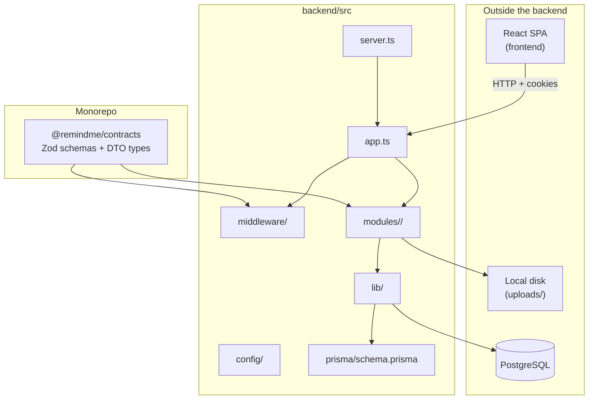

**One sentence summary:** HTTP request → validate input → authenticate → authorize → service does work → Prisma reads/writes DB → map to contract DTO → JSON response (or structured error).

---

## 2. Startup: how the server boots

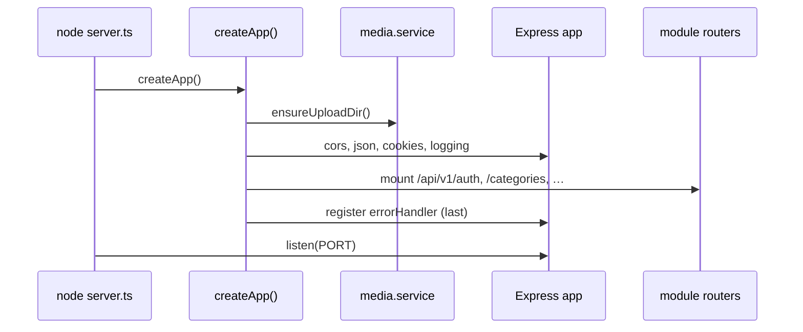

| File | Responsibility |
|------|----------------|
| [`server.ts`](../src/server.ts) | Entry point — creates the app and starts listening |
| [`app.ts`](../src/app.ts) | Wires global middleware, mounts all route modules under `/api/v1`, attaches error handler |
| [`config/env.ts`](../src/config/env.ts) | Validates `process.env` with Zod at startup (fails fast if misconfigured) |

Route mounting in `app.ts` defines the **URL tree**:

```
/api/v1/auth/*
/api/v1/categories/*
/api/v1/categories/:categoryId/topics/*
/api/v1/categories/:categoryId/topics/:topicId/entities/*
/api/v1/media/*
/api/v1/users/*
```

Nested paths (`topics` under `categories`, `entities` under `topics`) mirror the **content hierarchy** in the database.

---

## 3. Layers and what each folder does

Think of the backend as four horizontal layers. Data flows **down** on the way in and **up** on the way out.

```mermaid
flowchart TB
    subgraph L1 [Layer 1 — HTTP entry]
        Routes["modules/*.routes.ts"]
    end

    subgraph L2 [Layer 2 — Cross-cutting]
        Validate["validate()"]
        Auth["auth / optionalAuth"]
        Perm["requirePermission()"]
        ErrHandler["errorHandler"]
    end

    subgraph L3 [Layer 3 — Domain logic]
        Services["modules/*.service.ts"]
        Ownership["lib/ownership.ts"]
    end

    subgraph L4 [Layer 4 — Infrastructure]
        Prisma["lib/prisma.ts"]
        Errors["lib/errors.ts"]
        JWT["lib/jwt.ts"]
        Env["config/env.ts"]
    end

    subgraph L5 [Layer 5 — Persistence]
        DB[(PostgreSQL)]
        Files["uploads/"]
    end

    Routes --> Validate
    Routes --> Auth
    Routes --> Perm
    Routes --> Services
    Services --> Ownership
    Services --> Prisma
    Services --> Errors
    Services --> Files
    Prisma --> DB
    Routes -.->|errors via next(err)| ErrHandler
    Services -.->|throw AppError| ErrHandler
```

### Folder reference

| Folder | What lives here | What must NOT live here |
|--------|-----------------|-------------------------|
| `modules/<domain>/` | Routes + services for one business area | Raw SQL, env parsing, global middleware |
| `middleware/` | Reusable request pipeline steps (auth, validation, permissions) | Domain-specific rules (e.g. “can delete category with topics”) |
| `lib/` | Shared infrastructure used by many modules | HTTP `req`/`res` handling |
| `config/` | Environment validation only | API request/response schemas |
| `prisma/` | Schema, migrations, seed | HTTP or Express code |
| `openapi/` | Swagger spec for dev docs | Runtime logic |

---

## 4. A single request: step by step

Example: **create a category** — `POST /api/v1/categories` with JSON body `{ "name": "Math" }`.

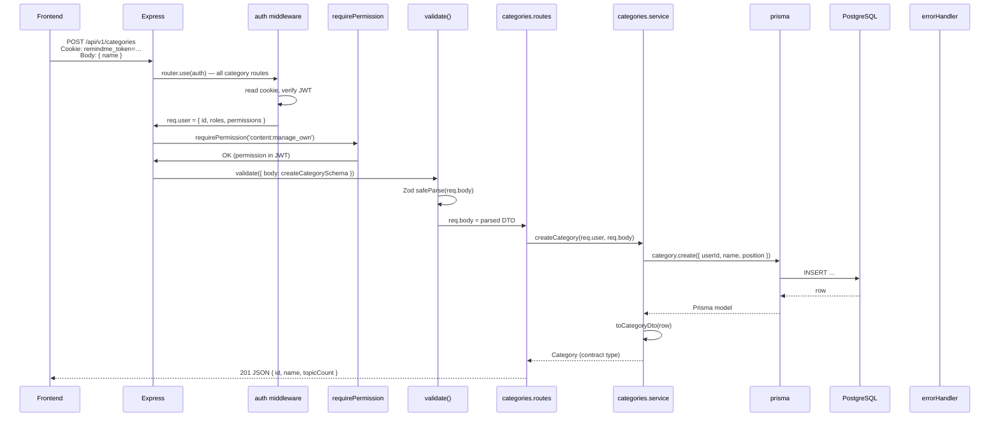

If anything fails, the route calls `next(error)` and Express jumps to `errorHandler`, which sends a consistent JSON error shape.

### Middleware order matters

On a protected route, the typical chain is:

1. **Global** (in `app.ts`): CORS → `express.json()` → `cookieParser()` → logging
2. **Router-level** (in `*.routes.ts`): `auth` → `requirePermission(...)`
3. **Per-route**: `validate({ body, params, query })`
4. **Handler**: call service → `res.json(...)`

Public routes (e.g. `POST /auth/login`) skip `auth` and `requirePermission`.

---

## 5. Modules: domains and how they relate

Each module maps to a frontend feature and a contracts file. Modules do **not** import each other's services directly (with one small exception noted below).

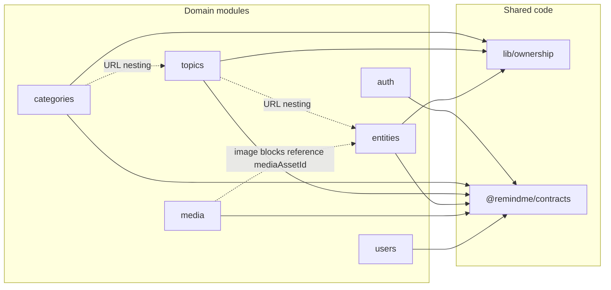

| Frontend feature | Backend module | Contracts | Base path |
|------------------|----------------|-----------|-----------|
| `features/auth/` | `modules/auth/` | `packages/contracts/src/auth.ts` | `/api/v1/auth` |
| `features/categories/` | `modules/categories/` | `categories.ts` | `/api/v1/categories` |
| `features/topics/` | `modules/topics/` | `topics.ts` | `…/categories/:categoryId/topics` |
| `features/entities/` | `modules/entities/` | `entities.ts` | `…/topics/:topicId/entities` |
| `features/media/` | `modules/media/` | `media.ts` | `/api/v1/media` |
| `features/player/` (revise/skip) | `modules/entities/` | `entities.ts` | `…/entities/:entityId/revise` |
| Admin users | `modules/users/` | `users.ts` | `/api/v1/users` |

### Content hierarchy (database + URLs)

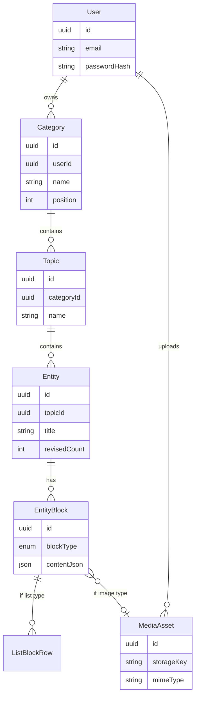

**Dependency order** (why auth was built first): everything except `auth` needs `req.user`. Content modules depend on the hierarchy: categories → topics → entities.

---

## 6. Routes vs services: the split

### Routes are thin

Routes know about HTTP (`req`, `res`, `next`, status codes, cookies). They should fit on one screen.

```typescript
// Pattern used everywhere in *.routes.ts
router.post('/', validate({ body: createCategorySchema }), async (req, res, next) => {
  try {
    const category = await categoriesService.createCategory(req.user!, req.body)
    res.status(201).json(category)
  } catch (error) {
    next(error)  // hand off to errorHandler
  }
})
```

### Services own business rules

Services receive **plain data** (`AuthUser`, contract input types) — not Express objects. They:

- Enforce ownership (via `lib/ownership.ts`)
- Run **transactions** when multiple tables must update together
- Map Prisma rows → contract DTOs (never return raw `@prisma/client` types to the client)
- `throw` `AppError` subclasses for expected failures

```typescript
// Pattern in *.service.ts
export async function createCategory(user: AuthUser, input: CreateCategoryInput): Promise<Category> {
  const category = await prisma.$transaction(async (tx) => {
    const created = await tx.category.create({ data: { userId: user.id, name: input.name, … } })
    if (input.firstTopicName) {
      await tx.topic.create({ … })
    }
    return created
  })
  return toCategoryDto(category, topicCount)
}
```

---

## 7. Shared packages and import rules

### `@remindme/contracts`

Lives in `packages/contracts/`. Contains **Zod schemas** (runtime validation) and **TypeScript types** (compile-time). Both frontend and backend import it.

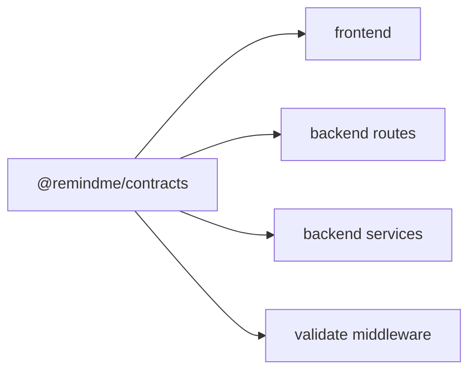

**Rule:** contracts import only `zod` — no Express, Prisma, or React. That keeps the package portable.

### Import boundaries (keep these strict)

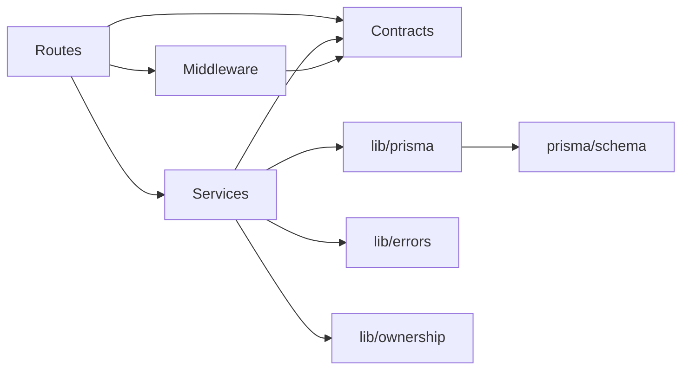

| Allowed | Forbidden |
|---------|-----------|
| `modules/*` → `lib/`, `middleware/`, `@remindme/contracts` | `modules/A` → `modules/B/*.service` (cross-module) |
| Services → `prisma`, `errors`, `ownership` | Exposing Prisma types in HTTP responses |
| Routes → their own `*.service` | Business logic inside routes |

**Known exception:** `media.service.ts` imports `mediaUrl` from `entities.service.ts` to build consistent image URLs. Prefer moving shared helpers to `lib/` if this grows.

---

## 8. Authentication and authorization

### Auth flow (login)

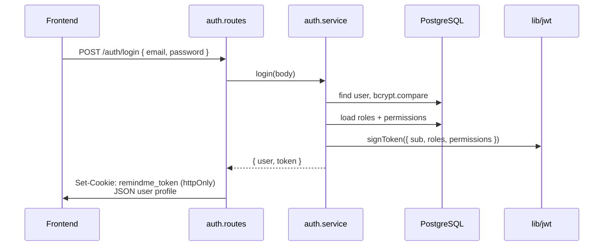

| Piece | File | Role |
|-------|------|------|
| Cookie name | `lib/jwt.ts` | `remindme_token` |
| Sign / verify | `lib/jwt.ts` | `signToken`, `verifyToken` |
| Read cookie → `req.user` | `middleware/auth.ts` | Runs on protected routers |
| Permission gate | `middleware/require-permission.ts` | Checks `req.user.permissions` |

JWT payload carries `sub` (user id), `roles`, and `permissions` so most routes avoid extra DB lookups for authorization.

### Authorization layers

1. **Authentication** — `auth` middleware: is there a valid session?
2. **Permission** — `requirePermission('content:manage_own')` or `users:manage`: does the JWT include the right capability?
3. **Ownership** — `lib/ownership.ts`: does this row belong to `req.user.id`? (Admins with `content:manage_any` can bypass ownership.)

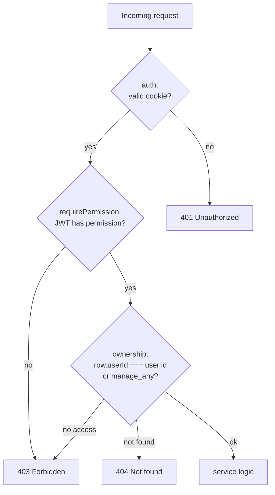

---

## 9. Validation and errors

### Input validation

`validate()` middleware runs Zod schemas from contracts against `body`, `params`, and `query`. On success it **replaces** `req.body` / `req.params` / `req.query` with parsed, typed values.

### Error handling

Services and middleware throw `AppError` (from `lib/errors.ts`). The global `errorHandler` converts them to JSON:

```json
{
  "message": "Validation failed",
  "code": "VALIDATION_ERROR",
  "errors": [{ "field": "name", "message": "Required" }]
}
```

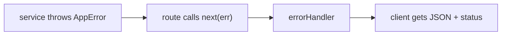

| Helper | HTTP status | When |
|--------|-------------|------|
| `validationError` | 422 | Zod / field errors |
| `unauthorized` | 401 | Missing or bad session |
| `forbidden` | 403 | Logged in but not allowed |
| `notFound` | 404 | Row does not exist |
| `conflict` | 409 | Business rule violation (e.g. delete category with topics) |
| `badRequest` | 400 | Other client mistakes |
| (unknown) | 500 | Logged server-side, generic message to client |

---

## 10. Data flow: inside and outside

### Outside → in (write path)

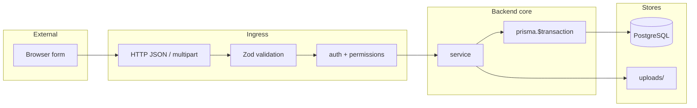

### Inside → out (read path)

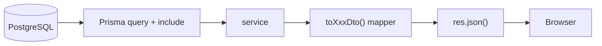

**Important:** Prisma returns database-shaped objects (snake_case fields mapped in schema, relations as nested objects). Services map them to **contract DTOs** before sending JSON. The frontend never sees `passwordHash`, internal ids it does not need, or Prisma-specific shapes.

### Media: two storage paths

| Step | Where |
|------|--------|
| Upload `POST /media/upload` | File bytes → `uploads/<storageKey>` on disk; metadata → `media_assets` table |
| Reference in entity | Entity block stores `mediaAssetId`; response includes `mediaUrl: /api/v1/media/files/:storageKey` |
| Serve `GET /media/files/:storageKey` | Lookup in DB → `res.sendFile` from disk |

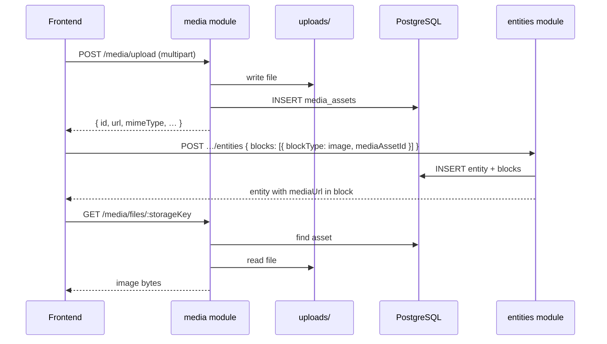

---

## 11. Transactions and complex writes

The **entities** module is the most complex: saving an entity can touch `entities`, `entity_blocks`, `list_block_rows`, and reference `media_assets`.

`prisma.$transaction` ensures **all-or-nothing** writes — if one insert fails, everything rolls back.

Used in:
- `entities.service` — create/update entity with many blocks
- `categories.service` — create category + optional first topic
- `auth.service` — reset password + mark token used

---

## 12. Module interaction cheat sheet

| From | To | How they interact |
|------|-----|-------------------|
| Frontend | `*.routes.ts` | HTTP to `/api/v1/...`; auth via httpOnly cookie (`credentials: 'include'`) |
| `*.routes.ts` | `*.service.ts` | Direct function call in same module folder |
| `*.routes.ts` | `middleware/` | Express middleware chain |
| `*.routes.ts` | `@remindme/contracts` | Import Zod schemas for `validate()` |
| `*.service.ts` | `lib/prisma` | All database access |
| `*.service.ts` | `lib/ownership` | Verify user owns category/topic/entity |
| `*.service.ts` | `lib/errors` | Throw typed errors |
| `auth.service` | `lib/jwt` | Sign tokens at login |
| `middleware/auth` | `lib/jwt` | Verify tokens on each request |
| `app.ts` | all `*.routes.ts` | Mount routers; no business logic |
| Modules | Other modules | **Avoid** — share via `lib/` or contracts |

---

## 13. Mental model for debugging

When something breaks, follow the request **down the stack**:

1. **URL wrong?** → Check `app.ts` mount path and route param names (`:categoryId`, `:topicId`).
2. **401?** → Cookie missing/expired → `middleware/auth.ts`, login flow, CORS `credentials`.
3. **403?** → Permission or ownership → JWT permissions vs `requirePermission` vs `lib/ownership.ts`.
4. **422?** → Body/params failed Zod → contracts schema vs what frontend sends.
5. **404?** → `ownership.ts` or service `findUnique` — id wrong or row belongs to another user.
6. **409?** → Business rule in service (e.g. delete category with topics).
7. **500?** → Unhandled exception — check server logs; often Prisma constraint or missing `next(error)` in route.

---

## 14. File map (quick reference)

```
backend/
  prisma/
    schema.prisma       # DB tables (source of truth with DATABASE.md)
    migrations/         # SQL migration history
    seed.ts               # roles, permissions, dev admin
  src/
    server.ts             # start listening
    app.ts                # Express wiring + route mounts
    config/env.ts         # validated environment
    lib/
      prisma.ts           # singleton PrismaClient
      errors.ts           # AppError + helpers
      jwt.ts              # sign/verify JWT, cookie name
      ownership.ts        # getCategory/Topic/EntityForUser
    middleware/
      auth.ts             # cookie → req.user
      require-permission.ts
      validate.ts         # Zod parse body/params/query
      error-handler.ts    # last middleware — JSON errors
    modules/
      auth/               # register, login, logout, me, password reset
      categories/         # CRUD root of content tree
      topics/             # nested under category
      entities/           # nested under topic; blocks; revise/skip
      media/              # upload + serve files
      users/              # admin user management
    openapi/spec.ts       # Swagger UI at /api/docs (dev only)
```

---

## 15. Glossary

| Term | Meaning in this project |
|------|-------------------------|
| **Module** | Folder under `modules/<domain>/` with `routes` + `service` |
| **DTO** | Data Transfer Object — the JSON shape defined in contracts |
| **Middleware** | Function that runs before your route handler; can modify `req` or stop the request |
| **Prisma** | ORM that generates TypeScript types from `schema.prisma` and runs queries |
| **Contract** | Shared Zod schema + types in `@remindme/contracts` |
| **Monolith** | One backend process/deployment (not split into microservices) |
| **Transaction** | Group of DB operations that commit together or roll back together |

---

*This document reflects the architecture described in the backend scaffold plan and the current `backend/src` implementation.*
