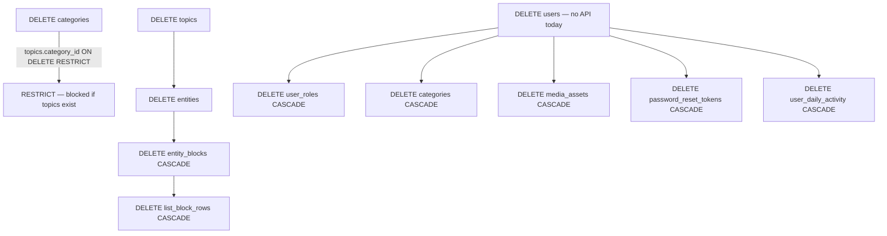

# Backend Database Data Flows

Operation-centric reference for how PostgreSQL data changes when the RemindMe backend runs. Use this document to trace data per API action and to write ad-hoc SQL queries.

**Related docs:**

- [frontend/docs/DATABASE.md](../../frontend/docs/DATABASE.md) — full schema catalog (tables, fields, indexes, business rules)
- [ARCHITECTURE.md](./ARCHITECTURE.md) — backend structure and request flow
- [prisma/schema.prisma](../prisma/schema.prisma) — source of truth for schema
- Write operations live in [`src/modules/*/*.service.ts`](../src/modules/)

---

## 1. Conventions

| Symbol | Meaning |
|--------|---------|
| **INSERT** | New row created |
| **UPDATE** | Existing row modified |
| **DELETE** | Row removed |
| **READ** | Query only — no database write |
| **CASCADE** | Child rows deleted automatically via foreign-key `ON DELETE` |

**Column names** use SQL `snake_case` to match PostgreSQL (`password_hash`, `user_id`).

**Auto-managed columns** (set by DB or Prisma, not explicitly passed in service code):

| Column | How it is set |
|--------|---------------|
| `id` | UUID generated on INSERT |
| `created_at` | DB default `CURRENT_TIMESTAMP` on INSERT |
| `updated_at` | Prisma `@updatedAt` on UPDATE (tables: `users`, `categories`, `topics`, `entities`, `entity_blocks`) |
| `entities.edited_at` | `NULL` on INSERT; set to `now()` only by Update entity (Constructor edit) — not by revise/skip/marker |
| `is_active` | Default `true` on `users` INSERT |
| `revised_count`, `skipped_count` | Default `0` on `entities` INSERT |
| `schedule_count` | On `entities` INSERT: `MIN(schedule_count)` of included entities in the topic, else in the category, else `0` (createEntity) |
| `visibility` | Default `'included'` on `entities` INSERT |

All database writes go through **Prisma ORM** — there is no raw SQL in application code.

---

## 2. Quick reference

| Domain | Write operations | Read-only operations |
|--------|------------------|----------------------|
| Auth | register, forgotPassword, resetPassword | login, getCurrentUser, logout |
| Users (admin) | updateUser | listUsers, getUser |
| Categories | createCategory, updateCategory, deleteCategory | listCategories, getCategory |
| Topics | createTopic, updateTopic, deleteTopic | listTopics, getTopic |
| Entities | createEntity, updateEntity, deleteEntity, reviseEntity, skipEntity, setEntityMarker | listEntities, getEntity |
| Player | — | getPlayerBatch |
| Activity | recordPlayerTime (+ written by reviseEntity / skipEntity) | getDailyActivity, getTodayActivity |
| Media | uploadMedia | getMediaFile |
| Seed | permissions, roles, role_permissions, admin user | — |

**Not implemented:** delete user, create user (admin), change email, verify email, reorder (`position` update), delete media asset, RBAC admin CRUD, password-reset token cleanup.

---

## 3. Operations catalog

### 3.1 Auth & user account

#### Register user

- **Service:** `register()` — [auth.service.ts](../src/modules/auth/auth.service.ts)
- **Route:** `POST /api/v1/auth/register`
- **Transaction:** no

| Table | Operation | Columns set |
|-------|-----------|-------------|
| `users` | INSERT | `email`, `password_hash`, `display_name` |
| `user_roles` | INSERT | `user_id`, `role_id` (default `user` role) |

**Defaults:** `users.id`, `users.is_active = true`, `users.created_at`, `users.updated_at`

**Note:** The route also calls `login()` (READ only) and sets an auth cookie — no extra writes.

```sql
-- Illustrative
INSERT INTO users (id, email, password_hash, display_name, is_active, created_at, updated_at)
VALUES (gen_random_uuid(), 'user@example.com', '$2b$...', 'Display Name', true, now(), now());

INSERT INTO user_roles (user_id, role_id)
VALUES ('<user_id>', '<user_role_id>');
```

---

#### Login

- **Service:** `login()` — [auth.service.ts](../src/modules/auth/auth.service.ts)
- **Route:** `POST /api/v1/auth/login`
- **Transaction:** no
- **DB impact:** READ only

**Tables read:** `users`, `user_roles`, `roles`, `role_permissions`, `permissions`

---

#### Get current user

- **Service:** `getCurrentUser()` — [auth.service.ts](../src/modules/auth/auth.service.ts)
- **Route:** `GET /api/v1/auth/me`
- **DB impact:** READ only (same joins as login profile)

---

#### Logout

- **Route:** `POST /api/v1/auth/logout`
- **DB impact:** none (clears auth cookie only)

---

#### Forgot password

- **Service:** `forgotPassword()` — [auth.service.ts](../src/modules/auth/auth.service.ts)
- **Route:** `POST /api/v1/auth/forgot-password`
- **Transaction:** no

| Table | Operation | Columns set |
|-------|-----------|-------------|
| `password_reset_tokens` | INSERT | `user_id`, `token_hash`, `expires_at` |

**Defaults:** `id`, `created_at`. `used_at` stays NULL until reset.

**Note:** If email is not found, no row is inserted (silent no-op).

```sql
INSERT INTO password_reset_tokens (id, user_id, token_hash, expires_at, created_at)
VALUES (gen_random_uuid(), '<user_id>', '<sha256_hash>', now() + interval '1 hour', now());
```

---

#### Reset password

- **Service:** `resetPassword()` — [auth.service.ts](../src/modules/auth/auth.service.ts)
- **Route:** `POST /api/v1/auth/reset-password`
- **Transaction:** yes

| Table | Operation | Columns set |
|-------|-----------|-------------|
| `users` | UPDATE | `password_hash` |
| `password_reset_tokens` | UPDATE | `used_at` |

```sql
BEGIN;
UPDATE users SET password_hash = '$2b$...', updated_at = now() WHERE id = '<user_id>';
UPDATE password_reset_tokens SET used_at = now() WHERE id = '<token_id>';
COMMIT;
```

---

#### Update user (admin)

- **Service:** `updateUser()` — [users.service.ts](../src/modules/users/users.service.ts)
- **Route:** `PATCH /api/v1/users/:id`
- **Transaction:** yes

| Table | Operation | Columns set |
|-------|-----------|-------------|
| `users` | UPDATE | `is_active`, `display_name` (when provided) |
| `user_roles` | DELETE | all rows for `user_id` (when `roleCodes` provided) |
| `user_roles` | INSERT | `user_id`, `role_id` per role (replaces previous assignments) |

```sql
UPDATE users SET is_active = false, display_name = 'New Name', updated_at = now()
WHERE id = '<user_id>';

DELETE FROM user_roles WHERE user_id = '<user_id>';
INSERT INTO user_roles (user_id, role_id) VALUES ('<user_id>', '<admin_role_id>');
```

---

### 3.2 Categories

#### Create category

- **Service:** `createCategory()` — [categories.service.ts](../src/modules/categories/categories.service.ts)
- **Route:** `POST /api/v1/categories`
- **Transaction:** no

| Table | Operation | Columns set |
|-------|-----------|-------------|
| `categories` | INSERT | `user_id`, `name`, `position` |

**Logic:** `position = MAX(position) + 1` for the current user (starts at `0`).

```sql
INSERT INTO categories (id, user_id, name, position, created_at, updated_at)
VALUES (gen_random_uuid(), '<user_id>', 'Work', 0, now(), now());
```

---

#### Update category

- **Service:** `updateCategory()` — [categories.service.ts](../src/modules/categories/categories.service.ts)
- **Route:** `PATCH /api/v1/categories/:categoryId`
- **Transaction:** no

| Table | Operation | Columns set |
|-------|-----------|-------------|
| `categories` | UPDATE | `name` (+ `updated_at`) |

---

#### Delete category

- **Service:** `deleteCategory()` — [categories.service.ts](../src/modules/categories/categories.service.ts)
- **Route:** `DELETE /api/v1/categories/:categoryId`
- **Transaction:** no

| Table | Operation | Columns set |
|-------|-----------|-------------|
| `categories` | DELETE | row by `id` |

**Guard:** Blocked in app code if the category has any topics (`topicCount > 0`). FK `topics.category_id` uses `ON DELETE RESTRICT`.

```sql
DELETE FROM categories WHERE id = '<category_id>';
-- Fails if: SELECT COUNT(*) FROM topics WHERE category_id = '<category_id>' > 0
```

---

### 3.3 Topics

#### Create topic

- **Service:** `createTopic()` — [topics.service.ts](../src/modules/topics/topics.service.ts)
- **Route:** `POST /api/v1/categories/:categoryId/topics`
- **Transaction:** no

| Table | Operation | Columns set |
|-------|-----------|-------------|
| `topics` | INSERT | `category_id`, `name`, `position` |

**Logic:** `position = MAX(position) + 1` within the category.

```sql
INSERT INTO topics (id, category_id, name, position, created_at, updated_at)
VALUES (gen_random_uuid(), '<category_id>', 'JavaScript', 0, now(), now());
```

---

#### Update topic

- **Service:** `updateTopic()` — [topics.service.ts](../src/modules/topics/topics.service.ts)
- **Route:** `PATCH /api/v1/categories/:categoryId/topics/:topicId`
- **Transaction:** no

| Table | Operation | Columns set |
|-------|-----------|-------------|
| `topics` | UPDATE | `name` (+ `updated_at`) |

---

#### Delete topic

- **Service:** `deleteTopic()` — [topics.service.ts](../src/modules/topics/topics.service.ts)
- **Route:** `DELETE /api/v1/categories/:categoryId/topics/:topicId`
- **Transaction:** no

| Table | Operation | Columns / effect |
|-------|-----------|------------------|
| `topics` | DELETE | row by `id` |
| `entities` | CASCADE DELETE | all rows where `topic_id` matches |
| `entity_blocks` | CASCADE DELETE | blocks of deleted entities |
| `list_block_rows` | CASCADE DELETE | rows of deleted blocks |

```sql
DELETE FROM topics WHERE id = '<topic_id>';
-- Cascades: entities → entity_blocks → list_block_rows
```

---

### 3.4 Entities (information entities)

#### Create entity

- **Service:** `createEntity()` — [entities.service.ts](../src/modules/entities/entities.service.ts)
- **Route:** `POST /api/v1/categories/:categoryId/topics/:topicId/entities`
- **Transaction:** yes

| Table | Operation | Columns set |
|-------|-----------|-------------|
| `entities` | INSERT | `topic_id`, `title`, `position` |
| *(via `replaceBlocks`)* | see §3.5 | |

**Logic:** `position = MAX(position) + 1` within the topic. Then all blocks are inserted via `replaceBlocks`.

```sql
INSERT INTO entities (id, topic_id, title, position, revised_count, skipped_count, schedule_count, visibility, created_at, updated_at)
VALUES (gen_random_uuid(), '<topic_id>', 'My Entity', 0, 0, 0, <min_schedule_count>, 'included', now(), now());
-- followed by replaceBlocks (§3.5)
```

---

#### Update entity

- **Service:** `updateEntity()` — [entities.service.ts](../src/modules/entities/entities.service.ts)
- **Route:** `PATCH /api/v1/categories/:categoryId/topics/:topicId/entities/:entityId`
- **Transaction:** yes

| Table | Operation | Columns set |
|-------|-----------|-------------|
| `entities` | UPDATE | `title`, `visibility` (when provided); `edited_at = now()` always |
| *(via `replaceBlocks`, optional)* | see §3.5 | when `blocks` is in request body |

---

#### Delete entity

- **Service:** `deleteEntity()` — [entities.service.ts](../src/modules/entities/entities.service.ts)
- **Route:** `DELETE /api/v1/categories/:categoryId/topics/:topicId/entities/:entityId`
- **Transaction:** no

| Table | Operation | Columns / effect |
|-------|-----------|------------------|
| `entities` | DELETE | row by `id` |
| `entity_blocks` | CASCADE DELETE | all blocks for entity |
| `list_block_rows` | CASCADE DELETE | all rows for those blocks |

**Note:** `entity_blocks.media_asset_id` uses `ON DELETE SET NULL` on `media_assets` — deleting an entity does **not** delete the media asset row.

---

#### Revise entity (Player)

- **Service:** `reviseEntity()` — [entities.service.ts](../src/modules/entities/entities.service.ts)
- **Route:** `PATCH /api/v1/categories/:categoryId/topics/:topicId/entities/:entityId/revise`
- **Header:** `X-Timezone` (IANA, e.g. `Europe/Kyiv`; set by the frontend Axios client). Missing/invalid → UTC.
- **Transaction:** yes (`prisma.$transaction`)

| Table | Operation | Columns set |
|-------|-----------|-------------|
| `entities` | UPDATE | `revised_count`, `schedule_count` (increment by 1) |
| `user_daily_activity` | UPSERT | `revised_count` (increment by 1) for (`req.user.id`, user's local date) — [lib/daily-activity.ts](../src/lib/daily-activity.ts) |

```sql
UPDATE entities SET revised_count = revised_count + 1, schedule_count = schedule_count + 1, updated_at = now()
WHERE id = '<entity_id>';

INSERT INTO user_daily_activity (user_id, activity_date, revised_count, updated_at)
VALUES ('<user_id>', '<local_yyyy_mm_dd>', 1, now())
ON CONFLICT (user_id, activity_date)
DO UPDATE SET revised_count = user_daily_activity.revised_count + 1, updated_at = now();
```

---

#### Skip entity (Player)

- **Service:** `skipEntity()` — [entities.service.ts](../src/modules/entities/entities.service.ts)
- **Route:** `PATCH /api/v1/categories/:categoryId/topics/:topicId/entities/:entityId/skip`
- **Header:** `X-Timezone` (same as revise)
- **Transaction:** yes (`prisma.$transaction`)

| Table | Operation | Columns set |
|-------|-----------|-------------|
| `entities` | UPDATE | `skipped_count` (increment by 1) |
| `user_daily_activity` | UPSERT | `skipped_count` (increment by 1) for (`req.user.id`, user's local date) |

---

#### Set entity marker (Constructor / Player)

- **Service:** `setEntityMarker()` — [entities.service.ts](../src/modules/entities/entities.service.ts)
- **Route:** `PATCH /api/v1/categories/:categoryId/topics/:topicId/entities/:entityId/marker` — body `{ "marker": 1 | 2 | null }`
- **Transaction:** no

| Table | Operation | Columns set |
|-------|-----------|-------------|
| `entities` | UPDATE | `marker` (`1` = needs edit, `2` = to remove, `NULL` = none; DB CHECK constraint) |

```sql
UPDATE entities SET marker = $1, updated_at = now() WHERE id = $2;
```

---

#### Get Player batch

- **Service:** `getPlayerBatch()` — [player.service.ts](../src/modules/player/player.service.ts)
- **Route:** `POST /api/v1/player/batch`
- **Transaction:** no
- **Behavior:** ownership check on scope; eligible rows (`visibility = included`, not in `excludeEntityIds`); sample up to `limit` ids from the minimum `schedule_count` pool (shuffled); load full entities with blocks + `categoryId`. See [PLAYER.md](../../frontend/docs/PLAYER.md).

| Table | Operation | Notes |
|-------|-----------|-------|
| `entities` (+ `topics`, `entity_blocks`, `list_block_rows`, `media_assets`) | READ | Min-pool sample, then full entity load |

---

### 3.4.1 Activity

#### Get daily activity (Home chart)

- **Service:** `getDailyActivity()` — [activity.service.ts](../src/modules/activity/activity.service.ts)
- **Route:** `GET /api/v1/activity/daily?month=YYYY-MM`
- **Transaction:** no
- **Behavior:** returns only days that have a row (sparse); the frontend zero-fills the month. Never recomputed from `entities` — the table is the source of truth for per-day history (lifetime counters predating it are not backfilled).

| Table | Operation | Notes |
|-------|-----------|-------|
| `user_daily_activity` | READ | PK range scan on (`user_id`, `activity_date`) for one month |
| `user_daily_activity` | READ | Earliest row for the user → `firstActivityDate` (lower bound for month paging; `null` if none) |

```sql
SELECT activity_date, revised_count, skipped_count, player_seconds FROM user_daily_activity
WHERE user_id = '<user_id>' AND activity_date >= '2026-10-01' AND activity_date < '2026-11-01'
ORDER BY activity_date;

SELECT activity_date FROM user_daily_activity
WHERE user_id = '<user_id>' ORDER BY activity_date LIMIT 1;  -- firstActivityDate
```

#### Get today's activity (Player timer start value)

- **Service:** `getTodayActivity()` — [activity.service.ts](../src/modules/activity/activity.service.ts)
- **Route:** `GET /api/v1/activity/today`
- **Transaction:** no
- **Behavior:** reads the row for the user's local day (`X-Timezone`); returns zeros when there is none (nothing is created).

| Table | Operation | Notes |
|-------|-----------|-------|
| `user_daily_activity` | READ | PK lookup (`user_id`, local `activity_date`) |

#### Record Player time

- **Service:** `recordPlayerTime()` — [activity.service.ts](../src/modules/activity/activity.service.ts) → `recordPlayerSeconds()` in [lib/daily-activity.ts](../src/lib/daily-activity.ts)
- **Route:** `POST /api/v1/activity/player-time` — body `{ seconds: 1..300 }`
- **Transaction:** no (single upsert)
- **Behavior:** the Player reports elapsed seconds every ~30s, on leaving and on `pagehide` (`fetch` keepalive). Values are **added**, never set, so concurrent tabs or overlapping reports can't overwrite each other. Returns today's row.

| Table | Operation | Notes |
|-------|-----------|-------|
| `user_daily_activity` | UPSERT | `player_seconds` (increment by `seconds`) for (`req.user.id`, user's local date) |

```sql
INSERT INTO user_daily_activity (user_id, activity_date, player_seconds, updated_at)
VALUES ('<user_id>', '2026-10-26', 30, now())
ON CONFLICT (user_id, activity_date)
DO UPDATE SET player_seconds = user_daily_activity.player_seconds + 30, updated_at = now();
```

---

### 3.5 Internal: replaceBlocks

Used by `createEntity` and `updateEntity` when blocks are saved. Not a public API.

- **Function:** `replaceBlocks()` — [entities.service.ts](../src/modules/entities/entities.service.ts)
- **Strategy:** full replace — delete all existing blocks and rows, then re-insert

| Step | Table | Operation | Columns set |
|------|-------|-----------|-------------|
| 1 | `list_block_rows` | DELETE | rows linked to entity's blocks |
| 2 | `entity_blocks` | DELETE | all rows where `entity_id` matches |
| 3 | `entity_blocks` | INSERT | `entity_id`, `block_type`, `position`, `content_json` (text/code/list/link), `media_asset_id` (image) |
| 4 | `list_block_rows` | INSERT | `block_id`, `position`, `left_value`, `right_value` (list blocks only) |

**Block type → columns:**

| `block_type` | `content_json` | `media_asset_id` |
|--------------|----------------|------------------|
| `text` | TipTap/ProseMirror JSON | NULL |
| `code` | `{ language, value, blurredByDefault }` | NULL |
| `image` | NULL | FK to `media_assets.id` |
| `list` | `{ blurRightSideByDefault }` | NULL (+ child rows in `list_block_rows`) |
| `link` | `{ title, url }` | NULL |

```sql
DELETE FROM list_block_rows
WHERE block_id IN (SELECT id FROM entity_blocks WHERE entity_id = '<entity_id>');

DELETE FROM entity_blocks WHERE entity_id = '<entity_id>';

INSERT INTO entity_blocks (id, entity_id, block_type, position, content_json, media_asset_id, created_at, updated_at)
VALUES (gen_random_uuid(), '<entity_id>', 'text', 0, '{"type":"doc",...}', NULL, now(), now());

INSERT INTO list_block_rows (id, block_id, position, left_value, right_value)
VALUES (gen_random_uuid(), '<block_id>', 0, 'Term', 'Definition');
```

---

### 3.6 Media

#### Upload media

- **Service:** `uploadMedia()` — [media.service.ts](../src/modules/media/media.service.ts)
- **Route:** `POST /api/v1/media/upload`
- **Transaction:** no

| Table | Operation | Columns set |
|-------|-----------|-------------|
| `media_assets` | INSERT | `user_id`, `storage_key`, `mime_type`, `byte_size`, `original_filename` |

**Side effect (not DB):** file written to disk at `UPLOAD_DIR/<storage_key>`.

```sql
INSERT INTO media_assets (id, user_id, storage_key, mime_type, byte_size, original_filename, created_at)
VALUES (gen_random_uuid(), '<user_id>', '<uuid>.png', 'image/png', 12345, 'photo.png', now());
```

**Not implemented:** delete media asset. Orphan `media_assets` rows can remain after entity block replacement or entity deletion.

---

### 3.7 Seed (dev/bootstrap only)

- **Script:** [prisma/seed.ts](../prisma/seed.ts)
- **Trigger:** `npm run db:seed` (not an HTTP API)

| Step | Table | Operation | Columns set |
|------|-------|-----------|-------------|
| Permissions loop | `permissions` | UPSERT | `code`, `name`, `description` |
| Roles loop | `roles` | UPSERT | `code`, `name`, `description` |
| Role-permissions loop | `role_permissions` | UPSERT | `role_id`, `permission_id` |
| Admin user (if missing) | `users` | INSERT | `email`, `password_hash`, `display_name` |
| Admin user (if missing) | `user_roles` | INSERT | `user_id`, `role_id` (admin role) |

---

## 4. Cascade and delete side effects

Use this when planning DELETE queries or understanding orphaned data.



| Parent DELETE | Child effect | FK rule |
|---------------|--------------|---------|
| `users` | `user_roles`, `password_reset_tokens`, `categories`, `media_assets`, `user_daily_activity` | CASCADE |
| `categories` | `topics` | **RESTRICT** (app also blocks if topics exist) |
| `topics` | `entities` → `entity_blocks` → `list_block_rows` | CASCADE chain |
| `entities` | `entity_blocks` → `list_block_rows` | CASCADE chain |
| `entity_blocks` | `list_block_rows` | CASCADE |
| `entities` / `topics` / `categories` | `user_daily_activity` is **not** affected — history is per user, not per entity | — |
| `media_assets` | `entity_blocks.media_asset_id` | SET NULL (block kept, reference cleared) |

---

## 5. Column usage matrix

Every column across all 12 tables, and how the application uses it today.

**Legend:** ✅ Written by app · 👁 Read only · ⚙ Auto/default · 🌱 Seed only · ➕ Create-only · ⬆ Increment-only · ❌ Unused

### `users`

| Column | Usage | Notes |
|--------|-------|-------|
| `id` | ⚙ | PK, referenced by FKs |
| `email` | ✅ ➕ | Set at register; no update-email API |
| `password_hash` | ✅ | register, resetPassword |
| `display_name` | ✅ | register, updateUser (admin) |
| `is_active` | ✅ | updateUser (admin); default true on register |
| `email_verified_at` | ❌ | Schema only — no verify-email flow |
| `created_at` | ⚙ 👁 | Default; exposed in admin user list |
| `updated_at` | ⚙ | Auto on user UPDATE |

### `roles`

| Column | Usage | Notes |
|--------|-------|-------|
| `id` | 🌱 👁 | Seed; read at login for RBAC |
| `code` | 🌱 👁 | e.g. `user`, `admin` |
| `name` | 🌱 | Seed only |
| `description` | 🌱 | Seed only |
| `created_at` | 🌱 ⚙ | Seed only |

### `permissions`

| Column | Usage | Notes |
|--------|-------|-------|
| `id` | 🌱 👁 | Seed; read at login |
| `code` | 🌱 👁 | e.g. `content:manage_own` |
| `name` | 🌱 | Seed only |
| `description` | 🌱 | Seed only |

### `role_permissions`

| Column | Usage | Notes |
|--------|-------|-------|
| `role_id` | 🌱 👁 | Seed; read at login |
| `permission_id` | 🌱 👁 | Seed; read at login |

### `user_roles`

| Column | Usage | Notes |
|--------|-------|-------|
| `user_id` | ✅ 👁 | register, updateUser (admin) |
| `role_id` | ✅ 👁 | register, updateUser (admin) |

### `password_reset_tokens`

| Column | Usage | Notes |
|--------|-------|-------|
| `id` | ⚙ 👁 | |
| `user_id` | ✅ 👁 | forgotPassword |
| `token_hash` | ✅ 👁 | forgotPassword (insert), resetPassword (lookup) |
| `expires_at` | ✅ 👁 | forgotPassword |
| `used_at` | ✅ 👁 | resetPassword |
| `created_at` | ⚙ | Default on insert |

**Gap:** expired/used tokens are never deleted — table grows over time.

### `categories`

| Column | Usage | Notes |
|--------|-------|-------|
| `id` | ⚙ 👁 | |
| `user_id` | ✅ 👁 | createCategory |
| `name` | ✅ 👁 | createCategory, updateCategory |
| `position` | ✅ ➕ 👁 | Set on create (`max+1`); no reorder API |
| `created_at` | ⚙ 👁 | |
| `updated_at` | ⚙ | Auto on UPDATE |

### `topics`

| Column | Usage | Notes |
|--------|-------|-------|
| `id` | ⚙ 👁 | |
| `category_id` | ✅ 👁 | createTopic |
| `name` | ✅ 👁 | createTopic, updateTopic |
| `position` | ✅ ➕ 👁 | Set on create; no reorder API |
| `created_at` | ⚙ 👁 | |
| `updated_at` | ⚙ | Auto on UPDATE |

### `entities`

| Column | Usage | Notes |
|--------|-------|-------|
| `id` | ⚙ 👁 | |
| `topic_id` | ✅ 👁 | createEntity |
| `title` | ✅ 👁 | createEntity, updateEntity |
| `position` | ✅ ➕ 👁 | Set on create; no reorder API |
| `revised_count` | ⬆ 👁 | reviseEntity only |
| `skipped_count` | ⬆ 👁 | skipEntity only |
| `schedule_count` | ✅ ⬆ | Initial value on createEntity; +1 in reviseEntity; Player min-pool ordering, not exposed in DTOs |
| `visibility` | ✅ 👁 | updateEntity; default `included` on create |
| `created_at` | ⚙ 👁 | |
| `updated_at` | ⚙ | Auto on UPDATE |

### `user_daily_activity`

| Column | Usage | Notes |
|--------|-------|-------|
| `user_id` | ✅ 👁 | PK part; acting user (`req.user.id`); CASCADE on user delete |
| `activity_date` | ✅ 👁 | PK part; `DATE` in the user's local timezone (`X-Timezone`) |
| `revised_count` | ⬆ 👁 | reviseEntity only |
| `skipped_count` | ⬆ 👁 | skipEntity only |
| `updated_at` | ⚙ | Auto on UPSERT |

Future per-day metrics: add counter columns (default `0`) and increment them in `recordDailyActivity`.

### `entity_blocks`

| Column | Usage | Notes |
|--------|-------|-------|
| `id` | ⚙ 👁 | |
| `entity_id` | ✅ 👁 | replaceBlocks |
| `block_type` | ✅ 👁 | replaceBlocks (`text`, `code`, `image`, `list`, `link`) |
| `position` | ✅ 👁 | replaceBlocks (0–19 per entity) |
| `content_json` | ✅ 👁 | text/code/list/link blocks in replaceBlocks |
| `media_asset_id` | ✅ 👁 | image blocks in replaceBlocks |
| `created_at` | ⚙ 👁 | |
| `updated_at` | ⚙ | Auto on block INSERT (replaceBlocks) |

### `list_block_rows`

| Column | Usage | Notes |
|--------|-------|-------|
| `id` | ⚙ 👁 | |
| `block_id` | ✅ 👁 | replaceBlocks |
| `position` | ✅ 👁 | replaceBlocks (0-based index) |
| `left_value` | ✅ 👁 | replaceBlocks |
| `right_value` | ✅ 👁 | replaceBlocks |

### `media_assets`

| Column | Usage | Notes |
|--------|-------|-------|
| `id` | ⚙ 👁 | uploadMedia; referenced by entity_blocks |
| `user_id` | ✅ 👁 | uploadMedia |
| `storage_key` | ✅ 👁 | uploadMedia |
| `mime_type` | ✅ 👁 | uploadMedia |
| `byte_size` | ✅ 👁 | uploadMedia |
| `original_filename` | ✅ 👁 | uploadMedia |
| `created_at` | ⚙ 👁 | |

**Gap:** insert-only — no delete API; orphaned assets possible.

---

## 6. Missing operations (schema supports, app does not expose)

| Operation | Relevant columns/tables |
|-----------|-------------------------|
| Delete user | `users` + CASCADE to `user_roles`, `categories`, `media_assets`, `password_reset_tokens`, `user_daily_activity` |
| Create user (admin) | `users`, `user_roles` |
| Change email | `users.email` |
| Verify email | `users.email_verified_at` |
| Reorder categories/topics/entities | `categories.position`, `topics.position`, `entities.position` |
| Delete media asset | `media_assets` (+ disk file) |
| Password reset token cleanup | `password_reset_tokens` |
| RBAC management | `roles`, `permissions`, `role_permissions` |

---

## 7. How to keep this document updated

1. **New or changed write in a service** — add or update the matching operation block in §3. Include route, transaction flag, tables, columns, and an SQL sketch if non-obvious.
2. **Prisma migration** — refresh §5 column matrix from [schema.prisma](../prisma/schema.prisma). Add new tables/columns; mark removed ones.
3. **New cascade behavior** — update §4 diagram and FK table.
4. **Cross-link** — ensure [ARCHITECTURE.md](./ARCHITECTURE.md) still links here under Related docs.

**Files to check when auditing writes:**

```
backend/src/modules/auth/auth.service.ts
backend/src/modules/users/users.service.ts
backend/src/modules/categories/categories.service.ts
backend/src/modules/topics/topics.service.ts
backend/src/modules/entities/entities.service.ts
backend/src/modules/media/media.service.ts
backend/prisma/seed.ts
```
