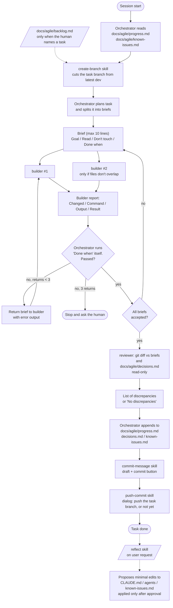

# Orchestrator workflow

How a task moves through the orchestrator (main Claude session), the `builder` and `reviewer` agents, and the `reflect` skill.
Rules live in [CLAUDE.md](../CLAUDE.md); agents in `.claude/agents/`; skill in `.claude/skills/reflect/`.

## Process

## Roles

| Who | Does | Never does |
|-----|------|------------|
| Orchestrator | Plans, runs `create-branch` at task start, writes briefs, runs "Done when", accepts work, commits and merges through the skills, updates `docs/` | Writes code (except 1-2 line fixes) |
| `builder` | Implements one brief, runs "Done when", reports | Touches "Don't touch" files |
| `reviewer` | Compares `git diff` with briefs and `docs/agile/decisions.md` | Changes anything |
| `reflect` | Lists what went wrong, proposes minimal edits | Changes anything before approval |
| Human | Approves `reflect` edits, answers after 3 failed returns | |
