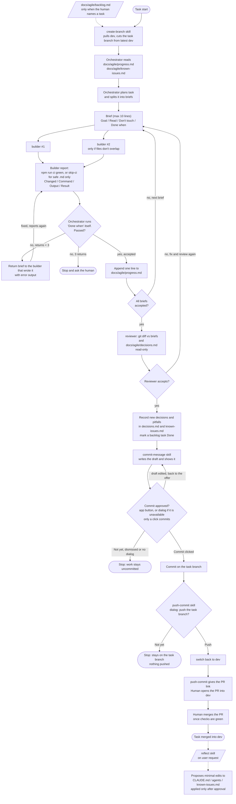

# Orchestrator workflow

How a task moves through the orchestrator (main Claude session), the `builder` and `reviewer` agents, and the skills `create-branch`, `commit-message`, `push-commit` and `reflect`.
Rules live in [CLAUDE.md](../CLAUDE.md); agents in `.claude/agents/`; skills in `.claude/skills/`.

## Process

## Roles

| Who | Does | Never does |
|-----|------|------------|
| Orchestrator | Plans, runs `create-branch` at task start (it pulls `dev` first), writes briefs, runs "Done when", accepts work, runs `commit-message` and `push-commit` (commits and pushes only after a click; push-commit then switches back to `dev`), updates `docs/` | Writes code (except 1-2 line fixes), opens PRs, merges, pushes `dev` |
| `builder` | Implements one brief, runs "Done when" and `npm run ci` unless only safe `.md` files changed (the check in `builder.md` step 3), reports | Touches "Don't touch" files |
| `reviewer` | Compares `git diff` with briefs and `docs/agile/decisions.md` | Changes anything |
| `reflect` | Lists what went wrong, proposes minimal edits | Changes anything before approval |
| Human | Clicks Commit or Push, opens PRs, merges them once checks are green, names backlog tasks, approves `reflect` edits, answers after 3 failed returns | |
