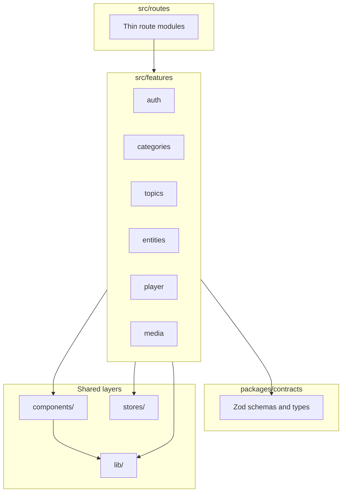
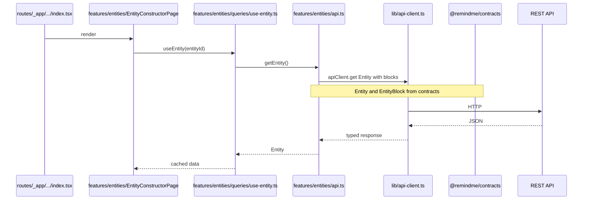

# RemindMe — Application Architecture

Defines **how the codebase is organized**: folder layout, ownership boundaries, and where code belongs. This document is the source of truth for file-system structure.

The repository is an **npm workspaces monorepo** with three application/library packages:

| Package | Path | Role |
|---------|------|------|
| Frontend | `frontend/` | Client SPA — consumes the backend over HTTP |
| Backend | `backend/` | Express REST API — validates and serves contract DTOs |
| Contracts | `packages/contracts/` | Shared Zod schemas + inferred types (`@remindme/contracts`) |

Frontend conventions below apply under `frontend/`. Backend layout is summarized in [TECH_STACK.md §15](TECH_STACK.md). Shared API contracts are defined in [TECH_STACK.md §12](TECH_STACK.md) and summarized in **§2.1** below.

For product behavior, see [PRODUCT.md](PRODUCT.md). For frontend libraries and runtime conventions, see [TECH_STACK.md](TECH_STACK.md).

---

## 1. Architecture pattern (frontend)

The frontend uses **Pattern 3 — Hybrid layout**:

- **Domain logic lives in `features/`** — each product area owns its API calls, query hooks, forms, and UI.
- **Infrastructure stays global** — shared HTTP client, query client, route tree, and cross-route Zustand stores live in `lib/` and `stores/`.
- **Routes stay thin** — `src/routes/` maps URLs to feature pages; no business logic in route files.
- **Shared UI is promoted deliberately** — start in a feature; move to `components/shared/` only when two or more features need the same component.



---

## 2. Repo layout

```
remindme/
  package.json                 # workspaces: ["frontend", "backend", "packages/*"]
  packages/
    contracts/                 # @remindme/contracts — shared API Zod schemas + types
      package.json
      src/
        auth.ts
        categories.ts
        topics.ts
        entities.ts
        common/
  frontend/                    # client SPA
    docs/
      PRODUCT.md
      PLAYER.md
      TECH_STACK.md
      ARCHITECTURE.md        ← this document
    public/
    src/
    components.json          # shadcn CLI config
    index.html
    package.json
    vite.config.ts
    tsconfig.json
    eslint.config.js
  backend/                   # Express API
    prisma/
    src/
    package.json
```

| Path | Purpose |
|------|---------|
| `packages/` | Workspace libraries consumed by apps — not deployed alone |
| `packages/contracts/` | Single source of truth for REST request/response DTOs and validation schemas |
| `packages/contracts/src/` | Contract source files — one module per API domain |
| `frontend/` | Frontend package — Vite + React SPA |
| `frontend/docs/` | Product spec, tech stack, architecture — no application code |
| `frontend/public/` | Static assets served as-is (favicon, robots.txt) |
| `frontend/src/` | Frontend application source — routes, features, components, lib, stores |
| `backend/` | Backend package — Express, Prisma, domain modules |

### 2.1 `packages/` and `packages/contracts/` explained

| Folder | What it is | What goes here | What does **not** go here |
|--------|------------|----------------|---------------------------|
| **`packages/`** | Container for **shared workspace packages**. Any code both apps need can live here as separate npm packages. | `contracts/` today; later maybe `eslint-config`, `tsconfig` bases | Application entrypoints, React pages, Express routes |
| **`packages/contracts/`** | The **`@remindme/contracts`** npm package — the **wire format** between frontend and backend. | Zod schemas, `z.infer` types, shared enums, pagination/error shapes | Prisma types, React components, env secrets, DB queries |
| **`packages/contracts/src/`** | Package **implementation** (like `frontend/src/` is for the SPA). | `categories.ts`, `entities.ts`, `common/errors.ts` | Feature UI, route handlers, `api.ts` Axios wrappers |

**Mental model:** `contracts` = the API agreement; `frontend` = how the UI calls it; `backend` = how the server enforces and persists it.

**Alternative package names** (same pattern, different labels): `packages/schemas` → `@remindme/schemas`, or `packages/api-types` → `@remindme/api-types`. RemindMe standardizes on **`contracts`** — see [TECH_STACK.md §12.9](TECH_STACK.md).

---

## 3. Frontend source tree (overview)

Paths below are relative to `frontend/`.

```
src/
  main.tsx                   # React entry — mounts app, providers
  index.css                  # Tailwind + CSS variable theme
  routeTree.gen.ts           # auto-generated by TanStack Router — do not edit
  routes/                    # file-based routing (URLs)
  features/                  # domain modules
  components/
    ui/                      # shadcn/ui primitives
    layout/                  # app shells, nav
    shared/                  # cross-feature UI (promoted when reused)
  lib/                       # app-wide utilities and clients
  stores/                    # Zustand — cross-route client state
  hooks/                     # hooks used by 2+ features only
```

Path alias: **`@/`** → `src/`.

---

## 4. `src/routes/` — routing layer

TanStack Router **file-based routes**. Each file (or folder + `index.tsx`) defines a URL segment. The Vite plugin generates `routeTree.gen.ts`.

**Responsibility:** URL structure, layouts, auth guards, search-param validation, route loaders that prefetch data.

**Not allowed here:** form schemas, Axios calls, entity constructor business logic, large page JSX.

### Structure

Aligned with [PRODUCT.md §3.1](PRODUCT.md) — Category → Topic → Entity hierarchy.

| Page | Route |
|------|-------|
| Home (public landing; login dialog; stats when logged in) | `/` |
| Category list | `/categories` |
| Category detail | `/categories/$categoryId` |
| Topic detail | `/categories/$categoryId/topics/$topicId` |
| Entity constructor (create) | `/categories/$categoryId/topics/$topicId/entities/new` |
| Entity constructor (edit) | `/categories/$categoryId/topics/$topicId/entities/$entityId` |
| Player | `/player` (search params: `categoryId` \| `topicId` \| `entityId`) |

Category creation uses a **popover on the Categories page** (`/categories`) — no dedicated route.

```
src/routes/
  __root.tsx                   # root layout — providers, global outlet, devtools, auth guard
  index.tsx                    # / — public Home (landing; login dialog via ?login=true; stats when logged in)
  auth/
    route.tsx                  # auth layout (no app chrome)
    login.tsx                  # /auth/login — redirects to /?login=true
    register.tsx               # /auth/register
    forgot-password.tsx        # /auth/forgot-password
  _app/
    route.tsx                  # pathless layout — nav, header, outlet
    player.tsx                 # /player — revision (search: categoryId | topicId | entityId)
    categories/
      index.tsx              # /categories — category list
      $categoryId/
        index.tsx              # /categories/$categoryId — category detail (topics list)
        topics/
          $topicId/
            index.tsx          # /categories/$categoryId/topics/$topicId — topic detail (entities list)
            entities/
              new.tsx          # entity constructor (create)
              $entityId.tsx    # entity constructor (edit)
```

### File roles

| File | Role |
|------|------|
| `__root.tsx` | Wraps entire app: `QueryClientProvider`, router outlet, toasts, error boundaries |
| `auth/route.tsx` | Centered auth layout; no main navigation |
| `_app/route.tsx` | Authenticated shell: sidebar/tab nav, header, `<Outlet />` |
| `*.tsx` leaf routes | `beforeLoad` guard, optional loader, render one feature page component |
| `routeTree.gen.ts` | Generated route tree — commit to git; never hand-edit |

### Conventions

- **`beforeLoad`** guards: `__root.tsx` sends unauthenticated visitors to `/?login=true` (the Home page opens the login dialog) for every route except `/`; `_app/route.tsx` applies the same rule to app routes.
- **Loaders** prefetch Query data when it avoids a loading waterfall (e.g. topic name on entity constructor page).
- **Search params** encode shareable UI state when needed (e.g. Player scope on `/player`, filter flags on topic detail).
- **Page components** are imported from `features/*/components/*Page.tsx` (or similar), not defined inline in route files.

---

## 5. `src/features/` — domain modules

Each subdirectory maps to a **product domain** from [PRODUCT.md](PRODUCT.md). A feature is self-contained: it owns HTTP functions, types, Query hooks, Zod schemas, and feature-specific components.

### Standard feature layout

Most features follow this shape:

```
features/<domain>/
  api.ts              # Axios functions + request/response types (or imports from types.ts)
  types.ts            # re-exports from @remindme/contracts (optional)
  queries/            # one file per hook — each exports useQuery / useInfiniteQuery / useMutation
  schemas.ts          # re-export or extend contract schemas; client-only form fields
  components/         # feature-specific UI
  index.ts            # optional public exports for other features
```

Not every feature needs every file. Add `types.ts` when re-exports clarify imports; keep `schemas.ts` only where forms exist.

Each feature maps to a **contracts module** (`packages/contracts/src/categories.ts` ↔ `features/categories/`).

### Query and mutation hooks (`queries/`)

Each **API operation** gets its own hook file under `features/<domain>/queries/`. One exported hook per file — no combined `queries.ts`.

| Rule | Detail |
|------|--------|
| **One file = one hook** | Each file exports a single `useQuery`, `useInfiniteQuery`, or `useMutation` wrapper |
| **File naming** | kebab-case, mirrors hook name: `use-categories.ts` → `useCategories`, `use-create-category.ts` → `useCreateCategory` |
| **`api.ts` stays pure** | Axios functions only; hooks call them via `queryFn` / `mutationFn` |
| **Query keys** | Import from `lib/query-keys.ts` — do not inline key arrays in hooks |
| **Invalidation** | Mutation hooks invalidate the narrowest keys in `onSuccess` |

```
features/categories/queries/
  use-categories.ts           # useQuery
  use-create-category.ts      # useMutation
  use-delete-category.ts      # useMutation
```

```typescript
// features/categories/queries/use-categories.ts
import { useQuery } from '@tanstack/react-query';
import { queryKeys } from '@/lib/query-keys';
import { getCategories } from '../api';

export function useCategories() {
  return useQuery({
    queryKey: queryKeys.categories.all,
    queryFn: getCategories,
  });
}
```

```typescript
// features/categories/queries/use-create-category.ts
import { useMutation, useQueryClient } from '@tanstack/react-query';
import { queryKeys } from '@/lib/query-keys';
import { createCategory } from '../api';

export function useCreateCategory() {
  const queryClient = useQueryClient();
  return useMutation({
    mutationFn: createCategory,
    onSuccess: () => {
      queryClient.invalidateQueries({ queryKey: queryKeys.categories.all });
    },
  });
}
```

Components import hooks directly from the file (e.g. `@/features/categories/queries/use-categories`). An optional `queries/index.ts` barrel re-export is allowed but not required.

### Type colocation (API contracts)

**Do not use a global `frontend/src/types/api/` folder.**  
**Do not hand-write duplicate DTO interfaces** — import from `@remindme/contracts` and re-export next to the feature API layer for ergonomics.

| Layer | Location | Role |
|-------|----------|------|
| **Source of truth** | `packages/contracts/src/*.ts` | Zod schemas + `z.infer` types |
| **Feature consumption** | `features/<domain>/api.ts`, `types.ts` | Import/re-export contract types; Axios functions typed against them |
| **Forms** | `features/<domain>/schemas.ts` | Re-export contract schemas when form = API payload; extend locally for client-only fields |

| Approach | When to use |
|----------|-------------|
| **Types in `api.ts`** | Small modules — import `Category` from contracts inline |
| **Separate `types.ts`** | Re-export contract types for cleaner imports within the feature |

```typescript
// packages/contracts/src/categories.ts — defined once
export const categorySchema = z.object({ id: z.string().uuid(), name: z.string(), topicCount: z.number() });
export type Category = z.infer<typeof categorySchema>;
```

```typescript
// features/categories/types.ts — re-export for colocation (no duplication)
export type { Category, CreateCategoryInput } from '@remindme/contracts/categories';
```

```typescript
// features/categories/api.ts
import type { Category } from '@remindme/contracts/categories';

export async function getCategories(): Promise<Category[]> {
  const { data } = await apiClient.get<Category[]>('/categories');
  return data;
}
```

```typescript
// features/entities/types.ts — larger module: re-export list/page types from contracts
export type { Entity, EntityListPage, CreateEntityPayload } from '@remindme/contracts/entities';
```

**Form and UI-only types** stay in `schemas.ts` (extend contract schemas) or next to the component — not mixed into API types unless they are the same shape.

**Cross-feature API types:** import from the owning feature's re-exports (e.g. topics imports `EntityRow` from `@/features/entities/components/EntityRow`) or directly from `@remindme/contracts/entities`. Never copy DTO field lists into a second file.

---

### 5.1 `features/auth/`

Registration, login, forgot password, session/profile reads.

```
features/auth/
  api.ts              # login, register, logout, forgotPassword, getCurrentUser
  types.ts            # User, LoginPayload — re-exported from @remindme/contracts/auth
  queries/
    use-current-user.ts
    use-login.ts
    use-register.ts
    use-logout.ts
  schemas.ts          # loginSchema, registerSchema, forgotPasswordSchema
  components/
    LoginForm.tsx            # sign-in fields + validation; rendered inside the dialog
    LoginDialog.tsx          # "Log in" button + shadcn Dialog (used by the header on Home)
    RegisterPage.tsx
    ForgotPasswordPage.tsx
    AuthFormLayout.tsx   # shared wrapper for auth screens (if needed)
```

| File | Contents |
|------|----------|
| `api.ts` | Auth endpoints; types inline or re-exported from `types.ts` |
| `queries/*` | One hook per file; mutations invalidate user query; 401 handling coordinated with `lib/api-client.ts` |
| `schemas.ts` | Re-export auth contract schemas; extend for `confirmPassword` etc. |

---

### 5.2 `features/categories/`

Categories page (`/categories`): category list, create category via popover, rename/delete via icon-only buttons on each row.

```
features/categories/
  api.ts
  types.ts            # Category, CreateCategoryInput — from @remindme/contracts/categories
  queries/
    use-categories.ts
    use-create-category.ts
    use-delete-category.ts
  schemas.ts          # re-export createCategorySchema from contracts
  components/
    CategoriesPage.tsx
    CategoryList.tsx
    CategoryCard.tsx
    AddCategoryPopover.tsx   # category name only — on the Categories page
    EmptyCategoryPrompt.tsx
    # PlayButton imported from features/player — embedded in CategoryCard
```

| Component | Used on |
|-----------|---------|
| `CategoriesPage.tsx` | `/categories` |
| `AddCategoryPopover.tsx` | `/categories` (embedded in CategoriesPage) |

---

### 5.2b `features/home/`

Public Home page (`/`). Guests see the slogan and the header's **Log in** button. Logged-in users also see **Open my categories** and the **Your library** section (`LibraryStats`, placeholder numbers until wired to the API).

```
features/home/
  components/
    HomePage.tsx        # slogan; guest vs logged-in variants
    LibraryStats.tsx    # Categories / Topics / Entities counts (placeholder values)
```

---

### 5.3 `features/topics/`

Category detail (topics list), topic detail (entity list), add topic.

```
features/topics/
  api.ts
  types.ts            # Topic, CreateTopicInput — from @remindme/contracts/topics
  queries/
    use-topics.ts
    use-topic.ts
    use-create-topic.ts
    use-update-topic.ts
    use-delete-topic.ts
  schemas.ts          # re-export topic contract schemas
  components/
    CategoryDetailPage.tsx   # topics list + Add topic
    TopicDetailPage.tsx      # entity list (Title rows); imports EntityRow from entities
    AddTopicDialog.tsx       # UI TBD per PRODUCT open decisions
    # PlayButton imported from features/player — embedded in topic rows
```

| Component | Used on |
|-----------|---------|
| `CategoryDetailPage.tsx` | `/categories/$categoryId` |
| `TopicDetailPage.tsx` | `/categories/$categoryId/topics/$topicId` |

---

### 5.4 `features/entities/`

Entity constructor (create + edit), block editors, preview panel. An **entity** is one piece of revisable information inside a topic ([PRODUCT.md §2](PRODUCT.md)) — configured with a required **Title** and 0–20 **constructor blocks** (Text, Code, Image, List).

```
features/entities/
  api.ts
  types.ts            # Entity, EntityBlock, SaveEntityPayload — from @remindme/contracts/entities
  queries/
    use-entities.ts           # useQuery — list by categoryId + topicId
    use-entity.ts             # useQuery — single entity with blocks
    use-create-entity.ts
    use-update-entity.ts
    use-delete-entity.ts
  schemas.ts          # saveEntitySchema from contracts (title + blocks)
  components/
    EntityConstructorPage.tsx   # create + edit (single page)
    EntityPreviewPanel.tsx      # left: read-only Title + blocks
    EntityConstructorPanel.tsx  # right: Title + block list
    EntityCard.tsx              # Title + revised count + Play/Edit/Remove on Topic detail
    blocks/
      TextBlockEditor.tsx
      CodeBlockEditor.tsx
      ImageBlockEditor.tsx
      ListBlockEditor.tsx
  utils/
    block-order.ts              # add/remove/reorder; enforce max 20 blocks
```

| Concern | Owner |
|---------|--------|
| Entity constructor UI | `EntityConstructorPage.tsx` + panels |
| Block type editors | `components/blocks/*` — **Text** uses TipTap (`TextBlockEditor.tsx`); **Code** uses `@uiw/react-codemirror` (`CodeBlockEditor.tsx`); **Image** uses custom `ImageBlockEditor.tsx` (file picker + drag-drop); shared helpers in `lib/tiptap/` and `lib/codemirror/` |
| Zod validation | Re-export/extend `@remindme/contracts/entities` schemas (static block types) |
| Topic detail entity list | `EntitiesPage.tsx` / `EntityCard.tsx` — Title, gray `{revisedCount} revised` label, Play/Edit/Remove |
| In-form draft state | react-hook-form local state — not Zustand |

Entity constructor routes delegate UI to this feature. Image blocks upload via `features/media/` (see §5.5).

---

### 5.5 `features/media/`

Multipart file upload for entity constructor **Image** blocks. No dedicated route — consumed by `ImageBlockEditor` in `features/entities/`.

```
features/media/
  api.ts                      # uploadMedia() — POST /media/upload (FormData)
  types.ts                    # MediaAsset, UploadMediaResponse — from @remindme/contracts/media
  queries/
    use-upload-media.ts       # useMutation
```

| File | Contents |
|------|----------|
| `api.ts` | `uploadMedia(file)` → `{ mediaAssetId }`; uses `apiClient` with `multipart/form-data` |
| `queries/use-upload-media.ts` | Mutation hook; entity save references returned `mediaAssetId` on image blocks |
| Upload UI | Custom `ImageBlockEditor` — centered file picker + drag-drop container; preview with remove (see [TECH_STACK.md §9](TECH_STACK.md)) |

**Backend mirror:** `backend/src/modules/media/` (`media.routes.ts`, `media.service.ts`).

---

### 5.6 `features/player/`

Revision flow — **Player** page at `/player` ([PRODUCT.md §3.5](PRODUCT.md), [PLAYER.md](PLAYER.md)). Shows one entity at a time as read-only preview; **Done** / **Skip** mutate counters; the current pack and per-round shown ids live in `PlayerPage` state.

```
features/player/
  constants.ts                # PLAYER_BATCH_SIZE = 10
  api.ts                      # fetchPlayerBatch, markEntityDone, markEntitySkip
  types.ts                    # PlayerScope, PlayerSessionState, PlayerBatchItem
  queries/
    use-player-batch.ts       # fetch / refill pack (includes round-reset)
    use-mark-done.ts          # useMutation — revised_count + 1
    use-mark-skip.ts          # useMutation — skipped_count + 1
  components/
    PlayerPage.tsx
    PlayerProgress.tsx        # pack-only Progress bar
    PlayerPreview.tsx         # read-only Title + blocks; EntityReadOnlyContent
    PlayerActions.tsx         # Done / Skip buttons
    PlayerBatchCompleteDialog.tsx  # Next 10 / Home
    PlayerDepleted.tsx        # zero eligible entities
    PlayButton.tsx            # icon-only row action → /player with scope search param
  utils/
    session.ts                # queue of full entities, shownEntityIds, round reset, progress
```

| Component | Used on |
|-----------|---------|
| `PlayerPage.tsx` | `/player` |
| `PlayButton.tsx` | Home category rows, Category detail topic rows, Topic detail entity rows (`EntityRow`) |

| Concern | Owner |
|---------|--------|
| Read-only entity render | `PlayerPreview.tsx` — same block renderers as entity preview (TipTap HTML, CodeMirror read-only, Image, List) |
| Pack + scheduling | `POST /api/v1/player/batch` (min `revised_count` sample) + `utils/session.ts` queue ([PLAYER.md](PLAYER.md)) |
| Counter mutations | `use-mark-done.ts` / `use-mark-skip.ts`; invalidate `queryKeys.entities.*` and topic/category list keys |
| Next-entity ready | Head of the in-memory pack (`queue[1]`) — no per-entity GET or prefetch hook |
| Session state | `PlayerPage` React state — current pack + `shownEntityIds` for the current **round**; no server session table |

**Route:** `src/routes/_app/player.tsx` validates search params (`categoryId` \| `topicId` \| `entityId` — exactly one required) and renders `PlayerPage`.

**Query keys:** `queryKeys.player.all`, `queryKeys.player.batch(scopeKey)` in `lib/query-keys.ts`. The pack itself is session state, not a cached query.

**Backend:** `POST /api/v1/player/batch` (contracts in `packages/contracts/src/player.ts`); Done/Skip reuse nested `PATCH …/revise` and `PATCH …/skip`.

---

### 5.7 Deferred product areas (not v1 UI)

**Statistics page** — removed from the product spec; do **not** scaffold `features/statistics/` for v1.

**Admin panel** — backend may expose admin API endpoints (`users:manage`); no v1 frontend feature, routes, or settings. Page layout and permissions UX are **not defined for now** — add `features/admin/` when the product spec exists.

---

## 6. `src/components/` — shared UI

UI that is **not owned by a single feature**. Split into three subfolders with clear rules.

```
src/components/
  ui/                 # shadcn/ui — do not import features
  layout/             # route-level shells
  shared/             # promoted cross-feature components
```

### 6.1 `components/ui/`

**shadcn/ui primitives** — Button, Input, Dialog, Form, Toast, etc. Installed via CLI; treated as owned source.

| Rule | Detail |
|------|--------|
| Imports | May import `lib/utils` (`cn`) only |
| Must not import | `features/`, `stores/`, route files |
| Customization | Edit in place when product requires; do not wrap unnecessarily |

### 6.2 `components/layout/`

App-wide layout pieces used by route layouts.

```
components/layout/
  PageContainer.tsx   # max-w-[1024px] mx-auto — MVP fixed column (see WIREFRAMES.md)
  AppShell.tsx        # nav + header + outlet slot
  AuthLayout.tsx      # centered card layout for auth routes
  MainNav.tsx         # tabs / drawer links (Home)
  PageHeader.tsx      # optional reusable page title + actions bar
```

Route files (`_app/route.tsx`, `auth/route.tsx`) compose these — they do not duplicate layout markup.

### 6.3 `components/shared/`

Components used by **two or more features** after deliberate promotion from a feature folder.

```
components/shared/
  ConfirmDialog.tsx
  EmptyState.tsx
  LoadingSpinner.tsx
  ErrorFallback.tsx
```

**Promotion rule:** implement inside `features/<x>/components/` first. Move here only on second use. Avoid creating shared components speculatively.

---

## 7. `src/lib/` — infrastructure

App-wide modules with no product domain knowledge.

```
src/lib/
  api-client.ts       # Axios instance, interceptors, ApiError type
  query-client.ts     # QueryClient defaults (retry, staleTime)
  query-keys.ts       # centralized query key factory
  utils.ts            # cn() — clsx + tailwind-merge
  auth.ts             # auth helpers: getAuthRedirect (route guard), getApiErrorMessage, isUnauthorizedError
```

| Module | Responsibility |
|--------|----------------|
| `api-client.ts` | Single Axios instance; `withCredentials: true` (httpOnly cookie auth — no Bearer header); response error normalization; 401 → logout redirect |
| `query-client.ts` | Shared `QueryClient` for app bootstrap |
| `query-keys.ts` | `queryKeys.categories.all`, `queryKeys.topics.list(...)`, `queryKeys.entities.list(...)`, `queryKeys.player.*`, etc. — used by all feature `queries/` hooks |
| `utils.ts` | `cn()` and other pure helpers with no feature imports |

`lib/` must **not** import from `features/`. Features import from `lib/`.

---

## 8. `src/stores/` — client state (Zustand)

Cross-route **ephemeral** state that is not server data and not form state.

```
src/stores/
  ui.ts                 # theme, nav drawer open, transient UI flags
```

| Store | Persists? | Notes |
|-------|-----------|-------|
| `ui.ts` | Optional (`persist` for theme only) | Theme and transient UI flags |

Player pack state lives in `PlayerPage` component state ([PLAYER.md](PLAYER.md)) — no `player-session` store.

**One store file per domain.** Use selectors to limit re-renders. Stores do not call Axios — mutations run in components via Query hooks. Entity constructor draft state lives in react-hook-form, not Zustand.

---

## 9. `src/hooks/` — cross-feature hooks

Only hooks consumed by **multiple features** that do not belong in `lib/`.

```
src/hooks/
  use-media-query.ts
  use-debounce.ts
```

If a hook is only used within one feature, keep it in that feature (e.g. `features/entities/hooks/use-entity-filters.ts`).

**Default:** data hooks live in `features/<domain>/queries/` (one file per hook). This folder is for non-Query hooks shared across features only.

---

## 10. Frontend entry and config files

```
frontend/
  src/
    main.tsx            # createRoot, RouterProvider, QueryClientProvider
    index.css
    vite-env.d.ts
  index.html
  components.json       # shadcn paths: @/components, @/lib/utils
  vite.config.ts        # @tanstack/router-plugin, @ alias, Tailwind
  tsconfig.json         # strict, paths: @/* → src/*
  eslint.config.js
  package.json
```

---

## 11. Import boundaries

Enforce mentally at first; optional ESLint `import/no-restricted-paths` later.

| From | May import |
|------|------------|
| `routes/` | `features/`, `components/`, `lib/`, `stores/` |
| `features/<a>/` | `features/<b>/` sparingly (prefer exported types from the owning feature) |
| `features/*` | `@remindme/contracts/*`, `components/`, `lib/`, `stores/`, other features' public types/api |
| `components/ui/` | `lib/utils` only |
| `components/layout/`, `shared/` | `components/ui/`, `lib/` |
| `lib/` | `@remindme/contracts/common/errors` only if needed for `ApiError`; not `features/` or `routes/` |
| `stores/` | `lib/` if needed; not `features/` |
| `packages/contracts/` | `zod` only — **must not** import `frontend/`, `backend/`, React, Express, Prisma |

### Anti-patterns

- Axios calls from components or routes — use `features/*/api.ts` + `features/*/queries/*`
- Multiple hooks in one file — split into separate files under `queries/`
- Duplicating DTO interfaces in multiple features or apps — use `@remindme/contracts`
- Hand-writing `interface Category { … }` when a contract type exists
- Global `frontend/src/types/api/` folder — colocate re-exports with the owning feature's API module
- Large page components defined inside route files
- `components/ui/` importing Zustand or Query hooks

---

## 12. Data flow (end to end)



Mutations follow the same path; on success, Query invalidates keys from `lib/query-keys.ts`.

---

## 13. Adding a new feature (checklist)

1. Add or update Zod schemas in `packages/contracts/src/<domain>.ts` (if new API surface).
2. Create `features/<name>/` with `api.ts` (+ `types.ts` re-exports if needed), `queries/` (one hook file per API operation), `schemas.ts` if forms exist.
2. Add components under `features/<name>/components/`.
3. Add route file(s) under `src/routes/` that import the page component.
4. Register query keys in `lib/query-keys.ts`.
5. Wire mutations to invalidate the narrowest keys.
6. Add Zustand store in `stores/` only if state crosses routes and is not server/form data.

---

## 14. Related documents

| Document | Covers |
|----------|--------|
| [PRODUCT.md](PRODUCT.md) | What the app does — pages, flows, business rules |
| [PLAYER.md](PLAYER.md) | How the Player deals packs, Done/Skip, and round reset |
| [WIREFRAMES.md](WIREFRAMES.md) | Page layouts and ASCII wireframes — MVP 1024px fixed width |
| [TECH_STACK.md](TECH_STACK.md) | Libraries, Query/Router/Zustand conventions, `packages/contracts` (§12), tooling |
| [ABOUT.md](ABOUT.md) | Original product notes |

---

## Changelog

| Date | Change |
|------|--------|
| 2026-06-29 | Initial architecture document — Pattern 3 hybrid layout, colocated API types |
| 2026-06-29 | Repo root layout (`src/` at root); frontend-only — no in-repo backend |
| 2026-06-29 | One Query/Mutation hook per file under `features/*/queries/` |
| 2026-07-13 | Monorepo layout: `frontend/` + `backend/` + `packages/contracts` (`@remindme/contracts`) |
| 2026-07-13 | Align with PRODUCT: remove templates feature; add topics; entity constructor model; defer revision/statistics |
| 2026-07-13 | Add `features/media/`; nested REST paths; defer admin UI; fix cookie-auth wording in `lib/` |
| 2026-07-13 | Adopt TipTap for Entity constructor Text blocks |
| 2026-07-13 | Adopt `@uiw/react-codemirror` for Entity constructor Code blocks (JavaScript + TypeScript) |
| 2026-07-13 | Image blocks: custom `ImageBlockEditor` — file picker + drag-drop; preview with remove |
| 2026-08-18 | Player batched client session: `POST /player/batch`, pack progress, continue modal, round reset |
| 2026-07-13 | Add `features/player/` and `/player` route; Play button on list rows; replace deferred-revision language |
| 2026-10-18 | Home `/` is the public landing page; login is a dialog opened from the header (`/?login=true`); category list moved to `/categories`; add `features/home/` |
