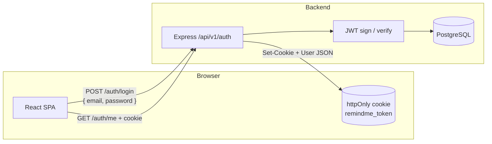
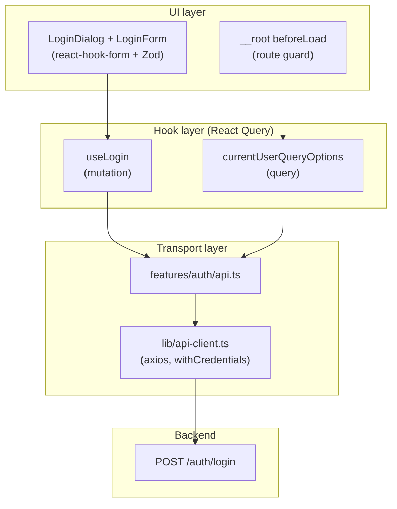
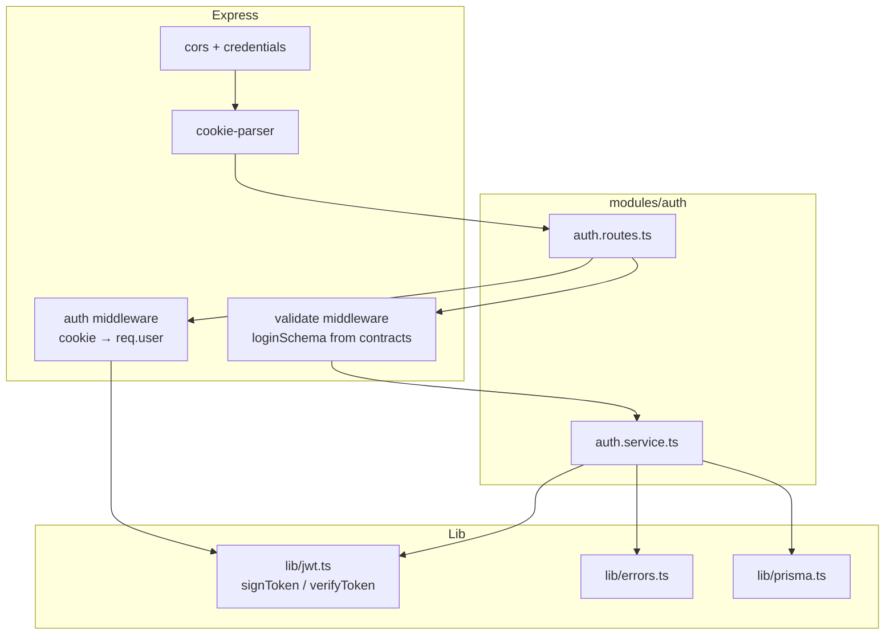
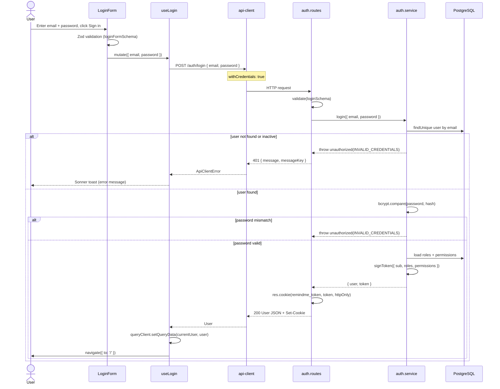
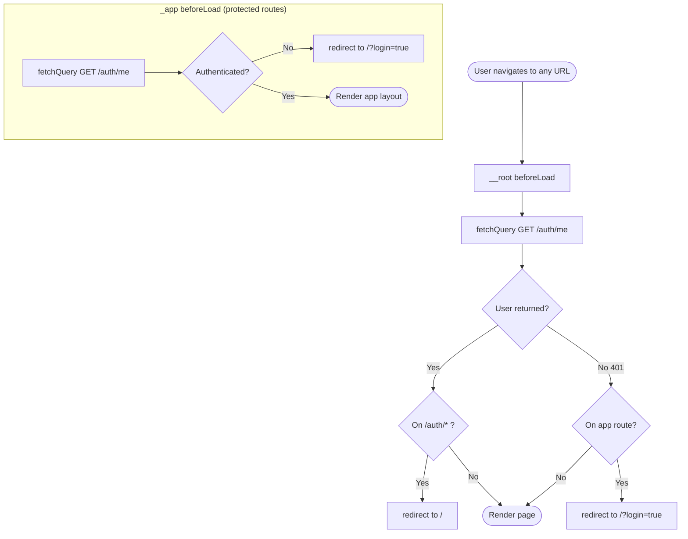
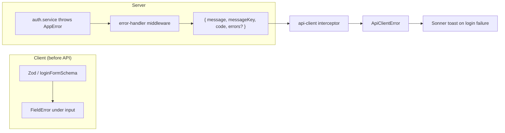

# Authentication — Login Flow

How sign-in works in RemindMe from the browser through the Express API. This document focuses on **login**; logout and session checks follow the same cookie-based model.

Related docs: [ARCHITECTURE.md](ARCHITECTURE.md), [TECH_STACK.md](TECH_STACK.md), [backend/docs/ARCHITECTURE.md](../../backend/docs/ARCHITECTURE.md).

---

## 1. Auth model at a glance

RemindMe uses **JWT stored in an httpOnly cookie** — not localStorage or Authorization headers.

| Piece | Value / behavior |
|-------|------------------|
| Cookie name | `remindme_token` |
| Set by | `POST /api/v1/auth/login` response (`Set-Cookie`) |
| Sent by browser | Automatically on every API request (`withCredentials: true`) |
| JWT payload | `{ sub, roles, permissions }` |
| Session lifetime | 7 days (cookie `maxAge` + JWT expiry) |
| JS access to token | **No** — `httpOnly: true` prevents XSS token theft |



---

## 2. Frontend architecture

Login code lives in `frontend/src/features/auth/` and follows the hybrid layout from [ARCHITECTURE.md](ARCHITECTURE.md): thin routes, feature hooks, shared transport.



### Key frontend files

| File | Role |
|------|------|
| `routes/auth/login.tsx` | Legacy route `/auth/login` → redirects to `/?login=true` |
| `features/auth/components/LoginForm.tsx` | Form fields and client-side validation (rendered inside the dialog) |
| `features/auth/components/LoginDialog.tsx` | Header **Log in** button and shadcn `Dialog`; open state is the `login` search param on `/` |
| `routes/index.tsx` | Public Home `/`; validates the `login` search param |
| `features/auth/schemas.ts` | `loginFormSchema` (Zod) |
| `features/auth/queries/use-login.ts` | Mutation: call API, cache user, navigate |
| `features/auth/api.ts` | `login()` → `POST /auth/login` |
| `lib/api-client.ts` | Axios instance with `withCredentials: true` |
| `lib/auth.ts` | Error helpers, redirect logic for route guard |
| `routes/__root.tsx` | Global auth check on every navigation; guests are sent to `/?login=true` (except `/`) |
| `routes/_app/route.tsx` | Extra guard for protected app routes |

---

## 3. Backend architecture

Auth endpoints are mounted at `/api/v1/auth` in `backend/src/app.ts`. CORS is configured with `credentials: true` so the browser may send cookies cross-origin. In dev that only happens when `VITE_API_URL` points at the API (`localhost:5173` → `localhost:3000`); by default the Vite `/api` proxy makes the calls same-origin.



### Key backend files

| File | Role |
|------|------|
| `modules/auth/auth.routes.ts` | `POST /login` — validate, call service, set cookie |
| `modules/auth/auth.service.ts` | Find user, bcrypt compare, build profile, sign JWT |
| `middleware/auth.ts` | Read `remindme_token` cookie, verify JWT, attach `req.user` |
| `middleware/validate.ts` | Zod validation for request body |
| `lib/jwt.ts` | `signToken`, `verifyToken`, `AUTH_COOKIE_NAME` |
| `config/session.ts` | `SESSION_MAX_AGE_MS` (7 days) |
| `packages/contracts/src/auth.ts` | Shared `loginSchema`, `User` type |

---

## 4. Login sequence (end-to-end)

This is the full path when a user submits the sign-in form.



### Step-by-step breakdown

#### Frontend

1. **Open the dialog** — `/` is public. The header's **Log in** button sets `?login=true`, which opens the dialog. A guest who opens a protected page, or `/auth/login`, is redirected to `/?login=true`. The `__root` `beforeLoad` runs first; if already authenticated, it redirects to `/`.

2. **Form validation** — `LoginForm` uses `react-hook-form` with `zodResolver(loginFormSchema)`. Invalid email or empty password show inline `FieldError` messages — no API call yet.

3. **Mutation** — On valid submit, `useLogin().mutate(values)` runs:
   - `mutationFn`: `features/auth/api.login()` → `POST /auth/login`
   - `onSuccess`: cache the returned `User` in React Query (`queryKeys.auth.currentUser`), then `navigate({ to: '/' })`, which drops the `login` param and closes the dialog
   - `onError`: show a Sonner toast via `getApiErrorMessage(error)`

4. **HTTP client** — `apiClient` sends JSON with `withCredentials: true`, so the browser includes (and later stores) cookies for the API origin.

#### Backend

5. **Validation** — `validate({ body: loginSchema })` parses the body using the shared contract from `@remindme/contracts/auth`. Failures return `422` with field errors.

6. **Credential check** — `authService.login()`:
   - Looks up user by normalized (lowercase) email
   - Rejects if user missing or `isActive === false`
   - Compares password with `bcrypt.compare`
   - On failure: `unauthorized(MessageKey.AUTH_INVALID_CREDENTIALS)` → **401** (generic message — no email enumeration)

7. **Profile + token** — On success:
   - `getUserAuthProfile()` loads roles and permissions from Prisma
   - `signToken()` creates a JWT with `sub`, `roles`, `permissions`
   - Route handler sets the cookie and returns the `User` JSON (no token in the body)

8. **Cookie options** (`auth.routes.ts`):

   ```ts
   {
     httpOnly: true,
     secure: NODE_ENV === 'production',
     sameSite: 'lax',
     maxAge: SESSION_MAX_AGE_MS, // 7 days
     path: '/',
   }
   ```

---

## 5. After login — session and route guards

Once the cookie is set, the app treats the user as authenticated without storing the JWT in JavaScript.



| Guard | Location | Behavior |
|-------|----------|----------|
| Global | `routes/__root.tsx` | Fetches current user; redirects logged-in users away from `/auth/*`, guests away from every route except `/` (which opens the login dialog) |
| App shell | `routes/_app/route.tsx` | Ensures authenticated user before any child route (`/categories`, `/player`, etc.) |
| API | `middleware/auth.ts` | Protected backend routes read cookie, verify JWT, set `req.user` |

Logout (`use-logout.ts`) resets the `currentUser` query, so mounted components (header, Home stats) re-render as a guest, then navigates to `/`.

`GET /auth/me` uses the `auth` middleware: reads `req.cookies.remindme_token`, verifies JWT, loads fresh user profile from DB.

---

## 6. Shared contracts

Frontend and backend share types and validation via `@remindme/contracts`:

```ts
// packages/contracts/src/auth.ts
export const loginSchema = z.object({
  email: z.string().email(),
  password: z.string().min(1),
})

export type User = {
  id: string
  email: string
  displayName: string | null
  roles: string[]
  permissions: string[]
}
```

- **Backend** uses `loginSchema` in the validate middleware.
- **Frontend** uses a separate `loginFormSchema` with friendlier error messages for the UI, but sends the same shape to the API.

---

## 7. Error handling



| Scenario | Status | User-visible result |
|----------|--------|---------------------|
| Invalid email format / empty password | — (client) | Red text under field |
| Wrong credentials | 401 | Toast: "Invalid email or password" |
| Validation error (malformed body) | 422 | Toast with validation message |
| Expired / tampered session on `/auth/me` | 401 | Silent redirect to `/?login=true` (route guard) |
| Network / server error | 5xx | Toast: generic error message |

Login intentionally uses the **same error message** for unknown email and wrong password (`AUTH_INVALID_CREDENTIALS`) to avoid leaking which emails are registered.

---

## 8. API reference (login-related)

| Method | Path | Auth | Request | Response |
|--------|------|------|---------|----------|
| `POST` | `/api/v1/auth/login` | None | `{ email, password }` | `200` + `Set-Cookie: remindme_token` + `User` body |
| `GET` | `/api/v1/auth/me` | Cookie | — | `200` `User` or `401` |
| `POST` | `/api/v1/auth/logout` | None | — | `200` + clears cookie |

**Example login request** (browser sends automatically via axios):

```http
POST /api/v1/auth/login HTTP/1.1
Host: localhost:3000
Content-Type: application/json
Origin: http://localhost:5173

{"email":"user@example.com","password":"secret"}
```

**Example success response**:

```http
HTTP/1.1 200 OK
Set-Cookie: remindme_token=eyJ...; Path=/; HttpOnly; SameSite=Lax; Max-Age=604800
Content-Type: application/json

{"id":"...","email":"user@example.com","displayName":null,"roles":["user"],"permissions":[...]}
```

---

## 9. Local development checklist

1. Backend running on `http://localhost:3000` with `CORS_ORIGIN=http://localhost:5173`.
2. Frontend `VITE_API_URL` is unset by default, so the app calls the relative `/api/v1`, which the Vite dev server proxies to `http://localhost:3000` (see `lib/api-client.ts` and `vite.config.ts`).
3. Browser must allow third-party cookies only if origins differ; same-site `lax` works for typical dev setup.
4. JWT secret and expiry configured in backend `.env` (`JWT_SECRET`, `JWT_EXPIRES_IN`).
