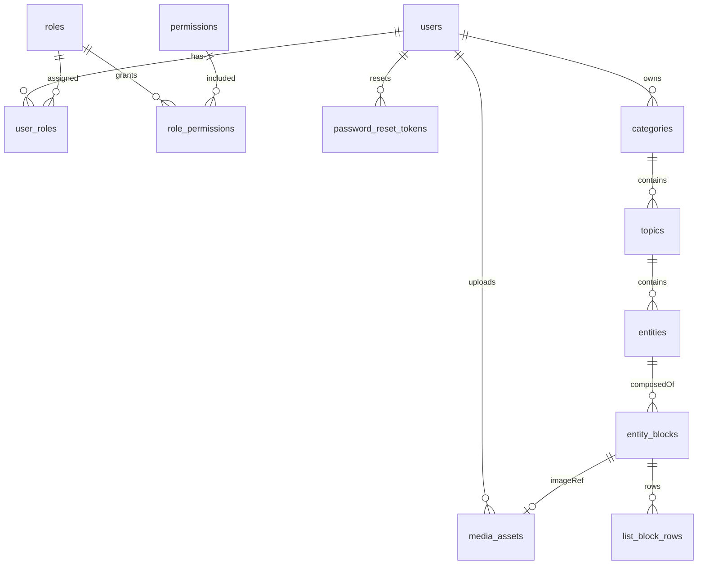
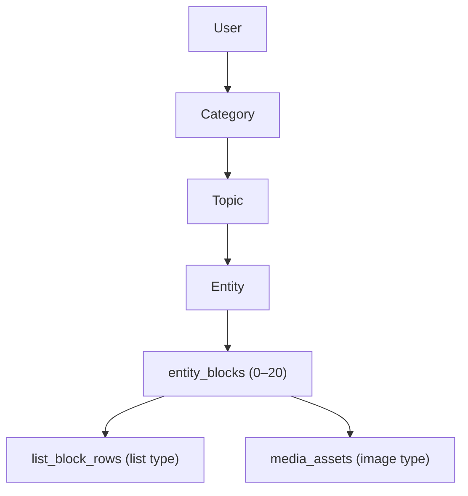

# RemindMe — Database Schema

Logical relational data model for RemindMe. Defines **tables**, **fields**, **relationships**, and **integrity rules**. No ORM or SQL dialect is assumed.

Product behavior lives in [PRODUCT.md](PRODUCT.md). This document describes how that behavior is persisted.

---

## 1. Design decisions

| Decision | Choice |
|----------|--------|
| Ownership | Each user owns their categories; topics and entities inherit ownership via the FK chain |
| Roles | Extensible RBAC: `roles` + `permissions` + join tables; seed `user` and `admin` |
| Entity constructor | **No table** — UI only ([PRODUCT.md §3.4](PRODUCT.md)); persist as `entities.title` + ordered `entity_blocks` (0–20 per entity) |
| Text blocks | TipTap JSON in `content_json` (ProseMirror document shape) |
| Code blocks | `{ language, value }` in `content_json` — edited via `@uiw/react-codemirror`; v1 languages: `javascript`, `typescript` |
| Image blocks | Upload to object storage; DB holds `media_assets` + FK from the block |
| List blocks | Normalized child rows in `list_block_rows` |
| Password reset | Dedicated token table (hashed tokens, expiry, single-use) |
| Revision counters | Stored on `entities` (`revised_count`, `skipped_count`) — updated by **Player** UI; no session tables |
| Revision eligibility | `entities.visibility` gates whether an entity can enter the Player queue |
| Scope | v1 includes **Player** at `/player`; no statistics page or session summary tables |

### Explicit non-tables

- No `entity_constructors` / templates table — the constructor is a page, not a domain entity.
- No revision-session or statistics aggregate tables (counters live on `entities`; Player session queue is client-side).

---

## 2. Entity relationship overview



Content hierarchy:



---

## 3. Table catalog

Conventions used below:

- **PK** — primary key
- **FK** — foreign key
- **UUID** — opaque unique identifier (preferred for all domain PKs)
- Timestamps are timezone-aware (`timestamptz` or equivalent)

---

### 3.1 Auth & RBAC

#### `users`

| Field | Type | Null | Notes |
|-------|------|------|-------|
| `id` | UUID | no | PK |
| `email` | text | no | Unique; login identifier |
| `password_hash` | text | no | Never store plaintext passwords |
| `display_name` | text | yes | Optional profile label |
| `is_active` | boolean | no | Default `true`; inactive users cannot sign in |
| `email_verified_at` | timestamptz | yes | Reserved for a future verify flow |
| `created_at` | timestamptz | no | |
| `updated_at` | timestamptz | no | |

**Indexes:** unique on `email`

---

#### `roles`

| Field | Type | Null | Notes |
|-------|------|------|-------|
| `id` | UUID | no | PK |
| `code` | text | no | Unique machine key: `user`, `admin`, later `manager`, … |
| `name` | text | no | Human-readable label |
| `description` | text | yes | |
| `created_at` | timestamptz | no | |

**Indexes:** unique on `code`

---

#### `permissions`

| Field | Type | Null | Notes |
|-------|------|------|-------|
| `id` | UUID | no | PK |
| `code` | text | no | Unique machine key (see seed list below) |
| `name` | text | no | |
| `description` | text | yes | |

**Indexes:** unique on `code`

---

#### `role_permissions`

| Field | Type | Null | Notes |
|-------|------|------|-------|
| `role_id` | UUID | no | FK → `roles.id`; part of composite PK |
| `permission_id` | UUID | no | FK → `permissions.id`; part of composite PK |

**PK:** `(role_id, permission_id)`

---

#### `user_roles`

| Field | Type | Null | Notes |
|-------|------|------|-------|
| `user_id` | UUID | no | FK → `users.id`; part of composite PK |
| `role_id` | UUID | no | FK → `roles.id`; part of composite PK |

**PK:** `(user_id, role_id)`

Registration assigns the `user` role. A user may hold multiple roles.

---

#### `password_reset_tokens`

| Field | Type | Null | Notes |
|-------|------|------|-------|
| `id` | UUID | no | PK |
| `user_id` | UUID | no | FK → `users.id` |
| `token_hash` | text | no | Unique; store only a hash of the emailed token |
| `expires_at` | timestamptz | no | |
| `used_at` | timestamptz | yes | Set when the token is consumed; null = unused |
| `created_at` | timestamptz | no | |

**Indexes:** unique on `token_hash`; index on `(user_id, created_at)`

---

### 3.2 Content hierarchy

#### `categories`

| Field | Type | Null | Notes |
|-------|------|------|-------|
| `id` | UUID | no | PK |
| `user_id` | UUID | no | FK → `users.id`; owner |
| `name` | text | no | Required on creation |
| `position` | integer | no | Stable list order within the owner’s home list |
| `created_at` | timestamptz | no | |
| `updated_at` | timestamptz | no | |

**Indexes:** `(user_id, position)`

**Delete rule:** `topics.category_id` uses `ON DELETE RESTRICT` so a category with topics cannot be deleted (matches PRODUCT: delete only when empty).

---

#### `topics`

| Field | Type | Null | Notes |
|-------|------|------|-------|
| `id` | UUID | no | PK |
| `category_id` | UUID | no | FK → `categories.id` (`ON DELETE RESTRICT`) |
| `name` | text | no | |
| `position` | integer | no | Order within the category |
| `created_at` | timestamptz | no | |
| `updated_at` | timestamptz | no | |

**Indexes:** `(category_id, position)`

May exist with zero entities.

---

#### `entities`

| Field | Type | Null | Notes |
|-------|------|------|-------|
| `id` | UUID | no | PK |
| `topic_id` | UUID | no | FK → `topics.id` |
| `title` | text | no | Required; shown as the row label on Topic detail |
| `position` | integer | no | Order within the topic |
| `revised_count` | integer | no | Default `0`; incremented when user presses **Done** in the Player; shown on Topic detail entity rows as gray `{count} revised` before the Play button |
| `skipped_count` | integer | no | Default `0`; incremented when user presses **Skip** in the Player; does not increment `revised_count` |
| `visibility` | enum / text | no | `included` \| `excluded`; default `included` |
| `created_at` | timestamptz | no | |
| `updated_at` | timestamptz | no | |

**Indexes:** `(topic_id, position)`; partial or composite index on `(topic_id, visibility, revised_count)` for Player queue queries

Belongs to exactly one topic. Title is not a constructor block and does not count toward the block limit.

**Revision fields (Player UI):**

Player scheduling ([PRODUCT.md §3.5](PRODUCT.md)) uses these fields within a scope (category, topic, or single entity):

- **Eligibility:** only `visibility = included` entities enter the Player queue.
- **First entity (category/topic scope):** random pick from entities at the **minimum** `revised_count` in scope.
- **All equal:** when every eligible entity has the same `revised_count`, pick randomly from all eligible entities in scope.
- **After Done:** increment `revised_count`; next entity = random from entities with the **lowest** `revised_count` in scope.
- **After Skip:** increment `skipped_count` only; next entity = random from **all** eligible entities in scope (not restricted to the minimum pool).
- **Once per session:** each entity in scope is shown at most once per Player session (tracked client-side; no session table).
- **Single-entity scope:** Play on one entity row shows that entity once; Done or Skip ends the session.
- `visibility = excluded` removes the entity from the Player candidate set (still editable on Topic detail / constructor).

---

### 3.3 Constructor blocks

#### `entity_blocks`

Ordered content units for one entity. There is **no** separate constructor table.

| Field | Type | Null | Notes |
|-------|------|------|-------|
| `id` | UUID | no | PK |
| `entity_id` | UUID | no | FK → `entities.id` (`ON DELETE CASCADE`) |
| `block_type` | enum / text | no | `text` \| `code` \| `image` \| `list` |
| `position` | integer | no | `0`–`19`; unique per entity |
| `content_json` | jsonb | yes | Used by `text` and `code` (see §4) |
| `media_asset_id` | UUID | yes | FK → `media_assets.id`; used by `image` |
| `created_at` | timestamptz | no | |
| `updated_at` | timestamptz | no | |

**Indexes / constraints:**

- Unique `(entity_id, position)`
- Check: `position` between `0` and `19` (max **20** blocks per entity)
- Type-specific nullability (enforce in DB checks and/or application):

| `block_type` | `content_json` | `media_asset_id` | Child rows |
|--------------|----------------|------------------|------------|
| `text` | required | null | none |
| `code` | required | null | none |
| `image` | null | required | none |
| `list` | options JSON (see §4) | null | `list_block_rows` |

---

#### `list_block_rows`

Key–value rows inside a **List** block.

| Field | Type | Null | Notes |
|-------|------|------|-------|
| `id` | UUID | no | PK |
| `block_id` | UUID | no | FK → `entity_blocks.id` (`ON DELETE CASCADE`); block must be `list` |
| `position` | integer | no | Order within the block |
| `left_value` | text | no | Left column |
| `right_value` | text | no | Right column |

**Indexes:** unique `(block_id, position)`

The “+” control in the UI adds a row here; it does not create a new top-level constructor block.

---

### 3.4 Media

#### `media_assets`

Metadata for uploaded files. Binary data lives in object storage; the DB stores the key and attributes only.

| Field | Type | Null | Notes |
|-------|------|------|-------|
| `id` | UUID | no | PK |
| `user_id` | UUID | no | FK → `users.id`; uploader / owner |
| `storage_key` | text | no | Object-storage path or key |
| `mime_type` | text | no | e.g. `image/jpeg` |
| `byte_size` | bigint | no | Size in bytes |
| `original_filename` | text | yes | Client filename at upload |
| `created_at` | timestamptz | no | |

**Indexes:** `(user_id)`

Image blocks reference a row via `entity_blocks.media_asset_id`. Orphan cleanup (unused assets) is an application concern.

---

## 4. `content_json` payload shapes

Editor-specific document schemas may evolve; the DB stores opaque JSON validated by the API.

### Text (`block_type = text`)

Structured rich-text document from **TipTap** (ProseMirror JSON via `editor.getJSON()`):

```json
{
  "type": "doc",
  "content": [
    {
      "type": "paragraph",
      "content": [{ "type": "text", "text": "Example note" }]
    }
  ]
}
```

Exact node schema follows the TipTap extension set configured in the app; treat this as an illustrative shape.

### Code (`block_type = code`)

```json
{
  "language": "typescript",
  "value": "const x = 1;"
}
```

| Field | Required | Notes |
|-------|----------|-------|
| `language` | yes | CodeMirror language id; v1 values: `javascript`, `typescript`; empty string allowed if language is unknown |
| `value` | yes | Source text |

### Image / List

Image blocks use `media_asset_id` only (no `content_json`). List blocks use `list_block_rows` for row data and `content_json` for display options.

### List (`block_type = list`)

```json
{
  "blurRightSideByDefault": true
}
```

| Field | Required | Notes |
|-------|----------|-------|
| `blurRightSideByDefault` | yes | When `true`, right column is blurred until user reveals it |

---

## 5. Seed roles and permissions

### Roles

| `code` | `name` | Purpose |
|--------|--------|---------|
| `user` | Regular user | Default on registration; manages own content |
| `admin` | Admin user | Platform administration; manage users and any content |

Additional roles (e.g. `manager`) are added as rows + `role_permissions` mappings without schema changes.

### Permissions (v1 seed)

| `code` | Meaning |
|--------|---------|
| `content:manage_own` | Create/update/delete own categories, topics, entities, blocks, media |
| `content:manage_any` | Manage any user’s content (admin) |
| `users:manage` | List, activate/deactivate, assign roles to users (admin) |

### Default role → permission map

| Role | Permissions |
|------|-------------|
| `user` | `content:manage_own` |
| `admin` | `content:manage_own`, `content:manage_any`, `users:manage` |

---

## 6. Integrity and business rules

Rules that the schema and application should uphold together (see PRODUCT.md):

| Rule | Enforcement |
|------|-------------|
| Category name required | `categories.name` NOT NULL |
| Category may have zero topics | Allowed |
| Delete category only when empty | `ON DELETE RESTRICT` on `topics.category_id` + app check |
| Topic belongs to exactly one category | `topics.category_id` NOT NULL FK |
| Topic may have zero entities | Allowed |
| Entity belongs to exactly one topic | `entities.topic_id` NOT NULL FK |
| Entity title required | `entities.title` NOT NULL |
| Revised / skipped counters start at 0 | `revised_count` / `skipped_count` NOT NULL, default `0`; non-negative |
| Done increments revised_count | Player **Done** → `revised_count + 1` |
| Skip does not count as revised | Player **Skip** → `skipped_count + 1` only |
| Excluded entities are not Player-eligible | Filter `visibility = 'included'` when building the Player queue |
| 0–20 constructor blocks per entity | Unique positions 0–19; app disables add at 20 |
| Block order persisted | `entity_blocks.position` |
| User sees only own content | Filter via `categories.user_id` (admins use `content:manage_any`) |
| Registration assigns regular role | Insert into `user_roles` with `user` |
| Reset tokens are single-use and expiring | `used_at` + `expires_at` checks on consume |

### Ownership queries

- List a user’s categories: `WHERE categories.user_id = :userId`
- Topics / entities / blocks: join through `categories` → `topics` → `entities` → `entity_blocks`
- Admins with `content:manage_any` may omit the owner filter

---

## 7. Scalability notes

- **UUID PKs** keep IDs safe for distributed generation and client-side create flows.
- **Ownership at category level** avoids denormalizing `user_id` onto every child while keeping ACL joins short; add covering indexes on FK columns as volume grows.
- **New block types** extend the `block_type` enum (or check constraint) and either reuse `content_json` / a new side table — hierarchy tables stay unchanged.
- **List rows and media** stay normalized so large lists and many images do not bloat entity or block rows.
- **RBAC join tables** allow new roles and permissions without altering `users`.

---

## 8. Out of scope / future

Not modeled in v1 (may appear in later schema revisions):

- Revision **session** / **session summary** tables (Player session state is client-side; durable counters and eligibility are on `entities`)
- Templates / template fields
- Statistics aggregates (beyond summing entity counters)
- Category icon, color, description (PRODUCT: optional future fields)
- Email verification tokens (column `email_verified_at` is reserved only)
- Soft deletes / audit log tables
- Sharing or multi-user collaboration on a category
