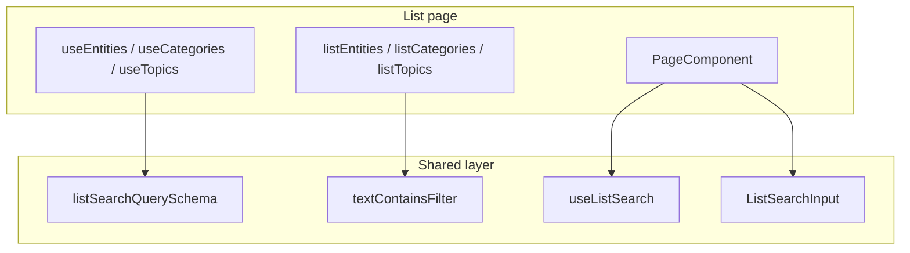
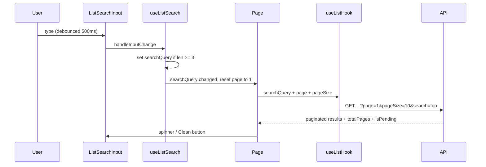

# List Search

Reusable search pattern for paginated list pages. **Entities** is the reference implementation; **Categories** (`HomePage`) and **Topics** (`TopicsPage`) can adopt the same building blocks with minimal page-specific wiring.

Search state lives in **local component state** (not in the URL). Pagination stays in the URL via `page` (see [list-page-search.ts](../src/lib/list-page-search.ts)).

---

## Shared building blocks (already implemented)

| Layer | File | Purpose |
|-------|------|---------|
| Contract | `packages/contracts/src/common/pagination.ts` | `listSearchQuerySchema`, `ListSearchQuery` — extends pagination with optional `search` |
| Backend helper | `backend/src/lib/search.ts` | `textContainsFilter(field, search)` — case-insensitive Prisma `contains` |
| Frontend hook | `frontend/src/lib/use-list-search.ts` | Debounced input, 3-char minimum, `clearSearch`, `onSearchChange` |
| Frontend UI | `frontend/src/components/shared/ListSearchInput.tsx` | Input + spinner + Clean button |
| Debounce util | `frontend/src/lib/debounce.ts` | Used by `useListSearch` |

### Search field by resource

| Resource | Page | DB / contract field | Backend filter |
|----------|------|---------------------|----------------|
| Entities | `EntitiesPage` | `title` | `textContainsFilter('title', query.search)` |
| Categories | `HomePage` | `name` | `textContainsFilter('name', query.search)` |
| Topics | `TopicsPage` | `name` | `textContainsFilter('name', query.search)` |

Do **not** add per-resource query schemas (`entityListQuerySchema`, etc.) — use `ListSearchQuery` everywhere.

---

## Architecture





---

## Reference implementation: EntitiesPage

See [EntitiesPage.tsx](../src/features/entities/components/EntitiesPage.tsx).

### Page wiring pattern

```tsx
const resetPage = useCallback(() => {
  void navigate({
    search: (prev) => ({ ...prev, page: undefined }),
    replace: true,
  })
}, [navigate])

const { inputValue, searchQuery, isSearchActive, handleInputChange, clearSearch } =
  useListSearch({ onSearchChange: resetPage })

const { data, isLoading, isPending } = useEntities(categoryId, topicId, page, pageSize, searchQuery)
```

### UI flags

```tsx
const isSearchResultsFound =
  isSearchActive && !isPending && (data?.totalItems ?? 0) > 0

<ListSearchInput
  value={inputValue}
  onChange={handleInputChange}
  isPending={isSearchActive && isPending}
  showClean={isSearchResultsFound}
  onClean={() => { clearSearch(); resetPage() }}
/>
```

### Empty-state guard

When search returns zero matches, do **not** show the empty-create prompt. Track unfiltered count from the last non-search fetch:

```tsx
const hasItemsRef = useRef(0)

useEffect(() => {
  if (!searchQuery && data !== undefined) {
    hasItemsRef.current = data.totalItems
  }
}, [data, searchQuery])

const itemCount = isSearchActive ? hasItemsRef.current : (data?.totalItems ?? 0)
const showListView = itemCount > 0 || isSearchActive
```

Use `showListView` instead of `totalItems > 0` to choose between list layout and empty prompt.

---

## Search + pagination

Search results use the **same server-side pagination** as the unfiltered list.

### Backend

Apply the search filter to **both** `count` and `findMany` with the same `where`:

```ts
const where = { /* scope filter */, ...textContainsFilter('title', query.search) }

const [totalItems, items] = await Promise.all([
  prisma.entity.count({ where }),
  prisma.entity.findMany({
    where,
    orderBy: { position: 'asc' },
    skip: getPaginationSkip(query),
    take: query.pageSize,
  }),
])
```

`totalItems` and `totalPages` in the response reflect **matching** items only.

### Frontend

- Pass `searchQuery` into the list hook; include `search` in the React Query key together with `page` and `pageSize`.
- Use `data.totalPages` from the current response (filtered when searching).
- `ListPagination` hides itself when `totalPages <= 1`.
- Reset page to 1 on search change (`onSearchChange`) and on Clean.
- Keep the existing page-clamp `useEffect` so out-of-range pages auto-correct.

| Action | Expected behavior |
|--------|-------------------|
| Search returns 25 matches (pageSize 10) | Page 1 shows 10 items; pagination shows 3 pages |
| Click page 2 while searching | API called with `?page=2&search=foo` |
| Change search term | Page resets to 1; pagination recalculates |
| Search returns 5 matches | Single page; pagination hidden |
| Clean search | Page resets to 1; full unfiltered list |

---

## Rollout: Categories (HomePage)

### Backend

1. **`backend/src/modules/categories/categories.service.ts`** — change `listCategories` to accept `ListSearchQuery` and filter:

   ```ts
   const where = {
     userId: user.id,
     ...textContainsFilter('name', query.search),
   }
   ```

2. **`backend/src/modules/categories/categories.routes.ts`** — replace `paginationQuerySchema` with `listSearchQuerySchema` on `GET /`.

### Frontend

3. **`frontend/src/features/categories/api.ts`** — accept `ListSearchQuery`; pass `search` in axios params when present.

4. **`frontend/src/lib/query-keys.ts`** — type `queryKeys.categories.list` param as `ListSearchQuery`.

5. **`frontend/src/features/categories/queries/use-categories.ts`** — add optional `search?: string`; build `{ page, pageSize, search? }` for key + API.

6. **`frontend/src/features/categories/components/HomePage.tsx`**:
   - Add `useListSearch` + `ListSearchInput` (copy pattern from `EntitiesPage`).
   - Pass `searchQuery` to `useCategories(page, searchQuery)`.
   - Empty-state guard: `categoryCount > 0 || isSearchActive`.
   - Destructure `isPending` from `useCategories` for spinner state.

No changes needed to `useListSearch`, `ListSearchInput`, or `listSearchQuerySchema`.

---

## Rollout: Topics (TopicsPage)

Same steps as Categories, with these file-specific targets:

### Backend

1. **`backend/src/modules/topics/topics.service.ts`** — `ListSearchQuery` + `textContainsFilter('name', query.search)` on `where: { categoryId, ... }`.

2. **`backend/src/modules/topics/topics.routes.ts`** — validate with `listSearchQuerySchema`.

### Frontend

3. **`frontend/src/features/topics/api.ts`** — `ListSearchQuery` + optional `search` param.

4. **`frontend/src/lib/query-keys.ts`** — type `queryKeys.topics.list` param as `ListSearchQuery`.

5. **`frontend/src/features/topics/queries/use-topics.ts`** — add optional `search?: string`.

6. **`frontend/src/features/topics/components/TopicsPage.tsx`** — wire `useListSearch`, `ListSearchInput`, empty-state guard (`topicCount > 0 || isSearchActive`).

---

## Behavior checklist

Use this when implementing or verifying search on any list page:

1. List loads normally; search input visible when items exist.
2. Typing 1–2 chars: no API `search` param, full list unchanged, no spinner.
3. Typing 3+ chars: after 500ms debounce, spinner via `isPending`, filtered results appear.
4. Case-insensitive partial match on the resource field (`name` or `title`).
5. When results exist: Clean button appears; click resets input, search state, and pagination.
6. Refresh clears search (local state only).
7. Zero search matches: stays on list layout, not empty prompt; no Clean button.
8. Search pagination: many matches show pagination; page 2 fetches `page=2&search=...`; pagination hidden when `totalPages <= 1`.
9. Changing search term or Clean resets to page 1; page-clamp works when results shrink below current page.
10. Shared hook/component contain no resource-specific logic.

---

## Files modified for Entities (reference)

| Layer | New | Modified |
|-------|-----|----------|
| Contracts | — | `packages/contracts/src/common/pagination.ts` |
| Backend | `backend/src/lib/search.ts` | `entities.service.ts`, `entities.routes.ts` |
| Frontend shared | `use-list-search.ts`, `ListSearchInput.tsx` | `query-keys.ts` |
| Frontend entities | — | `api.ts`, `use-entities.ts`, `EntitiesPage.tsx` |
