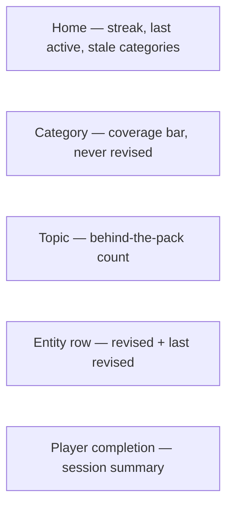

# RemindMe — User Metrics & Progress Tracking

Reference document for metrics that help users track revision progress and stay engaged with the product. Use this when designing analytics, UI surfaces, and backend event logging.

Related docs: [PRODUCT.md](PRODUCT.md), [DATABASE.md](DATABASE.md).

---

## Goals

Metrics should answer three user questions:

1. **Am I keeping my knowledge fresh?**
2. **What should I revise next?**
3. **Am I actually using this regularly?**

RemindMe is a **revision** tool (not a learning platform). Metrics should reinforce the core loop — organize content → revise in the Player → Done/Skip updates counters — without feeling like a gamified leaderboard.

---

## What the app already tracks

| Data | Status |
|------|--------|
| `revisedCount` per entity | Stored in DB; shown on entity rows as `{count} revised` |
| `skippedCount` per entity | Stored in DB; **not shown in UI** |
| Daily activity | `user_daily_activity`: revised/skipped per user per local day; shown as the **Daily activity** stacked bar chart on Home (month view) |
| Session history / event log | **None** — Player session queue is client-side only |
| Global aggregates | Only the daily rollup above; otherwise entity-level counters |
| Statistics page | **Removed** from product spec (see PRODUCT.md changelog) |

Player scheduling already favors entities at **minimum** `revisedCount` in scope. Metrics about coverage and balance align naturally with this behavior.

---

## Tier 1 — High value, mostly from existing data

These need little or no new backend work.

### 1. Coverage & balance (per category / topic)

| Metric | Why it helps |
|--------|----------------|
| **Revised at least once** — e.g. `12/18 entities revised` | Clear progress; empty states feel less discouraging |
| **Never revised** — count at `revisedCount = 0` | Direct "start here" nudge |
| **Behind the pack** — entities at minimum `revisedCount` in scope | Matches Player scheduling; tells users what the app will prioritize |
| **Most revised / least revised** entity in a topic | Surfaces neglected vs well-maintained items |

### 2. Done vs skip signal

`skippedCount` is stored but not surfaced. Useful interpretations:

| Metric | Meaning for the user |
|--------|----------------------|
| **Skip ratio** per entity: `skipped / (revised + skipped)` | High skips → "this one needs more attention" |
| **Frequently skipped** entities in a topic | Actionable list, not shame |

- Low skips + high revised → "well maintained"

### 3. Per-entity progress (enhance current UI)

Instead of only `3 revised`, consider:

- **Relative depth**: "3 revisions · topic avg 5"
- **Last revised** (needs `lastRevisedAt` — see Tier 2)
- **Status badge**: Never revised / In progress / Well revised (simple thresholds)

---

## Tier 2 — Retention & habit (needs lightweight event logging)

To encourage **not stopping**, add **time-bound** and **session-level** data. Lifetime counters alone cannot answer "when did I last revise?" or "how often do I come back?"

### 4. Activity streaks

| Metric | Retention effect |
|--------|------------------|
| **Current streak** — consecutive days with ≥1 Done | Strong habit hook |
| **Longest streak** | Personal best without competition |
| **This week** — sessions or entities revised | Short horizon, less pressure than "all time" |

**Design note:** Keep streaks forgiving — an "active day" = any Done, not finishing a full category session.

### 5. Session metrics

Persist simple session records (`player_session_start`, `player_session_complete`, `player_stop`):

| Metric | Why |
|--------|-----|
| **Sessions completed** (vs started) | Shows follow-through |
| **Entities per session** (done + skip) | "You revised 7 items today" — instant win |
| **Session completion rate** | Many Stop clicks → sessions may feel too long |
| **Scope breakdown** — category vs topic vs single entity | Shows how people use the product |

**Post-session summary** (lightweight completion card on `/player`, not a full Statistics page):

> Session complete · 6 done · 2 skipped · 12 min

### 6. Recency / freshness

Add `lastRevisedAt` (and optionally `lastSkippedAt`) on entities:

| Metric | Use |
|--------|-----|
| **Not revised in 14/30 days** | "Getting stale" nudge |
| **Last active** per category | "English — 3 days ago" on Categories |
| **Freshness score** — % revised in last N days | Better than lifetime count alone |

---

## Tier 3 — Content & engagement (secondary)

### 7. Library health

| Metric | Purpose |
|--------|---------|
| Total categories / topics / entities | Sense of investment in the product |
| **New but never revised** — created recently, `revisedCount = 0` | "You added 4 entities this week — revise them" |
| **Excluded entities** count | Visibility into what's out of rotation |

### 8. Constructor engagement (optional)

| Metric | Purpose |
|--------|---------|
| Entities edited after creation | Users curating knowledge = stickiness |
| Block types used | Product insight; lower priority for user-facing UI |

---

## Where to show metrics (without a heavy Statistics page)

The global Statistics page was removed from the product spec. Metrics work better **in context**:

| Surface | Metrics |
|---------|---------|
| **Home** | Streak, "revise today", categories not touched in N days |
| **Category / topic cards** | `X/Y revised`, never-revised count, optional mini progress bar |
| **Entity rows** | `revisedCount`, last revised, skip hint if high |
| **Before Play** | "This session: ~N entities at minimum revision level" |
| **Player completion** | Done / skip / duration — one screen, then Home |

Avoid a dense dashboard early; contextual nudges usually beat charts for a personal revision app.

---

## Metrics that encourage without feeling manipulative

### Do emphasize

- Personal progress ("you revised 40 entities this month")
- Actionable next steps ("5 never revised in TypeScript")
- Consistency over perfection (streaks, weekly totals)
- Completion moments (session summary)

### Be careful with

- Leaderboards / social comparison — out of scope and wrong tone
- Punitive streak loss — soft messaging ("start a new streak") works better
- Raw time-on-app — doesn't map to revision quality
- Too many numbers on every row — noise kills motivation

---

## Suggested MVP set

If implementing metrics incrementally, start with:

1. **Category/topic coverage** — `X/Y revised`, never-revised count
2. **`lastRevisedAt`** on entities
3. **Session log** — start, complete, done/skip counts
4. **Weekly activity** + **current streak**
5. **Post-session summary** on Player completion
6. **Surface skip ratio** for entities with enough history

This set gives progress tracking, habit reinforcement, and clear "what next?" — aligned with Done/Skip and min-pool scheduling.

---

## Data model additions

| Today | To unlock |
|-------|-----------|
| `revisedCount`, `skippedCount` | Coverage, balance, skip ratio |
| `createdAt` / `updatedAt` | Rough recency (weaker than explicit last-revised) |
| — | `lastRevisedAt` / `lastSkippedAt` on `entities` |
| — | `revision_events` or `player_sessions` table |
| `user_daily_activity` (per-day revised/skipped) | Streaks, "this week" totals, daily chart (implemented) |

### Suggested trackable events (not persisted today)

| Event | Notes |
|-------|-------|
| `player_session_start` | scope: categoryId / topicId / entityId |
| `player_session_complete` | entities shown, done vs skip counts, duration |
| `player_stop` | early exit; no counter change for current entity |
| `entity_done` | maps to `revisedCount + 1` |
| `entity_skip` | maps to `skippedCount + 1` |

Include scope metadata (`categoryId`, `topicId`, `entityId`, session size, position in queue) for analytics and UI.

---

## Summary

The strongest metrics for RemindMe are:

- **Coverage** — how much of your library you've touched
- **Balance** — what's lagging in the min-count pool
- **Recency** — what's going stale
- **Consistency** — streaks, weekly totals, session summaries

Lifetime counters alone aren't enough for retention — users need to see *when* they last revised and *what to do next*.
