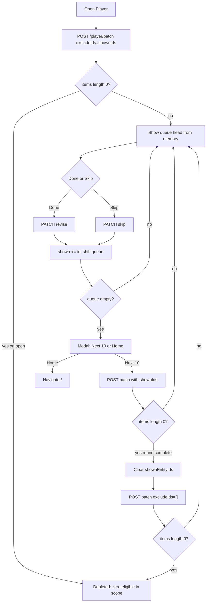

# RemindMe — Player

How the **Player** works: a client-held session of shuffled batches of up to 10 full entities, always preferring the least-revised items in scope.

Product behavior is summarized in [PRODUCT.md §3.5](PRODUCT.md). This document is the implementation-level explanation.

**Related docs:** [PRODUCT.md](PRODUCT.md) · [WIREFRAMES.md](WIREFRAMES.md) §8 · [ARCHITECTURE.md](ARCHITECTURE.md) §5.6 · [DATABASE.md](DATABASE.md) · [TECH_STACK.md](TECH_STACK.md)

---

## 1. What the Player is

The Player (`/player`) is where the user revises information they already added. It shows **one entity at a time** as a read-only preview (title + constructor blocks).

**Done** and **Skip** both advance to the next card. They only differ by which counter they increment:

| Action | Database | Navigation |
|--------|----------|------------|
| **Done** | `revised_count + 1` | Next item in the current pack |
| **Skip** | `skipped_count + 1` | Next item in the current pack |
| **Stop** | No change for the current entity | Home (`/`) |

There is **no server session table**. The frontend holds the current pack and the ids shown in the current **round**.

---

## 2. How to think about it

Think of the Player as dealing cards in **packs of 10**, always preferring “least revised.”

1. Open Player with a **scope** (category, topic, or single entity) from a Play button.
2. Ask the backend for a pack: up to 10 random **full entities** that are still eligible, not already shown this round, and currently at the **lowest `schedule_count`** among what’s left (`revised_count` plus an offset set at creation — see below).
3. Show `queue[0]` from memory. The next card is already in `queue[1]` — no extra fetch while playing.
4. Done or Skip mutates that entity, then drops it from the queue.
5. When the pack is empty → modal: **Get next 3** or **Go to Home**.
6. If a pack request returns nothing because every eligible id was already shown → **round reset** (clear shown ids and deal again). If it is still empty, the scope has zero eligible entities.

Skip does **not** raise `revised_count`, so skipped entities stay in the low pool and **re-enter** on the next round. Done entities move up a tier and appear less often until others catch up.

---

## 3. Scope and entry

`/player` requires exactly one search param:

| Play button on | Search param | Scope |
|----------------|--------------|--------|
| Category row (Home) | `?categoryId=` | All `included` entities in that category |
| Topic row (Category detail) | `?topicId=` | All `included` entities in that topic |
| Entity row (Topic detail) | `?entityId=` | That entity only (pack of 1 if eligible) |

Tapping a row name still opens detail. **Play** only starts the Player.

---

## 4. Batch session (client)

Hardcoded pack size: `PLAYER_BATCH_SIZE = 10` (`features/player/constants.ts`). Later this can be read from profile settings; the server already clamps the requested limit.

Session state lives in `PlayerPage` (React state), not Zustand and not the database:

| Field | Meaning |
|-------|---------|
| `queue` | Remaining full entities in this pack (head is on screen) |
| `shownEntityIds` | Entity ids already Done or Skipped in the **current round** |
| `batchTotal` | Pack size when the pack arrived (may be fewer than 10) |
| `completedInBatch` | How many cards in this pack were advanced (Done or Skip) |
| `status` | `loading` · `playing` · `batchComplete` · `depleted` · `error` |

`shownEntityIds` is **per round**, not per Player visit. A new round starts when the API returns an empty pack while shown ids are non-empty.

### Progress bar

While a pack is active, a shadcn `Progress` bar tracks **this pack only** — not lifetime counters and not the whole category/topic.

| Value | Source |
|-------|--------|
| Label | `{completedInBatch} of {batchTotal}` |
| Hint | `{queue.length} left` (includes the card on screen) |
| Bar | `(completedInBatch / batchTotal) * 100` |

After the last Done/Skip, the bar is full and the continue modal opens. **Get next 3** resets `batchTotal`, `completedInBatch`, and `queue`.

---

## 5. Backend batch

`POST /api/v1/player/batch`

**Body**

```ts
{
  scope: { type: 'category', categoryId } | { type: 'topic', topicId } | { type: 'entity', entityId }
  excludeEntityIds: string[] // default []
  limit: number               // client sends 10; server clamps to 10
}
```

**Response**

```ts
{
  items: Array<Entity & { categoryId: string }>
}
```

Each item is a full entity (title + blocks) plus `categoryId` so Done/Skip can call the nested revise/skip routes without another lookup.

**Selection**

1. Resolve ownership of the scope (category / topic / entity belongs to the user).
2. Filter eligible rows: in scope, `visibility = included`, id not in `excludeEntityIds`.
3. Compute `minCount = MIN(schedule_count)` on that set.
4. Take rows with `schedule_count = minCount`, shuffle, take up to `limit` ids.
5. Load those ids with blocks (same shape as get-entity) and attach `categoryId` from the topic.

New entities are created with `schedule_count = MIN(schedule_count)` of included entities in their topic (falling back to the category, then `0`), so they join the next pack mixed with existing items instead of being served alone until they catch up. Done increments both `revised_count` and `schedule_count`; `revised_count` stays the true lifetime stat shown in the UI.

Done and Skip reuse existing endpoints:

- `PATCH /api/v1/categories/:categoryId/topics/:topicId/entities/:entityId/revise`
- `PATCH /api/v1/categories/:categoryId/topics/:topicId/entities/:entityId/skip`

---

## 6. Round reset

An empty `items: []` response is not always “nothing to revise.”

| Empty response when | Meaning | Action |
|---------------------|---------|--------|
| `shownEntityIds` is non-empty | Every eligible entity was shown this round | Clear `shownEntityIds`, refetch with `excludeEntityIds: []` → **new round** |
| `shownEntityIds` is already empty (open or after reset) | Zero eligible entities in scope | **Depleted** UI — Home only |

Reset runs **at most once** per continue action. A second empty response means the scope is truly empty. Database counters persist across rounds; each new pack re-queries the current min pool.



---

## 7. Edge cases

| Situation | Behavior |
|-----------|----------|
| Fewer than 10 in the min pool | Return fewer; play until that short queue empties → same modal |
| Continue returns `[]` (round complete) | Clear shown ids, fetch a new round; user stays in Player |
| Continue returns `[]` twice | Depleted UI (Home only) |
| Empty scope on open | First fetch is `[]` with empty shown ids → depleted |
| 20 entities, 10 + 10 then `[]` | Round reset; skipped entities are eligible again |
| Single-entity scope | Pack of 1; continue with exclude → `[]` → reset → same entity again |
| **Stop** mid-card | Home immediately; current counters unchanged |
| Batch size from profile | Not implemented — named constant + server clamp only |
| Category Play on empty live categories | Play enablement still uses demo counts in some list rows — follow-up |

---

## 7.1 Daily timer

The header shows today's time in the Player (`MM:SS`, `H:MM:SS` from 1 h) against a daily goal (`PLAYER_DAILY_GOAL_MINUTES`, 15/30/60, default 30; later a user setting). The timer turns green when the goal is reached; the Player keeps working.

- **Start value:** `GET /activity/today` → `playerSeconds` for the user's local day (`X-Timezone`). Always refetched on mount; shows `--:--` until it loads (a failed load starts from 0).
- **Counting:** wall-clock time while `/player` is mounted and the tab is visible (`document.visibilityState`); hidden time earns no drops (`utils/visible-time.ts`). Uses `Date.now()` deltas. Gaps over 2 min between ticks are treated as sleep / bfcache and not counted. A report that crosses a 10-minute mark invalidates the score query.
- **Saving:** elapsed seconds are **added** server-side via `POST /activity/player-time` (`{ seconds: 1..300 }`) every 30 s, on unmount (Stop / navigation), and on `pagehide` (reload, tab close) using `fetch` keepalive. Worst-case loss is one interval (e.g. a browser crash). Several tabs add up instead of overwriting.
- **Midnight:** when the local day changes the timer restarts from 0; up to one interval of pre-midnight time lands on the new day.
- **Next-drop chip:** beside the timer, `NextDropChip` shows "Next drop in N min" to the next full 10 minutes, or "3/3 today" at the daily cap (`utils/next-drop.ts`, from the live timer and the score's `maxPerDay`). Rendered inside `PlayerTimer`, hidden until the timer and the score have loaded.
- The app header (`AppHeader` → `TodayPlayerTime`) shows today's saved total with the same look (static; refetched on each page mount, invalidated when leaving the Player). Markup is shared via `PlayerTimeDisplay`.
- Home shows the history as the **Time in Player** area chart (`features/activity/components/PlayerTimeChart.tsx`).

---

## 8. Frontend files

```
features/player/
  constants.ts                      # PLAYER_BATCH_SIZE = 10
  api.ts                            # fetchPlayerBatch, markEntityDone, markEntitySkip
  types.ts                          # PlayerScope, PlayerSessionState, PlayerBatchItem
  utils/session.ts                  # queue, shown ids, round reset, progress helpers
  queries/use-player-batch.ts       # fetch / refill pack
  queries/use-mark-done.ts          # revised_count + 1
  queries/use-mark-skip.ts          # skipped_count + 1
  hooks/use-player-timer.ts         # daily Player time: counts, reports to POST /activity/player-time
  utils/format-duration.ts          # MM:SS / H:MM:SS
  utils/next-drop.ts                # minutes to the next drop, or the daily cap
  components/
    PlayerPage.tsx                  # session orchestration
    PlayerProgress.tsx              # pack Progress bar
    PlayerPreview.tsx               # EntityReadOnlyContent
    PlayerActions.tsx               # Done / Skip
    PlayerBatchCompleteDialog.tsx   # Next 10 / Home
    PlayerDepleted.tsx              # empty scope
    PlayButton.tsx                  # list-row entry
    PlayerTimer.tsx                 # Player header timer (owns the ticking state)
    NextDropChip.tsx                # "Next drop in N min" / "3/3 today" beside the timer
    PlayerTimeDisplay.tsx           # shared timer markup: icon, time, goal, green when reached
    TodayPlayerTime.tsx             # static today's total for AppHeader
```

Route `src/routes/_app/player.tsx` stays thin: validate search params and render `PlayerPage`.

Contracts: `packages/contracts/src/player.ts`.

Backend: `backend/src/modules/player/` (`player.routes.ts`, `player.service.ts`).
