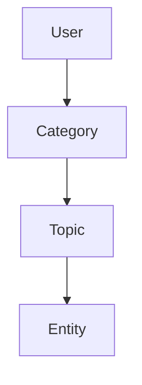
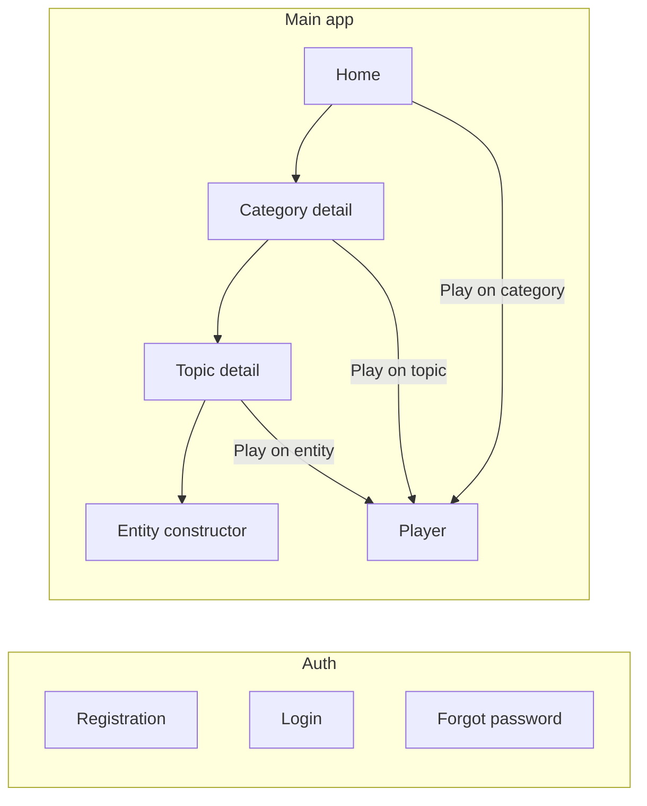
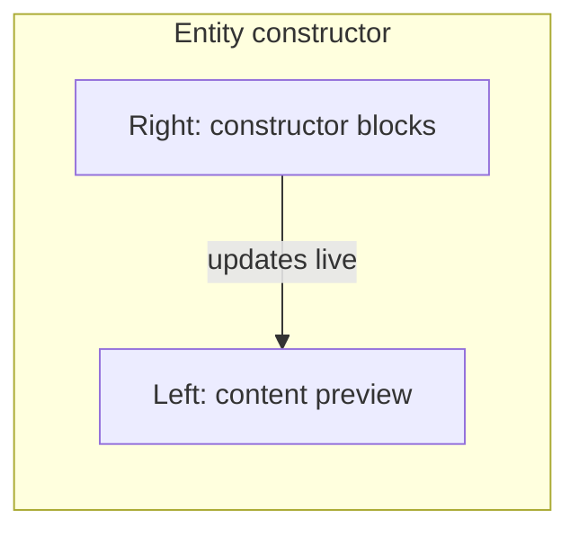

# RemindMe — Product Specification

Structured product knowledge for RemindMe. Defines **what the app is**, **how it is organized**, and **how it behaves**. No technical implementation details.

For the original raw notes, see [ABOUT.md](ABOUT.md).

For the chosen frontend libraries and conventions, see [TECH_STACK.md](TECH_STACK.md). For codebase folder layout (`frontend/` + `backend/`), see [ARCHITECTURE.md](ARCHITECTURE.md). For page wireframes and the MVP 1024px layout, see [WIREFRAMES.md](WIREFRAMES.md). For tables and fields, see [DATABASE.md](DATABASE.md).

---

## 1. Vision

| Aspect | Definition |
|--------|------------|
| **Purpose** | Help users revise information they have already learned |
| **Primary loop** | Organize content into categories and topics → add and configure entities → revise information on demand |
| **Not in scope (for now)** | Learning new material, social features, sharing, notifications |

---

## 2. Glossary

Core concepts used consistently throughout this document:

| Concept | Definition | Notes |
|---------|------------|-------|
| **Category** | A user-defined container for related topics | Can be **empty** (no topics); deletable only when empty |
| **Topic** | A named grouping inside a category that holds a list of entities | Can be **empty**; optional at category creation |
| **Entity** | One piece of revisable information inside a topic | Configured on the **Entity constructor** page: required **Title** plus an ordered sequence of **constructor blocks** (see §3.4) |

### Clarifications

- **Category creation:** Required **category name** only in the Home popover (not a separate page). Topics are added later from Category detail.
- **Category metadata:** Icon, color, and description are optional future fields (TBD, not required for v1).
- **Empty states:** A category may have zero topics; a topic may have zero entities.
- **Entity list identity:** The entity **Title** (required field on the constructor page) is shown as the row label on Topic detail.
- **Entity row revised count:** Each entity row shows `{revised_count} revised` in gray text before the Play button (e.g. `3 revised`).

---

## 3. Pages & Navigation

### 3.1 Page inventory

| Page | Purpose |
|------|---------|
| **Registration** | Create account |
| **Login** | Sign in |
| **Forgot password** | Password recovery |
| **Home** | List categories; add category via popover |
| **Category detail** | List topics in a category; **Add topic**; open a topic |
| **Topic detail** | List entities in a topic; **Add entity** (modal); edit or remove each entity |
| **Entity** | Constructor — split preview (left) and block editor (right); opened as modal from Topic detail; required Title + up to 20 constructor blocks (see §3.4) |
| **Player** | Revise entities one at a time; **Done** / **Skip** update counters (see §3.5) |

### 3.2 Navigation map

### 3.3 Page-specific notes

**Home**

- Lists all created categories.
- **Add category** button opens a **popover** (not a new page).
- Popover contains only **Category name** (required) and a **Save** button below the field.
- Save creates the category and redirects to **Category detail** (empty category page).
- Tap a category → Category detail.
- Icon-only **Rename**, **Delete**, and **Play** buttons on each category row (`aria-label` carries the action name). Delete only if category is empty (no topics). **Play** opens the **Player** for all entities in that category (see §3.5); disabled when the category has no eligible entities.

**Category detail**

- **Add topic** button at the top; list of existing topics below.
- Tap a topic → Topic detail.
- After creating a new topic, user is redirected to that topic's **Topic detail** page.
- Icon-only **Rename** and **Delete** buttons on the category title row (`aria-label` carries the action name). Delete only when the category has no topics (with confirmation).
- Each topic row has icon-only **Rename**, **Delete**, and **Play** buttons. Delete only when the topic has no entities. **Play** opens the **Player** for all entities in that topic (see §3.5); disabled when the topic has no eligible entities.

**Topic detail**

- **Add entity** button; list of existing entities below.
- **Add entity** opens a **modal** containing the Entity constructor.
- Each entity row shows the entity's **`revised_count`** as gray text (`{count} revised`) before icon-only **Edit**, **Remove**, and **Play** buttons (`aria-label` carries the action name) — **Edit** opens the Entity constructor; **Remove** asks for confirmation; **Play** opens the **Player** for that entity only (see §3.5).

**Entity (constructor)**

- Shown in a **modal** when creating from Topic detail (**Add entity**); may also open as a full page or modal when editing (see Open decisions).
- Full layout, block types, and limits: see **§3.4 Entity constructor**.

### 3.4 Entity constructor

The Entity page is a two-panel editor. The user builds revisable content from a required Title and an ordered list of constructor blocks.

**Layout**

- **Left — content preview:** Read-only render of the entity as configured (Title + blocks in sequence). Updates live as the user edits on the right.
- **Right — constructor panel:** Title field, ordered block list, and type-specific editors. Used to add, remove, and reorder blocks.

**Title**

- Required text field at the top of the constructor panel.
- Not counted toward the block limit.
- Shown as the entity name on **Topic detail**.

**Constructor blocks**

Each entity has its own ordered sequence of blocks. Types can be mixed and ordered freely per entity.

| Block type | Purpose | Editor behavior |
|------------|---------|-----------------|
| **Text** | Prose / notes | TipTap rich text editor (bold, italic, underline, headings, lists, tables) |
| **Code** | Code snippet | `@uiw/react-codemirror` editor with language selector; MVP: **JavaScript** and **TypeScript** |
| **Image** | Visual content | Custom upload container: centered file picker + drag-drop; preview after upload; remove to re-upload |
| **List** | Key–value pairs | Rows with **left** and **right** columns; **+** adds a row within the block |

Additional block types may be added in future versions; v1 supports the four types above.

**List block:** The **+** button adds a row inside that List block (left/right values). It does not add a new top-level constructor block.

**Image block:** Empty state shows a drop zone with a centered **Choose image** button. Drag-and-drop onto the container triggers the same upload flow. Once uploaded, the image preview fills the container. A remove control clears the image and returns to the empty state so the user can upload again.

**Block management**

- User can add, remove, and reorder blocks in the right panel.
- When the entity already has **20 blocks**, adding new blocks is disabled.

**Limits**

- Maximum **20 constructor blocks** per entity (Title excluded).
- An entity may have zero blocks if Title is set.

### 3.5 Player

The **Player** (`/player`) is where the user revises information. It shows one entity at a time as a read-only preview (Title + all constructor blocks — same content as the Entity constructor left panel).

**Layout**

- **Top — Stop:** Button near the top of the page; exits the Player immediately and returns to **Home** (`/`). Does not change counters for the current entity.
- **Center — entity preview:** Read-only render of the current entity (Title + blocks in sequence).
- **Bottom — actions:** **Done** and **Skip** buttons below the preview.

**Behavior**

- One entity is shown at a time; the next entity is preloaded in the background.
- **Done** — increments `revised_count` for the current entity in the database; advances to the next entity per scheduling rules (§4.5).
- **Skip** — increments `skipped_count` only (does not increment `revised_count`); advances to the next entity per scheduling rules (§4.5).
- **Session end** — when the last entity in the session is Done or Skipped, the Player stays on `/player` and shows a completion message (no summary screen, no auto-redirect).
- **Empty scope** — if there are no eligible entities in scope, **Play** is disabled on the list row; navigating to `/player` with an empty scope shows an empty/completion state.

**Entry points**

| Page | Play button | Session scope |
|------|-------------|---------------|
| Home (categories list) | Each category row | All entities in that category (across topics) |
| Category detail (topics list) | Each topic row | All entities in that topic |
| Topic detail (entities list) | Each entity row | That entity only (one-item session) |

Tapping a row name still navigates to detail; **Play** navigates to `/player` with the scope encoded in route search params (`categoryId`, `topicId`, or `entityId`).

**Scheduling (category and topic scopes only)**

1. Only entities with `visibility = included` are eligible (see [DATABASE.md](DATABASE.md)).
2. **First entity:** pick randomly from entities at the **minimum** `revised_count` in scope.
3. **All equal:** when every eligible entity in scope has the same `revised_count`, pick randomly from all eligible entities in scope.
4. **After Done:** increment `revised_count`; next entity = random from entities with the **lowest** `revised_count` in scope.
5. **After Skip:** increment `skipped_count` only; next entity = random from **all** eligible entities in scope (not restricted to the minimum pool).
6. **Once per session:** each entity in scope is shown at most once per Player session.

Single-entity sessions (Play on an entity row) show that entity once; after Done or Skip, the completion state is shown.

---

## 4. User Flows

### 4.1 New category (popover on Home)

1. Home → **Add category**
2. Popover: enter **category name** (required) — the only field
3. Tap **Save** (below the field) → category created
4. User is redirected to **Category detail** (empty category page)

Notes:

- Category may have no topics; user adds topics from Category detail.

### 4.2 Existing category (browse topics)

1. Home → tap category → **Category detail**
2. **Add topic** button at the top; list of previously created topics below
3. Tap a topic → **Topic detail**

### 4.3 Add topic (from Category detail)

1. Category detail → **Add topic**
2. Create topic (input UI TBD — modal, popover, or inline)
3. After save → user is redirected to the new **Topic detail** page

### 4.4 Topic detail (entities)

1. Topic detail → **Add entity** button at the top; list of previously created entities below
2. **Add entity** opens a **modal** with the Entity constructor
3. On each existing entity: **Edit** (Entity constructor) or **Remove** (with confirmation)

### 4.5 Revision flow (Player)

**Start from a category (Home)**

1. Home → **Play** on a category row → **Player** (`/player?categoryId=…`)
2. First entity shown: random pick from entities at minimum `revised_count` in that category (only `visibility = included`)
3. User reviews the read-only preview
4. **Done** → `revised_count` incremented → next entity: random from lowest `revised_count` pool in category
5. **Skip** → `skipped_count` incremented → next entity: random from all eligible entities in category
6. Repeat until every eligible entity in the category has been shown once
7. Completion message shown on `/player`

**Start from a topic (Category detail)**

1. Category detail → **Play** on a topic row → **Player** (`/player?topicId=…`)
2. Same scheduling rules as category scope, limited to entities in that topic
3. Session ends with completion message on `/player`

**Start from a single entity (Topic detail)**

1. Topic detail → **Play** on an entity row → **Player** (`/player?entityId=…`)
2. That entity is shown once
3. **Done** or **Skip** → completion message on `/player`

**Stop at any time**

1. **Stop** (top of Player) → return to **Home** immediately; current entity counters are unchanged

---

## 5. Business Rules

### Categories

- User can create unlimited categories
- Category name is required on creation
- Category may exist with zero topics
- Delete category only when it contains zero topics
- Topics are added separately from Category detail, not during category creation

### Topics

- Belong to exactly one category
- May exist empty (zero entities)
- Added from Category detail via **Add topic**
- Naming, edit, and delete rules TBD (see Open decisions)

### Entities

- Belong to exactly one topic (not directly to category)
- Created and edited via **Entity constructor** page
- Removed individually from Topic detail (with confirmation)
- **Title** is required before save
- Block sequence: **0–20** constructor blocks per entity; block order is persisted and drives the content preview and Player display
- **Revision (Player):**
  - **Done** increments `revised_count`; **Skip** increments `skipped_count` only
  - Entities with `visibility = excluded` are not eligible for the Player
  - Category/topic sessions: each eligible entity shown once; scheduling favors entities at minimum `revised_count` (see §3.5)
  - **Play** disabled on list rows when scope has zero eligible entities

---

## 6. Auth

Minimal structure — no technical detail:

| Flow | Behavior |
|------|----------|
| **Registration** | Email + password (assumed); success → Home |
| **Login** | Credentials → Home |
| **Forgot password** | Email → reset link flow → Login |

Users have roles (`user`, `admin`; extensible). Regular users see only their own categories, topics, and entities. Schema details: [DATABASE.md](DATABASE.md). Multi-device sync is an implicit benefit of accounts, not a separate feature spec.

---

## 7. Open Decisions

Items not blocking product structure but needing confirmation before implementation:

1. **Add topic UI** — modal, popover, or inline on Category detail?
2. **Topic rename / delete** — rules and empty-topic delete behavior
3. **Category rename** — inline on Category detail or separate edit screen?
4. **Entity edit entry point** — same modal as Add entity, or navigate to full Entity page?

---

## 8. Changelog from Original Notes

Changes made when structuring [ABOUT.md](ABOUT.md):

| Topic | Original | Structured |
|-------|----------|------------|
| Category creation | Implied template + fields during category creation | Category created **empty** with name only; entities added separately |
| Revision session | Described only as "pick category and press Start" | Added **Revision session** and **Session summary** pages; session is a **fixed pass** through eligible entities |
| Skip counter | Only "Revised" counter mentioned in scheduling logic | **Skipped counter** added for statistics; skip does not increment revised counter |
| Skip scheduling effect | Not stated | Skipped entities reappear in future sessions sooner (stay in minimum revised pool) |
| Session set | "Random order" among entities with lower revised counter | Clarified: session includes entities at **minimum** revised counter only; shuffled randomly; each shown once |
| Template scope | Ambiguous (category flow included template step) | Templates assigned **per entity**, not per category |
| Category metadata | Not mentioned | **Category name** required on creation |
| Empty category revision | Not addressed | **Blocked** — cannot start revision on empty category |
| Statistics scope | Chart of revised vs skipped | Global totals for v1; session summary is per-session |
| Missing pages | Auth, Home, Entities only | Added Create category, Add entity flows, Edit entity, Revision session, Session summary, Statistics |

### Restructuring (Topics, flows, remove Statistics)

| Topic | Previous | Updated |
|-------|----------|---------|
| Content hierarchy | Category → Entity | Category → Topic → Entity |
| Category creation | Dedicated Create category page | Home popover (name only) → redirect to Category detail |
| Entity model | Template-bound fields | User-configured constructor: Title + ordered blocks (Text, Code, Image, List) |
| Entity constructor | Elements TBD | Split layout (preview left, editor right); max 20 blocks per entity |
| Statistics page | Global chart page | **Removed** from product spec |
| Revision / Templates | Full session + template flows | **Player** page at `/player` replaces session/summary pages; template flows removed |

### Player (2026-07-13)

| Topic | Previous | Updated |
|-------|----------|---------|
| Revision UI | Deferred — removed from product spec | **Player** page at `/player` — read-only entity preview, Done/Skip, Stop → Home |
| Entry points | Not defined | **Play** button on category, topic, and entity list rows |
| Session scope | Category-only "Start" | Category (all entities), topic (topic entities), or single entity |
| Scheduling | Min revised_count pool, random, once per session | Restored with Done → min pool; Skip → random in scope |
| Session end | Session summary page | Completion message on `/player` (no summary screen) |
| Counter mutations | Schema only | Done → `revised_count + 1`; Skip → `skipped_count + 1` |
