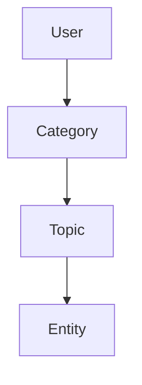
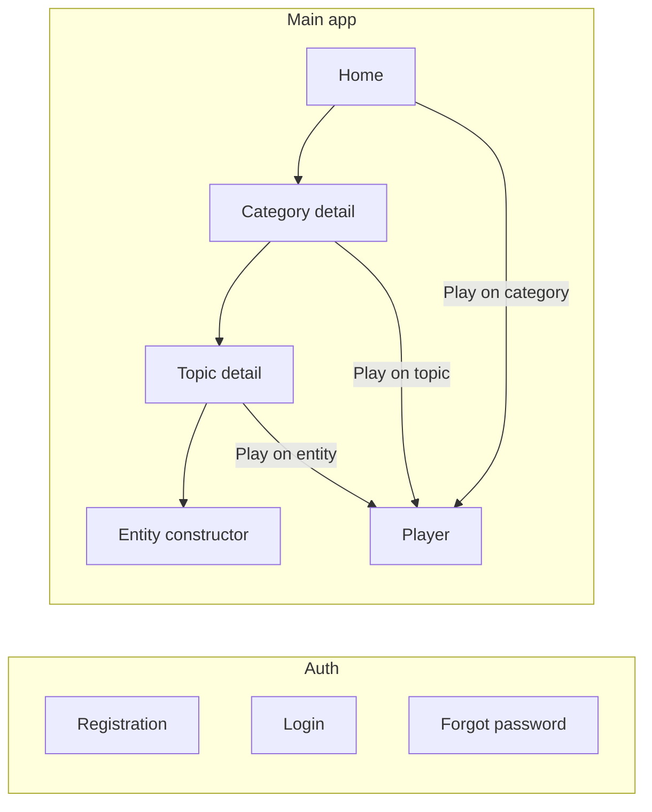
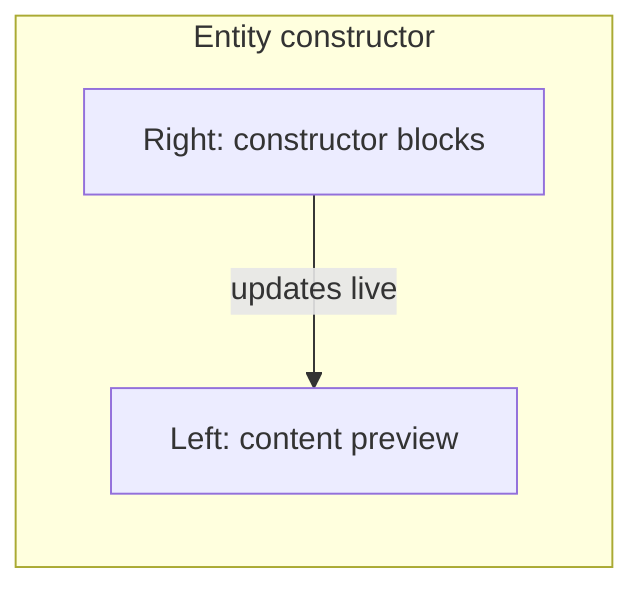

# RemindMe — Product Specification

Structured product knowledge for RemindMe. Defines **what the app is**, **how it is organized**, and **how it behaves**. No technical implementation details.

For the original raw notes, see [ABOUT.md](ABOUT.md).

For the chosen frontend libraries and conventions, see [TECH_STACK.md](TECH_STACK.md). For codebase folder layout (`frontend/` + `backend/`), see [ARCHITECTURE.md](ARCHITECTURE.md). For page wireframes and the MVP 1024px layout, see [WIREFRAMES.md](WIREFRAMES.md). For tables and fields, see [DATABASE.md](DATABASE.md). For how the Player deals batches and resets rounds, see [PLAYER.md](PLAYER.md).

---

## 1. Vision

| Aspect | Definition |
|--------|------------|
| **Purpose** | Help users revise information they have already learned |
| **Primary loop** | Organize content into categories and topics → add and configure entities → revise information on demand |
| **Not in scope (for now)** | Learning new material, social features, sharing, notifications |

---

## 2. Glossary

Core concepts used consistently throughout this document:

| Concept | Definition | Notes |
|---------|------------|-------|
| **Category** | A user-defined container for related topics | Can be **empty** (no topics); deletable only when empty |
| **Topic** | A named grouping inside a category that holds a list of entities | Can be **empty**; optional at category creation |
| **Entity** | One piece of revisable information inside a topic | Configured on the **Entity constructor** page: required **Title** plus an ordered sequence of **constructor blocks** (see §3.4) |

### Clarifications

- **Category creation:** Required **category name** only in the Categories popover (not a separate page). Topics are added later from Category detail.
- **Category metadata:** Icon, color, and description are optional future fields (TBD, not required for v1).
- **Empty states:** A category may have zero topics; a topic may have zero entities.
- **Entity list identity:** The entity **Title** (required field on the constructor page) is shown as the row label on Topic detail.
- **Entity row revised count:** Each entity row shows `{revised_count} revised` in gray text before the Play button (e.g. `3 revised`).

---

## 3. Pages & Navigation

### 3.1 Page inventory

| Page | Purpose |
|------|---------|
| **Registration** | Create account |
| **Login** | Sign-in dialog on Home (`/?login=true`), opened from **Log in** or when a guest opens a protected page; not a separate page |
| **Forgot password** | Password recovery |
| **Home** | Public landing page: slogan and **Log in** for guests; logged-in users also see **Open my categories**, **Your library** counts and the **Daily activity** chart |
| **Categories** | List categories; add category via popover |
| **Category detail** | List topics in a category; **Add topic**; open a topic |
| **Topic detail** | List entities in a topic; **Add entity** (modal); edit or remove each entity |
| **Entity** | Constructor — split preview (left) and block editor (right); opened as modal from Topic detail; required Title + up to 20 constructor blocks (see §3.4) |
| **Player** | Revise entities one at a time; **Done** / **Skip** update counters (see §3.5) |

### 3.2 Navigation map

### 3.3 Page-specific notes

**Home** (`/`)

- Public landing page: slogan plus **Log in** for guests.
- Logged in: also **Open my categories** (→ `/categories`) and the **Your library** counts (categories, topics, entities; placeholder values until wired to the API).
- Logged in: **Daily activity** — full-width stacked bar chart, one bar per day of the selected month: **Skipped** (red) at the bottom, **Revised** (green) on top. Defaults to the current month; **Prev month** / **Next** (top-left) page through months: Next is disabled on the current month, Prev is disabled on the first month that has any activity (or on the current month if there is none yet). Empty months in between (e.g. a long break) stay reachable. Days are the user's local calendar days. Counts come only from Player **Done** / **Skip** clicks from the moment the feature shipped. Data is cached for a day and refreshed after any Done/Skip.

**Categories** (`/categories`)

- Lists all created categories.
- **Add category** button opens a **popover** (not a new page).
- Popover contains only **Category name** (required) and a **Save** button below the field.
- Save creates the category and redirects to **Category detail** (empty category page).
- Tap a category → Category detail.
- Icon-only **Rename**, **Delete**, and **Play** buttons on each category row (`aria-label` carries the action name). Delete only if category is empty (no topics). **Play** opens the **Player** for all entities in that category (see §3.5); disabled when the category has no eligible entities.

**Category detail**

- **Add topic** button at the top; list of existing topics below.
- Tap a topic → Topic detail.
- After creating a new topic, user is redirected to that topic's **Topic detail** page.
- Icon-only **Rename** and **Delete** buttons on the category title row (`aria-label` carries the action name). Delete only when the category has no topics (with confirmation).
- Each topic row has icon-only **Rename**, **Delete**, and **Play** buttons. Delete only when the topic has no entities. **Play** opens the **Player** for all entities in that topic (see §3.5); disabled when the topic has no eligible entities.

**Topic detail**

- **Add entity** button; list of existing entities below.
- **Add entity** opens a **modal** containing the Entity constructor.
- Each entity row shows the entity's **`revised_count`** as gray text (`{count} revised`) before icon-only **Edit**, **Remove**, and **Play** buttons (`aria-label` carries the action name) — **Edit** opens the Entity constructor; **Remove** asks for confirmation; **Play** opens the **Player** for that entity only (see §3.5).

**Entity (constructor)**

- Shown in a **modal** when creating from Topic detail (**Add entity**); may also open as a full page or modal when editing (see Open decisions).
- Full layout, block types, and limits: see **§3.4 Entity constructor**.

### 3.4 Entity constructor

The Entity page is a two-panel editor. The user builds revisable content from a required Title and an ordered list of constructor blocks.

**Layout**

- **Left — content preview:** Read-only render of the entity as configured (Title + blocks in sequence). Updates live as the user edits on the right.
- **Right — constructor panel:** Title field, ordered block list, and type-specific editors. Used to add, remove, and reorder blocks.

**Title**

- Required text field at the top of the constructor panel.
- Not counted toward the block limit.
- Shown as the entity name on **Topic detail**.

**Constructor blocks**

Each entity has its own ordered sequence of blocks. Types can be mixed and ordered freely per entity.

| Block type | Purpose | Editor behavior |
|------------|---------|-----------------|
| **Text** | Prose / notes | TipTap rich text editor (bold, italic, underline, headings, lists, tables) |
| **Code** | Code snippet | `@uiw/react-codemirror` editor with language selector; MVP: **JavaScript** and **TypeScript**; optional checkbox: **Blured by default** |
| **Image** | Visual content | Custom upload container: centered file picker + drag-drop; preview after upload; remove to re-upload |
| **List** | Key–value pairs | Rows with **left** and **right** columns; **+** adds a row within the block; optional checkbox: **Blur right side by default** |
| **Link** | External resource | **Title** (optional, max 75 symbols) + **URL** (required, `http://` or `https://`) |

Additional block types may be added in future versions; v1 supports the five types above.

**Code block options** (checkbox below the editor):

| Option | Default | Behavior |
|--------|---------|----------|
| **Blured by default** | off | Code is blurred until the user clicks/taps to reveal (revision-style guess-then-check) |

**List block:** The **+** button adds a row inside that List block (left/right values). It does not add a new top-level constructor block.

**List block options** (checkbox below **+ Add row**):

| Option | Default | Behavior |
|--------|---------|----------|
| **Blur right side by default** | off | Right column text is blurred until the user clicks/taps to reveal (revision-style guess-then-check) |

**Link block:** In preview and the Player the title (if set) is shown above the URL; the URL is a link that opens in a new tab, with an external-link icon to its right.

**Image block:** Empty state shows a drop zone with a centered **Choose image** button. Drag-and-drop onto the container triggers the same upload flow. Once uploaded, the image preview fills the container. A remove control clears the image and returns to the empty state so the user can upload again.

**Block management**

- User can add, remove, and reorder blocks in the right panel.
- When the entity already has **20 blocks**, adding new blocks is disabled.

**Limits**

- Maximum **20 constructor blocks** per entity (Title excluded).
- An entity may have zero blocks if Title is set.

### 3.5 Player

The **Player** (`/player`) is where the user revises information. It shows one entity at a time as a read-only preview (Title + all constructor blocks — same content as the Entity constructor left panel). Implementation detail: [PLAYER.md](PLAYER.md).

**Layout**

- **Top — Stop:** Button near the top of the page; exits the Player immediately and returns to **Home** (`/`). Does not change counters for the current entity.
- **Progress:** A pack progress bar under the title row (`completed of total` plus how many are left in this pack).
- **Center — entity preview:** Read-only render of the current entity (Title + blocks in sequence).
- **Bottom — actions:** **Done** and **Skip** buttons below the preview.

**Behavior**

- The Player deals **packs of up to 10** eligible entities (fewer if the min pool is smaller). The next card is already in the client queue.
- **Done** — increments `revised_count` for the current entity; advances to the next item in the current pack.
- **Skip** — increments `skipped_count` only (does not increment `revised_count`); advances to the next item in the current pack. Skip and Done differ only by which counter they update.
- **Pack complete** — when the current pack is exhausted, a modal offers **Get next 3** or **Go to Home**. The user stays on `/player` (no summary screen, no auto-redirect).
- **Round reset** — if the next pack is empty because every eligible entity was already shown this round, shown ids are cleared and a new pack is dealt. Play continues.
- **Empty scope** — if there are no eligible entities in scope, **Play** is disabled on the list row when possible; navigating to `/player` with an empty scope shows a depleted state (Home only).

**Entry points**

| Page | Play button | Session scope |
|------|-------------|---------------|
| Categories list | Each category row | All entities in that category (across topics) |
| Category detail (topics list) | Each topic row | All entities in that topic |
| Topic detail (entities list) | Each entity row | That entity only (packs of 1; continues after a round reset) |

Tapping a row name still navigates to detail; **Play** navigates to `/player` with the scope encoded in route search params (`categoryId`, `topicId`, or `entityId`).

**Scheduling**

1. Only entities with `visibility = included` are eligible (see [DATABASE.md](DATABASE.md)).
2. Each pack is a random sample from entities at the **minimum** `revised_count` among those not yet shown this round.
3. An entity is shown at most once per **round** (the current pass through the scope). A new round starts when every eligible entity has been shown.
4. After Done, that entity’s `revised_count` rises, so it is less likely to appear until others catch up.
5. After Skip, `revised_count` stays the same, so the entity stays in the low pool and can re-enter on the next round.

---

## 4. User Flows

### 4.1 New category (popover on Categories)

1. Categories → **Add category**
2. Popover: enter **category name** (required) — the only field
3. Tap **Save** (below the field) → category created
4. User is redirected to **Category detail** (empty category page)

Notes:

- Category may have no topics; user adds topics from Category detail.

### 4.2 Existing category (browse topics)

1. Categories → tap category → **Category detail**
2. **Add topic** button at the top; list of previously created topics below
3. Tap a topic → **Topic detail**

### 4.3 Add topic (from Category detail)

1. Category detail → **Add topic**
2. Create topic (input UI TBD — modal, popover, or inline)
3. After save → user is redirected to the new **Topic detail** page

### 4.4 Topic detail (entities)

1. Topic detail → **Add entity** button at the top; list of previously created entities below
2. **Add entity** opens a **modal** with the Entity constructor
3. On each existing entity: **Edit** (Entity constructor) or **Remove** (with confirmation)

### 4.5 Revision flow (Player)

**Start from a category (Categories)**

1. Categories → **Play** on a category row → **Player** (`/player?categoryId=…`)
2. First pack: up to 10 random entities at minimum `revised_count` in that category (only `visibility = included`)
3. User reviews the read-only preview
4. **Done** or **Skip** → matching counter incremented → next entity in the current pack
5. When the pack is empty → modal: **Get next 3** or **Go to Home**
6. Continue deals another pack, excluding entities already shown this round
7. When a pack request is empty, the round resets and play continues from the current min pool

**Start from a topic (Category detail)**

1. Category detail → **Play** on a topic row → **Player** (`/player?topicId=…`)
2. Same pack / Done / Skip / continue rules, limited to entities in that topic

**Start from a single entity (Topic detail)**

1. Topic detail → **Play** on an entity row → **Player** (`/player?entityId=…`)
2. That entity is shown (pack of 1) if eligible
3. **Done** or **Skip** → continue modal; next pack after a round reset is the same entity again

**Stop at any time**

1. **Stop** (top of Player) → return to **Home** immediately; current entity counters are unchanged

---

## 5. Business Rules

### Categories

- User can create unlimited categories
- Category name is required on creation
- Category may exist with zero topics
- Delete category only when it contains zero topics
- Topics are added separately from Category detail, not during category creation

### Topics

- Belong to exactly one category
- May exist empty (zero entities)
- Added from Category detail via **Add topic**
- Naming, edit, and delete rules TBD (see Open decisions)

### Entities

- Belong to exactly one topic (not directly to category)
- Created and edited via **Entity constructor** page
- Removed individually from Topic detail (with confirmation)
- **Title** is required before save
- Block sequence: **0–20** constructor blocks per entity; block order is persisted and drives the content preview and Player display
- **Revision (Player):**
  - **Done** increments `revised_count`; **Skip** increments `skipped_count` only
  - Entities with `visibility = excluded` are not eligible for the Player
  - Packs of up to 10 from the minimum `revised_count` pool; each eligible entity at most once per round (see §3.5 and [PLAYER.md](PLAYER.md))
  - **Play** disabled on list rows when scope has zero eligible entities

---

## 6. Auth

Minimal structure — no technical detail:

| Flow | Behavior |
|------|----------|
| **Registration** | Email + password (assumed); success → Home |
| **Login** | Credentials in the sign-in dialog on Home → Home (dialog closes) |
| **Forgot password** | Email → reset link flow → Login |

Users have roles (`user`, `admin`; extensible). Regular users see only their own categories, topics, and entities. Schema details: [DATABASE.md](DATABASE.md). Multi-device sync is an implicit benefit of accounts, not a separate feature spec.

---

## 7. Open Decisions

Items not blocking product structure but needing confirmation before implementation:

1. **Add topic UI** — modal, popover, or inline on Category detail?
2. **Topic rename / delete** — rules and empty-topic delete behavior
3. **Category rename** — inline on Category detail or separate edit screen?
4. **Entity edit entry point** — same modal as Add entity, or navigate to full Entity page?

---

## 8. Changelog from Original Notes

Changes made when structuring [ABOUT.md](ABOUT.md):

| Topic | Original | Structured |
|-------|----------|------------|
| Category creation | Implied template + fields during category creation | Category created **empty** with name only; entities added separately |
| Revision session | Described only as "pick category and press Start" | Added **Revision session** and **Session summary** pages; session is a **fixed pass** through eligible entities |
| Skip counter | Only "Revised" counter mentioned in scheduling logic | **Skipped counter** added for statistics; skip does not increment revised counter |
| Skip scheduling effect | Not stated | Skipped entities reappear in future sessions sooner (stay in minimum revised pool) |
| Session set | "Random order" among entities with lower revised counter | Clarified: session includes entities at **minimum** revised counter only; shuffled randomly; each shown once |
| Template scope | Ambiguous (category flow included template step) | Templates assigned **per entity**, not per category |
| Category metadata | Not mentioned | **Category name** required on creation |
| Empty category revision | Not addressed | **Blocked** — cannot start revision on empty category |
| Statistics scope | Chart of revised vs skipped | Global totals for v1; session summary is per-session |
| Missing pages | Auth, Home, Entities only | Added Create category, Add entity flows, Edit entity, Revision session, Session summary, Statistics |

### Restructuring (Topics, flows, remove Statistics)

| Topic | Previous | Updated |
|-------|----------|---------|
| Content hierarchy | Category → Entity | Category → Topic → Entity |
| Category creation | Dedicated Create category page | Categories page popover (name only) → redirect to Category detail |
| Entity model | Template-bound fields | User-configured constructor: Title + ordered blocks (Text, Code, Image, List, Link) |
| Entity constructor | Elements TBD | Split layout (preview left, editor right); max 20 blocks per entity |
| Statistics page | Global chart page | **Removed** from product spec |
| Revision / Templates | Full session + template flows | **Player** page at `/player` replaces session/summary pages; template flows removed |

### Player (2026-07-13)

| Topic | Previous | Updated |
|-------|----------|---------|
| Revision UI | Deferred — removed from product spec | **Player** page at `/player` — read-only entity preview, Done/Skip, Stop → Home |
| Entry points | Not defined | **Play** button on category, topic, and entity list rows |
| Session scope | Category-only "Start" | Category (all entities), topic (topic entities), or single entity |
| Scheduling | Min revised_count pool, random, once per session | Restored with Done → min pool; Skip → random in scope |
| Session end | Session summary page | Completion message on `/player` (no summary screen) |
| Counter mutations | Schema only | Done → `revised_count + 1`; Skip → `skipped_count + 1` |

### Link block (2026-10-23)

| Topic | Previous | Updated |
|-------|----------|---------|
| Block types | Text, Code, Image, List | Added **Link**: optional title (≤75 symbols) + required http(s) URL; opens in a new tab with an external-link icon |

### Code block blur (2026-08-31)

| Topic | Previous | Updated |
|-------|----------|---------|
| Code block options | Language selector + editor only | Optional **Blured by default** checkbox; preview/Player click-to-reveal |

### Player batches (2026-08-18)

| Topic | Previous | Updated |
|-------|----------|---------|
| Queue | Load all eligible client-side; once per session | Packs of ≤10 full entities; next card already in the client queue |
| Session end | Completion message after every eligible entity once | Continue modal each pack; **round reset** when the scope is fully shown |
| Skip scheduling | Random from all remaining in scope | Next in current pack (counter only differs) |
| Progress | None | Pack-only progress bar (`completed of total`) |
