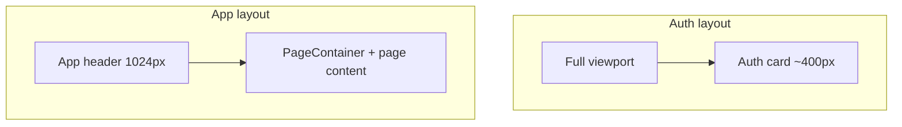

# RemindMe — Page Wireframes (MVP)

Visual layout reference for every v1 screen. Describes **what each page looks like** and how the fixed-width MVP shell is structured.

For product behavior and flows, see [PRODUCT.md](PRODUCT.md). For routes and component ownership, see [ARCHITECTURE.md](ARCHITECTURE.md).

---

## 1. Layout system (MVP)

### 1.1 Fixed width, centered

MVP uses a **1024px content column** centered horizontally. The viewport may be wider; side margins are empty (or a subtle background fill).

Future responsive work should only change the wrapper — page content stays inside `PageContainer`.

```
┌──────────────────────────────────────────────────────────────────────────── viewport ──┐
│                                                                                        │
│     (margin)    ┌────────────────────── 1024px ──────────────────────┐    (margin)   │
│                 │                                                      │               │
│                 │              PageContainer (mx-auto)                 │               │
│                 │                                                      │               │
│                 └──────────────────────────────────────────────────────┘               │
│                                                                                        │
└────────────────────────────────────────────────────────────────────────────────────────┘
```

### 1.2 `PageContainer` wrapper

Implement once in `components/layout/PageContainer.tsx` and use on every page.

| Property | MVP value | Future |
|----------|-----------|--------|
| Max width | `1024px` (`max-w-[1024px]`) | Same or breakpoint-based |
| Horizontal centering | `mx-auto` | Same |
| Width | `w-full` | Same — fills column up to max |
| Horizontal padding | `px-6` (24px) | May increase on small screens |
| Vertical padding | Page-specific | — |

```tsx
// components/layout/PageContainer.tsx
export function PageContainer({ children }: { children: React.ReactNode }) {
  return (
    <div className="mx-auto w-full max-w-[1024px] px-6">
      {children}
    </div>
  );
}
```

### 1.3 Layout variants

| Layout | Used on | Shell |
|--------|---------|-------|
| **Auth layout** | Login, Register, Forgot password | No app nav; centered card inside viewport |
| **App layout** | Home, Category detail, Topic detail, Entity constructor (full page), Player | Header + `PageContainer` + page body |



---

## 2. Shared app chrome

All authenticated pages share the same header inside `PageContainer`.

```
┌────────────────────────────── 1024px ──────────────────────────────┐
│  RemindMe                                    [User menu ▾]         │  ← App header (sticky optional)
├────────────────────────────────────────────────────────────────────┤
│                                                                    │
│                         Page content                               │
│                                                                    │
└────────────────────────────────────────────────────────────────────┘
```

| Element | Behavior |
|---------|----------|
| **Logo / app name** | Links to Home (`/`) |
| **User menu** | Logout; profile TBD for v1 |

Auth pages **do not** show this header.

### 2.1 Page breadcrumbs

Every app-layout page shows an **`AppBreadcrumbs`** component directly **under the page title** (not in the header). Built on shadcn/ui [`Breadcrumb`](https://ui.shadcn.com/docs/components/breadcrumb); wrapped in a shared component at `components/shared/AppBreadcrumbs.tsx`.

| Page | Breadcrumb trail | Link behavior |
|------|------------------|---------------|
| Home | `Home` | Current page only |
| Category detail | `Home` › `Category: English` | Home → `/`; category segment is current |
| Topic detail | `Home` › `Category: English` › `Topic: Verbs` | Home → `/`; category → category detail; topic segment is current |
| Entity constructor (full page) | `Home` › `Category: English` › `Topic: Verbs` | Same as topic detail (entity editing stays in topic context) |
| Player | *(none)* | Immersive revision mode — no breadcrumbs; **Stop** replaces back navigation |

Label format is fixed: **`Category: <name>`** and **`Topic: <name>`** — include the prefix in the visible text. The current (last) segment uses `BreadcrumbPage` (non-link); ancestors use `BreadcrumbLink`.

Auth pages do **not** show breadcrumbs.

```tsx
// components/shared/AppBreadcrumbs.tsx — import on every app-layout page
<AppBreadcrumbs />
<AppBreadcrumbs category={{ id, name }} />
<AppBreadcrumbs category={{ id, name }} topic={{ id, name }} />
```

Page title block pattern:

```
Categories                              [ + Add category ]
Home

English                    [ ✏ ] [ 🗑 ]  [ + Add topic ]
Home › Category: English

Verbs                                   [ + Add entity ]
Home › Category: English › Topic: Verbs
```

---

## 3. Auth pages

Centered card on a full-height viewport. Card is **~400px** wide inside the 1024px column.

### 3.1 Login — `/auth/login`

```
┌──────────────────────────── viewport ────────────────────────────┐
│                                                                  │
│              ┌────────────── ~400px ──────────────┐              │
│              │  RemindMe                         │              │
│              │                                   │              │
│              │  Sign in                          │              │
│              │                                   │              │
│              │  Email                            │              │
│              │  ┌─────────────────────────────┐  │              │
│              │  │                             │  │              │
│              │  └─────────────────────────────┘  │              │
│              │                                   │              │
│              │  Password                         │              │
│              │  ┌─────────────────────────────┐  │              │
│              │  │                             │  │              │
│              │  └─────────────────────────────┘  │              │
│              │                                   │              │
│              │  [        Sign in        ]        │              │
│              │                                   │              │
│              │  Forgot password?                 │              │
│              │  Don't have an account? Register  │              │
│              └───────────────────────────────────┘              │
│                                                                  │
└──────────────────────────────────────────────────────────────────┘
```

| Action | Result |
|--------|--------|
| Sign in | Redirect to Home |
| Forgot password? | → Forgot password page |
| Register | → Registration page |

---

### 3.2 Registration — `/auth/register`

```
┌──────────────────────────── viewport ────────────────────────────┐
│                                                                  │
│              ┌────────────── ~400px ──────────────┐              │
│              │  RemindMe                         │              │
│              │                                   │              │
│              │  Create account                   │              │
│              │                                   │              │
│              │  Email                            │              │
│              │  ┌─────────────────────────────┐  │              │
│              │  └─────────────────────────────┘  │              │
│              │                                   │              │
│              │  Password                         │              │
│              │  ┌─────────────────────────────┐  │              │
│              │  └─────────────────────────────┘  │              │
│              │                                   │              │
│              │  Confirm password                 │              │
│              │  ┌─────────────────────────────┐  │              │
│              │  └─────────────────────────────┘  │              │
│              │                                   │              │
│              │  [      Create account     ]      │              │
│              │                                   │              │
│              │  Already have an account? Sign in │              │
│              └───────────────────────────────────┘              │
│                                                                  │
└──────────────────────────────────────────────────────────────────┘
```

| Action | Result |
|--------|--------|
| Create account | Redirect to Home |
| Sign in | → Login page |

---

### 3.3 Forgot password — `/auth/forgot-password`

```
┌──────────────────────────── viewport ────────────────────────────┐
│                                                                  │
│              ┌────────────── ~400px ──────────────┐              │
│              │  RemindMe                         │              │
│              │                                   │              │
│              │  Reset password                   │              │
│              │                                   │              │
│              │  Enter your email and we'll send  │              │
│              │  you a reset link.                │              │
│              │                                   │              │
│              │  Email                            │              │
│              │  ┌─────────────────────────────┐  │              │
│              │  └─────────────────────────────┘  │              │
│              │                                   │              │
│              │  [      Send reset link    ]      │              │
│              │                                   │              │
│              │  Back to sign in                  │              │
│              └───────────────────────────────────┘              │
│                                                                  │
└──────────────────────────────────────────────────────────────────┘
```

| Action | Result |
|--------|--------|
| Send reset link | Success message (email sent) |
| Back to sign in | → Login page |

---

## 4. Home — `/`

Lists all categories. **Add category** opens a popover (not a separate page).

```
┌────────────────────────────── 1024px ──────────────────────────────┐
│  RemindMe                                    [User menu ▾]         │
├────────────────────────────────────────────────────────────────────┤
│                                                                    │
│  Categories                              [ + Add category ]        │
│  Home                                                              │
│                                                                    │
│  ┌──────────────────────────────────────────────────────────────┐  │
│  │  English                              [ ▶ ] [ ✏ ] [ 🗑 ]  │  │
│  └──────────────────────────────────────────────────────────────┘  │
│  ┌──────────────────────────────────────────────────────────────┐  │
│  │  TypeScript                           [ ▶ ] [ ✏ ] [ 🗑 ]  │  │
│  └──────────────────────────────────────────────────────────────┘  │
│  ┌──────────────────────────────────────────────────────────────┐  │
│  │  React                                [ ▶ ] [ ✏ ] [ 🗑 ]  │  │
│  └──────────────────────────────────────────────────────────────┘  │
│  ┌──────────────────────────────────────────────────────────────┐  │
│  │  NodeJS                               [ ▶ ] [ ✏ ] [ 🗑 ]  │  │
│  └──────────────────────────────────────────────────────────────┘  │
│                                                                    │
└────────────────────────────────────────────────────────────────────┘
```

| Element | Behavior |
|---------|----------|
| Category row | Tap name → Category detail |
| **Play** / **Rename** / **Delete** | Icon-only buttons on each row — play (revision), pencil (rename), trash (delete); action name in `aria-label`; **Play** → `/player?categoryId=…`; disabled when category has no eligible entities; delete only when empty (no topics); no dropdown menu |
| **+ Add category** | Opens popover (below) |

### 4.1 Add category popover (overlay)

Anchored to **+ Add category** button.

```
                              [ + Add category ]
                              ┌─────────────────────────┐
                              │  Category name          │
                              │  ┌───────────────────┐  │
                              │  │                   │  │
                              │  └───────────────────┘  │
                              │                         │
                              │  [       Save       ]   │
                              └─────────────────────────┘
```

| Field | Required |
|-------|----------|
| Category name | Yes |

**Save** → creates category → redirect to **Category detail** (empty).

---

### 4.2 Home — empty state

Shown when the user has no categories yet.

```
┌────────────────────────────── 1024px ──────────────────────────────┐
│  RemindMe                                    [User menu ▾]         │
├────────────────────────────────────────────────────────────────────┤
│                                                                    │
│                         Categories                                 │
│                         Home                                       │
│                                                                    │
│                    ┌─────────────────────┐                         │
│                    │   (folder icon)     │                         │
│                    │                     │                         │
│                    │  No categories yet  │                         │
│                    │                     │                         │
│                    │ [ + Add category ]  │                         │
│                    └─────────────────────┘                         │
│                                                                    │
└────────────────────────────────────────────────────────────────────┘
```

---

## 5. Category detail — `/categories/$categoryId`

Lists topics in one category.

```
┌────────────────────────────── 1024px ──────────────────────────────┐
│  RemindMe                                    [User menu ▾]         │
├────────────────────────────────────────────────────────────────────┤
│                                                                    │
│  English                        [ ✏ ] [ 🗑 ]  [ + Add topic ]      │
│  Home › Category: English                                          │
│                                                                    │
│  ┌──────────────────────────────────────────────────────────────┐  │
│  │  Verbs                            [ ▶ ] [ ✏ ] [ 🗑 ]      │  │
│  └──────────────────────────────────────────────────────────────┘  │
│  ┌──────────────────────────────────────────────────────────────┐  │
│  │  Idioms                           [ ▶ ] [ ✏ ] [ 🗑 ]      │  │
│  └──────────────────────────────────────────────────────────────┘  │
│  ┌──────────────────────────────────────────────────────────────┐  │
│  │  Grammar                          [ ▶ ] [ ✏ ] [ 🗑 ]      │  │
│  └──────────────────────────────────────────────────────────────┘  │
│                                                                    │
└────────────────────────────────────────────────────────────────────┘
```

| Element | Behavior |
|---------|----------|
| **Breadcrumbs** | `Home` › `Category: {name}` — under title; Home links to `/` |
| Category **Rename** / **Delete** | Icon-only buttons in page title row — `aria-label`: "Rename category" / "Delete category"; delete only when no topics |
| Topic row | Tap name → Topic detail |
| Topic **Play** / **Rename** / **Delete** | Icon-only buttons on each topic row — `aria-label`: "Play topic" / "Rename topic" / "Delete topic"; **Play** → `/player?topicId=…`; disabled when topic has no eligible entities; delete only when no entities |
| **+ Add topic** | Opens add-topic UI (modal shown below — pattern TBD in [PRODUCT.md §7](PRODUCT.md)) |

### 5.1 Add topic dialog (overlay)

Placeholder wireframe — final pattern (modal vs popover vs inline) is an open decision.

```
        ┌─────────────────────────────────────────┐
        │  Add topic                         [×]  │
        ├─────────────────────────────────────────┤
        │                                         │
        │  Topic name                             │
        │  ┌───────────────────────────────────┐  │
        │  │                                   │  │
        │  └───────────────────────────────────┘  │
        │                                         │
        │              [ Cancel ]  [ Save ]       │
        └─────────────────────────────────────────┘
```

**Save** → creates topic → redirect to **Topic detail** for the new topic.

---

### 5.2 Category detail — empty state

```
┌────────────────────────────── 1024px ──────────────────────────────┐
│  RemindMe                                    [User menu ▾]         │
├────────────────────────────────────────────────────────────────────┤
│                                                                    │
│  English                        [ ✏ ] [ 🗑 ]  [ + Add topic ]      │
│  Home › Category: English                                          │
│                                                                    │
│                    ┌─────────────────────┐                         │
│                    │   (topic icon)      │                         │
│                    │                     │                         │
│                    │   No topics yet     │                         │
│                    │                     │                         │
│                    │  [ + Add topic ]    │                         │
│                    └─────────────────────┘                         │
│                                                                    │
└────────────────────────────────────────────────────────────────────┘
```

---

## 6. Topic detail — `/categories/$categoryId/topics/$topicId`

Lists entities (shown by **Title**) in one topic.

```
┌────────────────────────────── 1024px ──────────────────────────────┐
│  RemindMe                                    [User menu ▾]         │
├────────────────────────────────────────────────────────────────────┤
│                                                                    │
│  Verbs                                  [ + Add entity ]           │
│  Home › Category: English › Topic: Verbs                           │
│                                                                    │
│  ┌──────────────────────────────────────────────────────────────┐  │
│  │  Present Simple — usage           3 revised [ ▶ ] [ ✏ ] [ 🗑 ]│  │
│  └──────────────────────────────────────────────────────────────┘  │
│  ┌──────────────────────────────────────────────────────────────┐  │
│  │  Irregular verbs list             0 revised [ ▶ ] [ ✏ ] [ 🗑 ]│  │
│  └──────────────────────────────────────────────────────────────┘  │
│  ┌──────────────────────────────────────────────────────────────┐  │
│  │  Phrasal verbs — common patterns  1 revised [ ▶ ] [ ✏ ] [ 🗑 ]│  │
│  └──────────────────────────────────────────────────────────────┘  │
│                                                                    │
└────────────────────────────────────────────────────────────────────┘
```

| Element | Behavior |
|---------|----------|
| **Breadcrumbs** | `Home` › `Category: {name}` › `Topic: {name}` — under title |
| Entity row | Title text; gray **`{revised_count} revised`** label before icon-only **Play** / **Edit** / **Remove** buttons on the right |
| **Revised count** | Displays `revised_count` from the entity record (e.g. `3 revised`); muted gray text (`text-muted-foreground`); placed immediately before the Play button |
| **Play** / **Edit** / **Remove** | Icon-only buttons — play (revision), pencil (edit), trash (remove); `aria-label`: "Play entity" / "Edit entity" / "Remove entity"; **Play** → `/player?entityId=…` (single-entity session); edit opens Entity constructor modal; remove asks for confirmation; no dropdown menu |
| **+ Add entity** | Opens Entity constructor **modal** (§7.2) |

---

### 6.1 Topic detail — empty state

```
┌────────────────────────────── 1024px ──────────────────────────────┐
│  RemindMe                                    [User menu ▾]         │
├────────────────────────────────────────────────────────────────────┤
│                                                                    │
│  Verbs                                  [ + Add entity ]           │
│  Home › Category: English › Topic: Verbs                           │
│                                                                    │
│                    ┌─────────────────────┐                         │
│                    │   (entity icon)     │                         │
│                    │                     │                         │
│                    │  No entities yet    │                         │
│                    │                     │                         │
│                    │  [ + Add entity ]   │                         │
│                    └─────────────────────┘                         │
│                                                                    │
└────────────────────────────────────────────────────────────────────┘
```

---

## 7. Entity constructor

Two entry points share the **same two-panel layout**:

| Entry | Context |
|-------|---------|
| **Modal** | Topic detail → **+ Add entity** or **Edit** icon button |
| **Full page** | Direct routes: `/…/entities/new` and `/…/entities/$entityId` |

### 7.1 Full page — `/categories/…/topics/…/entities/new` or `…/$entityId`

Uses app header + `PageContainer`. Split layout: **content left**, **templates right** (~50/50 within 1024px).

**Default state** — left column shows only the required **Title** field; right column always lists all Templates.

```
┌────────────────────────────── 1024px ──────────────────────────────┐
│  RemindMe                                    [User menu ▾]         │
├────────────────────────────────────────────────────────────────────┤
│                                                                    │
│  New entity                           [ Cancel ]  [ Save ]         │
│  Home › Category: English › Topic: Verbs                           │
│                                                                    │
│  ┌──────────────── Content ───────────────┬── Templates ──────────┐ │
│  │                                          │                     │ │
│  │  Title *                                 │  Text               │ │
│  │  ┌─────────────────────────────────────┐ │  Code               │ │
│  │  │                                     │ │  Image              │ │
│  │  └─────────────────────────────────────┘ │  List               │ │
│  │                                          │                     │ │
│  │  (no blocks yet)                         │                     │ │
│  │                                          │                     │ │
│  └──────────────────────────────────────────┴─────────────────────┘ │
│                                                                    │
└────────────────────────────────────────────────────────────────────┘
```

**Hover on Template** — a gray rectangle placeholder appears below existing content in the left column, indicating where the block will be inserted.

```
│  ┌──────────────── Content ───────────────┬── Templates ──────────┐ │
│  │                                          │                     │ │
│  │  Title *                                 │  Text  ← hover      │ │
│  │  ┌─────────────────────────────────────┐ │  Code               │ │
│  │  │                                     │ │  Image              │ │
│  │  └─────────────────────────────────────┘ │  List               │ │
│  │                                          │                     │ │
│  │  ┌─────────────────────────────────────┐ │                     │ │
│  │  │ ░░░░░░░░░░░░░░░░░░░░░░░░░░░░░░░░░░░ │ │                     │ │
│  │  │ ░  (gray placeholder — insert here) ░ │ │                     │ │
│  │  │ ░░░░░░░░░░░░░░░░░░░░░░░░░░░░░░░░░░░ │ │                     │ │
│  │  └─────────────────────────────────────┘ │                     │ │
│  └──────────────────────────────────────────┴─────────────────────┘ │
```

**After click** — the real block is inserted below existing content; the placeholder is replaced by the block editor.

```
│  ┌──────────────── Content ───────────────┬── Templates ──────────┐ │
│  │                                          │                     │ │
│  │  Title *                                 │  Text               │ │
│  │  ┌─────────────────────────────────────┐ │  Code               │ │
│  │  │ Present Simple — usage              │ │  Image              │ │
│  │  └─────────────────────────────────────┘ │  List               │ │
│  │                                          │                     │ │
│  │  ┌─ Text ─────────────────────── [≡][×]│                     │ │
│  │  │ [TipTap editor]                       │                     │ │
│  │  └─────────────────────────────────────┘ │                     │ │
│  │  ┌─ Code ─────────────────────── [≡][×]│                     │ │
│  │  │ [CodeMirror — JS / TS]                │                     │ │
│  │  └─────────────────────────────────────┘ │                     │ │
│  │                                          │                     │ │
│  │  Blocks (2/20)                           │                     │ │
│  └──────────────────────────────────────────┴─────────────────────┘ │
```

| Panel | Contents |
|-------|----------|
| **Left — Content** | Required **Title** field (always visible) + ordered block editors below; starts with Title only |
| **Right — Templates** | Always-visible list of all block Templates: Text, Code, Image, List |

| Template | Block editor (left column, after insert) |
|----------|------------------------------------------|
| **Text** | TipTap rich text editor |
| **Code** | `@uiw/react-codemirror` editor + language selector (JavaScript, TypeScript) |
| **Image** | Custom `ImageBlockEditor`: centered file picker + drag-drop container; preview after upload; remove to re-upload |
| **List** | Rows: left + right columns; **+** adds row (see §7.3) |

| Interaction | Behavior |
|-------------|----------|
| **Hover Template** (right) | Gray placeholder rectangle appears below existing left-column content |
| **Click Template** (right) | Inserts a real block of that type below existing content; placeholder becomes the block editor |
| `[≡]` | Drag handle — reorder blocks in left column |
| `[×]` | Remove block from left column |
| **Save** | Requires Title; persists entity → back to Topic detail |
| **Cancel** | Discard / confirm if dirty → Topic detail |

Templates are disabled when the entity already has **20 blocks** (Title excluded).

---

### 7.2 Entity constructor modal (from Topic detail)

Same two-panel layout inside a large dialog. Modal width ≈ **960px** (fits inside 1024px column with margin).

```
┌──────────────────────────── viewport ────────────────────────────────┐
│ ░░░░░░░░░░░░░░░░░░░░░░░░░ backdrop ░░░░░░░░░░░░░░░░░░░░░░░░░░░░░░░░ │
│ ░░░  ┌────────────────────── ~960px ──────────────────────────┐ ░░ │
│ ░░░  │  New entity                                           [×]│ ░░ │
│ ░░░  ├────────────────────────────┬─────────────────────────────┤ ░░ │
│ ░░░  │  Content                   │  Templates                  │ ░░ │
│ ░░░  │  (same as §7.1 left)       │  (same as §7.1 right)       │ ░░ │
│ ░░░  │                            │                             │ ░░ │
│ ░░░  ├────────────────────────────┴─────────────────────────────┤ ░░ │
│ ░░░  │                        [ Cancel ]  [ Save ]               │ ░░ │
│ ░░░  └───────────────────────────────────────────────────────────┘ ░░ │
│ ░░░░░░░░░░░░░░░░░░░░░░░░░░░░░░░░░░░░░░░░░░░░░░░░░░░░░░░░░░░░░░░░░░░ │
└──────────────────────────────────────────────────────────────────────┘
```

On small viewports (post-MVP), the modal may stack preview above editor. MVP fixed width keeps side-by-side panels.

---

### 7.3 Constructor block — List type (detail)

One List block in the left column, expanded:

```
┌─ List ─────────────────────────────────────────────── [≡] [×] ─┐
│                                                                 │
│  ┌──────────────────────┐    ┌──────────────────────┐           │
│  │ left                 │    │ right                │  [×]    │
│  └──────────────────────┘    └──────────────────────┘           │
│  ┌──────────────────────┐    ┌──────────────────────┐           │
│  │ another              │    │ pair                 │  [×]    │
│  └──────────────────────┘    └──────────────────────┘           │
│                                                                 │
│  [ + Add row ]                                                  │
└─────────────────────────────────────────────────────────────────┘
```

**+ Add row** adds a row inside this List block only (not a new top-level block).

---

### 7.4 Constructor block — Image type (detail)

One Image block in the left column.

**Empty state** — no image selected yet:

```
┌─ Image ────────────────────────────────────────────── [≡] [×] ─┐
│                                                                 │
│  ┌ ─ ─ ─ ─ ─ ─ ─ ─ ─ ─ ─ ─ ─ ─ ─ ─ ─ ─ ─ ─ ─ ─ ─ ─ ─ ─ ─ ─ ┐ │
│  │                                                             │ │
│  │              [ Choose image ]   (or drag and drop)          │ │
│  │                                                             │ │
│  └ ─ ─ ─ ─ ─ ─ ─ ─ ─ ─ ─ ─ ─ ─ ─ ─ ─ ─ ─ ─ ─ ─ ─ ─ ─ ─ ─ ─ ┘ │
└─────────────────────────────────────────────────────────────────┘
```

**With image** — uploaded image shown inside the container:

```
┌─ Image ────────────────────────────────────────────── [≡] [×] ─┐
│                                                                 │
│  ┌─────────────────────────────────────────────────────────────┐ │
│  │                                                             │ │
│  │                    [ image preview ]                   [×]  │ │
│  │                                                             │ │
│  └─────────────────────────────────────────────────────────────┘ │
└─────────────────────────────────────────────────────────────────┘
```

| Interaction | Behavior |
|-------------|----------|
| **Choose image** | Opens native file picker; accepts image mime types |
| **Drag and drop** | Drop onto the dashed container; same upload flow as file picker |
| **Upload** | Calls `POST /media/upload`; on success, preview renders inside the container |
| **Remove** (`[×]` on preview) | Clears the image and returns to empty state; user can upload again |

---

## 8. Player — `/player`

Revision page. Shows one entity at a time as a read-only preview. Uses app layout (header + `PageContainer`) but **no breadcrumbs** — immersive revision mode.

### 8.1 Active session

```
┌────────────────────────────── 1024px ──────────────────────────────┐
│  RemindMe                          [ Stop ]        [User menu ▾]   │
├────────────────────────────────────────────────────────────────────┤
│                                                                    │
│  ┌──────────────── Entity preview (read-only) ─────────────────┐ │
│  │                                                                │ │
│  │  Present Simple — usage                                        │ │
│  │                                                                │ │
│  │  ┌─ Text ───────────────────────────────────────────────────┐ │ │
│  │  │ Use for habits, facts, and general truths.                 │ │ │
│  │  └────────────────────────────────────────────────────────────┘ │ │
│  │  ┌─ List ───────────────────────────────────────────────────┐ │ │
│  │  │  I work          │  every day                            │ │ │
│  │  │  She works       │  in London                            │ │ │
│  │  └────────────────────────────────────────────────────────────┘ │ │
│  │                                                                │ │
│  └────────────────────────────────────────────────────────────────┘ │
│                                                                    │
│              [ Done ]              [ Skip ]                        │
│                                                                    │
└────────────────────────────────────────────────────────────────────┘
```

| Element | Behavior |
|---------|----------|
| **Stop** | Top of page (header area or page title row); navigates to **Home** (`/`) immediately; does not change counters for the current entity |
| **Entity preview** | Read-only Title + all constructor blocks (same render as Entity constructor left panel) |
| **Done** | Increments `revised_count`; advances to next entity per [PRODUCT.md §3.5](PRODUCT.md) scheduling |
| **Skip** | Increments `skipped_count` only; advances to next entity per scheduling rules |
| **Preload** | Next entity fetched in background (TanStack Query) while user reviews current entity |

Search params (one required): `categoryId`, `topicId`, or `entityId`.

### 8.2 Session complete

Shown when the last entity in the session is Done or Skipped (or scope was empty). User stays on `/player` — no auto-redirect.

```
┌────────────────────────────── 1024px ──────────────────────────────┐
│  RemindMe                          [ Stop ]        [User menu ▾]   │
├────────────────────────────────────────────────────────────────────┤
│                                                                    │
│                    ┌─────────────────────┐                         │
│                    │   (checkmark icon)  │                         │
│                    │                     │                         │
│                    │  Session complete   │                         │
│                    │                     │                         │
│                    │  [ Go to Home ]     │                         │
│                    └─────────────────────┘                         │
│                                                                    │
└────────────────────────────────────────────────────────────────────┘
```

| Element | Behavior |
|---------|----------|
| **Session complete** | Centered message; no per-session statistics summary |
| **Go to Home** | Optional link/button → `/` (same destination as **Stop**) |
| **Stop** | Still available — navigates to Home |

---

## 9. Confirm dialogs (shared pattern)

Used for destructive actions: delete category, delete topic, remove entity.

```
        ┌─────────────────────────────────────────┐
        │  Delete category?                  [×]  │
        ├─────────────────────────────────────────┤
        │                                         │
        │  This cannot be undone.                 │
        │                                         │
        │              [ Cancel ]  [ Delete ]     │
        └─────────────────────────────────────────┘
```

---

## 10. Page → route map

| Wireframe | Route | Layout |
|-----------|-------|--------|
| Login | `/auth/login` | Auth |
| Registration | `/auth/register` | Auth |
| Forgot password | `/auth/forgot-password` | Auth |
| Home | `/` | App |
| Category detail | `/categories/$categoryId` | App |
| Topic detail | `/categories/$categoryId/topics/$topicId` | App |
| Player | `/player` (`?categoryId` \| `?topicId` \| `?entityId`) | App (no breadcrumbs) |
| Entity constructor (full page) | `/categories/…/topics/…/entities/new` or `…/$entityId` | App |
| Entity constructor (modal) | — (overlay on Topic detail) | Dialog |
| Add category popover | — (overlay on Home) | Popover |
| Add topic dialog | — (overlay on Category detail) | Dialog |

---

## 11. Implementation checklist

When building UI, wire layouts to these components (see [ARCHITECTURE.md §6.2](ARCHITECTURE.md)):

| Component | Role |
|-----------|------|
| `PageContainer` | 1024px centered wrapper — **create for MVP** |
| `AuthLayout` | Full-viewport centering for auth card |
| `AppShell` | Header + `PageContainer` + `<Outlet />` |
| `AppBreadcrumbs` | Shared shadcn breadcrumb trail — import on every app-layout page, placed under the title |
| `PageHeader` | Optional reusable page title + actions row (title + `AppBreadcrumbs` + actions) |
| `PlayButton` | Icon-only play action on category, topic, and entity list rows → `/player` with scope search param |

Suggested Tailwind on app shell outer wrapper:

```tsx
<div className="min-h-screen bg-background">
  <AppShell>
    <PageContainer>{/* page */}</PageContainer>
  </AppShell>
</div>
```

---

## 12. Related documents

| Document | Covers |
|----------|--------|
| [PRODUCT.md](PRODUCT.md) | Flows, business rules, entity block types |
| [ARCHITECTURE.md](ARCHITECTURE.md) | Routes, feature folders, layout components |
| [TECH_STACK.md](TECH_STACK.md) | Tailwind, shadcn/ui, TanStack Router |

---

## Changelog

| Date | Change |
|------|--------|
| 2026-07-13 | Entity list rows show gray `{revised_count} revised` label before Play button |
| 2026-07-13 | Add Player wireframe (`/player`); Play button on category, topic, and entity list rows; completion state |
| 2026-07-13 | List row actions use icon-only buttons (pencil / trash) with `aria-label` text — not visible labels |
| 2026-07-13 | Categories, Topics, and Entities list rows use inline action buttons — not dropdown menus |
| 2026-07-13 | Add `AppBreadcrumbs` (shadcn) under page titles on all app-layout pages; label format `Home` › `Category: …` › `Topic: …`; replace back links |
| 2026-07-13 | Initial wireframes — MVP 1024px fixed layout, all v1 pages and overlays |
| 2026-07-13 | Text template: TipTap rich text editor |
| 2026-07-13 | Code template: `@uiw/react-codemirror` (JavaScript + TypeScript) |
| 2026-07-13 | Image template: custom `ImageBlockEditor` — file picker + drag-drop; preview with remove |
