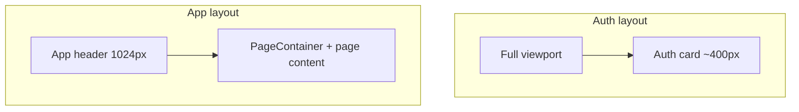

# RemindMe — Page Wireframes (MVP)

Visual layout reference for every v1 screen. Describes **what each page looks like** and how the fixed-width MVP shell is structured.

For product behavior and flows, see [PRODUCT.md](PRODUCT.md). For routes and component ownership, see [ARCHITECTURE.md](ARCHITECTURE.md).

---

## 1. Layout system (MVP)

### 1.1 Fixed width, centered

MVP uses a **1024px content column** centered horizontally. The viewport may be wider; side margins are empty (or a subtle background fill).

Future responsive work should only change the wrapper — page content stays inside `PageContainer`.

```
┌──────────────────────────────────────────────────────────────────────────── viewport ──┐
│                                                                                        │
│     (margin)    ┌────────────────────── 1024px ──────────────────────┐    (margin)   │
│                 │                                                      │               │
│                 │              PageContainer (mx-auto)                 │               │
│                 │                                                      │               │
│                 └──────────────────────────────────────────────────────┘               │
│                                                                                        │
└────────────────────────────────────────────────────────────────────────────────────────┘
```

### 1.2 `PageContainer` wrapper

Implement once in `components/layout/PageContainer.tsx` and use on every page.

| Property | MVP value | Future |
|----------|-----------|--------|
| Max width | `1024px` (`max-w-[1024px]`) | Same or breakpoint-based |
| Horizontal centering | `mx-auto` | Same |
| Width | `w-full` | Same — fills column up to max |
| Horizontal padding | `px-6` (24px) | May increase on small screens |
| Vertical padding | Page-specific | — |

```tsx
// components/layout/PageContainer.tsx
export function PageContainer({ children }: { children: React.ReactNode }) {
  return (
    <div className="mx-auto w-full max-w-[1024px] px-6">
      {children}
    </div>
  );
}
```

### 1.3 Layout variants

| Layout | Used on | Shell |
|--------|---------|-------|
| **Auth layout** | Register, Forgot password (login is a dialog on Home) | No app nav; centered card inside viewport |
| **App layout** | Home, Categories, Category detail, Topic detail, Entity constructor (full page) | Header + `PageContainer` + page body |
| **Player** | Player (`/player`) | Own top bar (Player heading, timer, Stop); no app header |



---

## 2. Shared app chrome

All authenticated pages share the same header inside `PageContainer`.

```
┌────────────────────────────── 1024px ──────────────────────────────┐
│  RemindMe                                    [User menu ▾]         │  ← App header (sticky optional)
├────────────────────────────────────────────────────────────────────┤
│                                                                    │
│                         Page content                               │
│                                                                    │
└────────────────────────────────────────────────────────────────────┘
```

| Element | Behavior |
|---------|----------|
| **Logo / app name** | Links to Home (`/`) |
| **Today's Player time** | Logged in only: a timer ring with today's time in the Player against the 30-minute goal, next to the logo |
| **Log in** (guests only) | Opens the sign-in dialog on Home (`/?login=true`); shown instead of the user menu |
| **User menu** | Logout; profile TBD for v1 |

Auth pages **do not** show this header.

### 2.1 Page breadcrumbs

Every app-layout page shows an **`AppBreadcrumbs`** component directly **above the page title** (not in the header). Built on shadcn/ui [`Breadcrumb`](https://ui.shadcn.com/docs/components/breadcrumb); wrapped in a shared component at `components/shared/AppBreadcrumbs.tsx`.

| Page | Breadcrumb trail | Link behavior |
|------|------------------|---------------|
| Home | *(none)* | Public landing page — no breadcrumbs |
| Categories | `Home` › `Categories` | Home → `/`; Categories is current |
| Category detail | `Home` › `Categories` › `Category: English` | Home → `/`; Categories → `/categories`; category segment is current |
| Topic detail | `Home` › `Categories` › `Category: English` › `Topic: Verbs` | Home → `/`; Categories → `/categories`; category → category detail; topic segment is current |
| Entity constructor (full page) | `Home` › `Categories` › `Category: English` › `Topic: Verbs` › `Entity: {title}` | Same as topic detail; the entity segment is current and shows the title as typed |
| Player | *(none); the entity card shows a muted Category › Topic line | Immersive revision mode; **Stop** replaces back navigation |

Label format is fixed: **`Category: <name>`**, **`Topic: <name>`** and **`Entity: <title>`** — include the prefix in the visible text. The current (last) segment uses `BreadcrumbPage` (non-link); ancestors use `BreadcrumbLink`.

Auth pages do **not** show breadcrumbs.

```tsx
// components/shared/AppBreadcrumbs.tsx — import on every app-layout page
<AppBreadcrumbs />
<AppBreadcrumbs category={{ id, name }} />
<AppBreadcrumbs category={{ id, name }} topic={{ id, name }} />
```

Page title block pattern (breadcrumbs above the title):

```
Home › Categories                              [ + Add category ]
Categories

Home › Category: English › Topic: Verbs        [ + Add entity ]
Entities
```

---

## 3. Auth pages

Centered card on a full-height viewport. Card is **~400px** wide inside the 1024px column.

### 3.1 Login — dialog on Home (`/?login=true`)

Login is not a separate page. The **Log in** button in the header opens this dialog over the home page, and the URL becomes `/?login=true`. `/auth/login` redirects to the same place, and so does any protected page a guest opens.

```
┌──────────────────────────── Home (dimmed behind) ────────────────┐
│  RemindMe                                            [ Log in ]  │
│                                                                  │
│              ┌────────────── ~400px ──────────────┐   [ × ]        │
│              │  Sign in                           │                │
│              │  Enter your email and password…    │                │
│              │                                    │                │
│              │  Email                             │                │
│              │  ┌─────────────────────────────┐   │                │
│              │  └─────────────────────────────┘   │                │
│              │  Password                          │                │
│              │  ┌─────────────────────────────┐   │                │
│              │  └─────────────────────────────┘   │                │
│              │  [          Sign in           ]    │                │
│              └────────────────────────────────────┘                │
└──────────────────────────────────────────────────────────────────┘
```

| Action | Result |
|--------|--------|
| Sign in | Dialog closes; user stays on Home, which now shows **Open my categories** and the **Your library** section |
| × / Escape / click outside | Dialog closes; URL returns to `/` |

Forgot password and Register are not in the dialog yet; they remain separate pages (§3.2–3.3).

---

### 3.2 Registration — `/auth/register`

```
┌──────────────────────────── viewport ────────────────────────────┐
│                                                                  │
│              ┌────────────── ~400px ──────────────┐              │
│              │  RemindMe                         │              │
│              │                                   │              │
│              │  Create account                   │              │
│              │                                   │              │
│              │  Email                            │              │
│              │  ┌─────────────────────────────┐  │              │
│              │  └─────────────────────────────┘  │              │
│              │                                   │              │
│              │  Password                         │              │
│              │  ┌─────────────────────────────┐  │              │
│              │  └─────────────────────────────┘  │              │
│              │                                   │              │
│              │  Confirm password                 │              │
│              │  ┌─────────────────────────────┐  │              │
│              │  └─────────────────────────────┘  │              │
│              │                                   │              │
│              │  [      Create account     ]      │              │
│              │                                   │              │
│              │  Already have an account? Sign in │              │
│              └───────────────────────────────────┘              │
│                                                                  │
└──────────────────────────────────────────────────────────────────┘
```

| Action | Result |
|--------|--------|
| Create account | Redirect to Home |
| Sign in | → Login page |

---

### 3.3 Forgot password — `/auth/forgot-password`

```
┌──────────────────────────── viewport ────────────────────────────┐
│                                                                  │
│              ┌────────────── ~400px ──────────────┐              │
│              │  RemindMe                         │              │
│              │                                   │              │
│              │  Reset password                   │              │
│              │                                   │              │
│              │  Enter your email and we'll send  │              │
│              │  you a reset link.                │              │
│              │                                   │              │
│              │  Email                            │              │
│              │  ┌─────────────────────────────┐  │              │
│              │  └─────────────────────────────┘  │              │
│              │                                   │              │
│              │  [      Send reset link    ]      │              │
│              │                                   │              │
│              │  Back to sign in                  │              │
│              └───────────────────────────────────┘              │
│                                                                  │
└──────────────────────────────────────────────────────────────────┘
```

| Action | Result |
|--------|--------|
| Send reset link | Success message (email sent) |
| Back to sign in | → Login page |

---

## 4. Home — `/`

Public landing page. Guests see the hero and the tree explainer. Logged-in users see the tree card, the library counts and two activity charts.

**Guest** — the header shows **Log in** instead of the user menu. No stats.

```
┌─ 1024px ───────────────────────────────────────────────────────────┐
│  RemindMe                                              [ Log in ]  │
├────────────────────────────────────────────────────────────────────┤
│                                                                    │
│                        A FEW MINUTES A DAY                         │
│                   Remember what you've learned.                    │
│     Make your own cards, review them in short daily sessions,      │
│         and watch your tree grow as your knowledge sticks.         │
│                                                                    │
│                        [ See how it works ]                        │
│                                                                    │
│                           Grow your tree                           │
│                                                                    │
│ ┌──────────────────┐   ┌──────────────────┐   ┌──────────────────┐ │
│ │                  │   │                  │   │                  │ │
│ │      (tree)      │   │      (tree)      │   │      (tree)      │ │
│ │                  │   │                  │   │                  │ │
│ │      Sprout      │   │      Leaves      │   │      Apples      │ │
│ │      Day 1       │   │     Days 6–8     │   │    Days 12–15    │ │
│ │                  │   │                  │   │                  │ │
│ └──────────────────┘   └──────────────────┘   └──────────────────┘ │
│                                                                    │
└────────────────────────────────────────────────────────────────────┘
```

| Element | Behavior |
|---------|----------|
| **Hero** | Centred: accent eyebrow, H1 in Fraunces, muted subtitle |
| **See how it works** | Extra-large accent button. Opens the sign-in dialog (§3.1); there is no tour yet |
| **Grow your tree** | Three cards with the tree at the Sprout, Leaves and Apples stages. The day labels are the placeholder ranges (see [PRODUCT.md §3.3](PRODUCT.md)) |
| **Log in** | Header button (§2) |

**Logged in** — the header shows the user menu. The page shows the tree card, the library counts and two charts side by side.

```
┌─ 1024px ───────────────────────────────────────────────────────────┐
│  RemindMe                                   [ you@example.com ▾ ]  │
├────────────────────────────────────────────────────────────────────┤
│                                                                    │
│ ┌──────────────────────────────────────────────────────────────┐   │
│ │ (tree) (can)    Your tree · Leaves    [ Open my categories ] │   │
│ │              (drop) 7 drops                                  │   │
│ │              Come back tomorrow to earn up to 3 more drops.  │   │
│ │              4 categories · 12 topics · 87 entities          │   │
│ └──────────────────────────────────────────────────────────────┘   │
│                                                                    │
│ ┌──────────────────────────────┐  ┌──────────────────────────────┐ │
│ │ DAILY ACTIVITY  ‹ Nov 2026 › │  │ TIME IN PLAYER               │ │
│ │ 42 revised · 8 skipped       │  │ total for the month          │ │
│ │                              │  │ average per active day       │ │
│ │ ▂ ▅ ▇ ▃ ▆ ▂ ▅ ▇ ▃ ▂          │  │                              │ │
│ │ skipped below, revised above │  │ area chart, dashed goal line │ │
│ │                              │  │                              │ │
│ └──────────────────────────────┘  └──────────────────────────────┘ │
│                                                                    │
└────────────────────────────────────────────────────────────────────┘
```

| Element | Behavior |
|---------|----------|
| **Tree card** | Tree at the placeholder stage (any of the six), a grey watering can with a drop, the title "Your tree · {stage}", the drops count and the hint "Come back tomorrow to earn up to 3 more drops." Values are placeholders (see [PRODUCT.md §3.3](PRODUCT.md)) |
| **Library counts** | Categories, topics and entities from the API, inline with thin dividers; an em dash while loading |
| **Open my categories** | Large accent button → `/categories`. Below 1024px it moves under the text column |
| **Daily activity** | Left chart card. Headline: revised and skipped totals for the month on screen. Stacked bars per day: skipped at the bottom, revised on top; x-axis labels 1, 5, 10 … 30. **Prev** / **Next** buttons on the title row (right side) page through months; Next is disabled on the current month |
| **Time in Player** | Right chart card. Headline: Player time total for the month on screen and the average per active day. Area chart of minutes per day with a dashed line at the 30-minute goal; a dot marks the last day with time |

The two chart cards sit side by side from 768px wide.

---

## 4a. Categories — `/categories`

Lists all categories. **Add category** opens a popover (not a separate page). This used to be the home page.

```
┌─ 1024px ───────────────────────────────────────────────────────────┐
│  RemindMe                                         [ User menu ▾ ]  │
├────────────────────────────────────────────────────────────────────┤
│  Home › Categories                                                 │
│  Categories                                    [ + Add category ]  │
│                                                                    │
│ ┌──────────────────────────────────────────────────────────────┐   │
│ │  English                            75%   [ ▶ ] [ ✎ ] [ × ]  │   │
│ │  2 topics · 12 entities                                      │   │
│ └──────────────────────────────────────────────────────────────┘   │
│                                                                    │
│ ┌──────────────────────────────────────────────────────────────┐   │
│ │  TypeScript                         40%   [ ▶ ] [ ✎ ] [ × ]  │   │
│ │  1 topic · 3 entities                                        │   │
│ └──────────────────────────────────────────────────────────────┘   │
│                                                                    │
│                             ‹  1  2  ›                             │
│                                                                    │
└────────────────────────────────────────────────────────────────────┘
```

Each row is the shared `ListRow` card: title and meta line on the left; markers, the completion percentage and three round 40px buttons on the right. Row actions are icon-only buttons with the action name in `aria-label`; there are no dropdown menus. The pagination sits below the list, with the current page in the accent colour.

| Element | Behavior |
|---------|----------|
| Row title | Tap name → Category detail |
| Meta line | `N topics · M entities`, singular for one (`1 topic`, `1 entity`) |
| Completion | Percentage, shown when the category has entities |
| Markers | Dots for Needs edit and To remove; a grey dot when some entities are hidden from the Player |
| **Play** | `/player?categoryId=…`; disabled, with a tooltip, when the category has no entities |
| **Edit** | Opens the rename popover |
| **Delete** | Opens a confirmation; disabled, with a tooltip, unless the category has no topics |
| **+ Add category** | Primary button; opens the popover (§4.1) |

Categories have no visibility switch, so their rows are never hidden.

### 4.1 Add category popover (overlay)

Anchored to **+ Add category** button.

```
                              [ + Add category ]
                              ┌─────────────────────────┐
                              │  Category name          │
                              │  ┌───────────────────┐  │
                              │  │                   │  │
                              │  └───────────────────┘  │
                              │                         │
                              │  [       Save       ]   │
                              └─────────────────────────┘
```

| Field | Required |
|-------|----------|
| Category name | Yes |

**Save** → creates category → redirect to **Category detail** (empty).

---

### 4.2 Categories — empty state

Shown when the user has no categories yet.

```
┌────────────────────────────── 1024px ──────────────────────────────┐
│  RemindMe                                    [User menu ▾]         │
├────────────────────────────────────────────────────────────────────┤
│                                                                    │
│  Home › Categories                                                 │
│  Categories                                                        │
│                                                                    │
│                    ┌─────────────────────┐                         │
│                    │   (folder icon)     │                         │
│                    │                     │                         │
│                    │  No categories yet  │                         │
│                    │                     │                         │
│                    │ [ + Add category ]  │                         │
│                    └─────────────────────┘                         │
│                                                                    │
└────────────────────────────────────────────────────────────────────┘
```

---

## 5. Category detail — `/categories/$categoryId`

Lists topics in one category.

```
┌─ 1024px ───────────────────────────────────────────────────────────┐
│  RemindMe                                         [ User menu ▾ ]  │
├────────────────────────────────────────────────────────────────────┤
│  Home › Categories › Category: English                             │
│  Topics                 [ ‹ Back to Categories ]  [ + Add topic ]  │
│                                                                    │
│ ┌──────────────────────────────────────────────────────────────┐   │
│ │  Verbs                                   [ on ]   ▶   ✎   ×  │   │
│ │  3 entities                                                  │   │
│ └──────────────────────────────────────────────────────────────┘   │
│                                                                    │
│ ┌──────────────────────────────────────────────────────────────┐   │
│ │  Idioms                                  [ off ]  ▶   ✎   ×  │   │
│ │  5 entities                                                  │   │
│ └──────────────────────────────────────────────────────────────┘   │
│                                                                    │
└────────────────────────────────────────────────────────────────────┘
```

| Element | Behavior |
|---------|----------|
| **Breadcrumbs** | `Home` › `Categories` › `Category: {name}`, above the title |
| **Back to Categories** | Outline button → `/categories` |
| **+ Add topic** | Primary button; opens the popover (§5.1) |
| Topic row | Title links to Topic detail; meta line `N entities` (singular for one) |
| **Visibility switch** | Topic visibility. Switching it changes every entity in the topic (in or out of the Player). Disabled while the topic has no entities. When off, the row is dashed (hidden) |
| Markers | As on the category rows |
| **Play** | `/player?topicId=…`; disabled when the topic has no entities |
| **Edit** | Opens the rename popover |
| **Delete** | Opens a confirmation; disabled unless the topic has no entities |

The category itself is renamed or deleted from the Categories list (§4a).

### 5.1 Add topic popover (overlay)

Anchored to **+ Add topic**, same pattern as the category popover (§4.1).

```
                              [ + Add topic ]
                              ┌─────────────────────────┐
                              │  Topic name             │
                              │  ┌───────────────────┐  │
                              │  │                   │  │
                              │  └───────────────────┘  │
                              │                         │
                              │  [       Save       ]   │
                              └─────────────────────────┘
```

| Field | Required |
|-------|----------|
| Topic name | Yes |

**Save** creates the topic. Unlike category creation, it does not redirect.

---

### 5.2 Category detail — empty state

```
┌────────────────────────────── 1024px ──────────────────────────────┐
│  RemindMe                                    [User menu ▾]         │
├────────────────────────────────────────────────────────────────────┤
│                                                                    │
│  Home › Categories › Category: English                             │
│  English                                                           │
│                                                                    │
│                    ┌─────────────────────┐                         │
│                    │   (topic icon)      │                         │
│                    │                     │                         │
│                    │   No topics yet     │                         │
│                    │                     │                         │
│                    │  [ + Add topic ]    │                         │
│                    └─────────────────────┘                         │
│                                                                    │
└────────────────────────────────────────────────────────────────────┘
```

---

## 6. Topic detail — `/categories/$categoryId/topics/$topicId`

Lists entities (shown by **Title**) in one topic.

```
┌─ 1024px ───────────────────────────────────────────────────────────┐
│  RemindMe                                         [ User menu ▾ ]  │
├────────────────────────────────────────────────────────────────────┤
│  Home › Categories › Category: English › Topic: Verbs              │
│  Entities                  [ ‹ Back to Topics ]  [ + Add entity ]  │
│  [ Search … ]                                                      │
│                                                                    │
│ ┌──────────────────────────────────────────────────────────────┐   │
│ │  Present Simple — usage      3 revised   [ on ]   ▶   ✎   ×  │   │
│ │  Created 12-11-2026 · Edited 14-11-2026                      │   │
│ └──────────────────────────────────────────────────────────────┘   │
│                                                                    │
│ ┌──────────────────────────────────────────────────────────────┐   │
│ │  Irregular verbs list       0 revised   [ off ]   ▶   ✎   ×  │   │
│ │  Created 02-11-2026                                          │   │
│ └──────────────────────────────────────────────────────────────┘   │
│                                                                    │
└────────────────────────────────────────────────────────────────────┘
```

| Element | Behavior |
|---------|----------|
| **Breadcrumbs** | `Home` › `Categories` › `Category: {name}` › `Topic: {name}`, above the title |
| **Back to Topics** | Outline button → Category detail |
| **+ Add entity** | Primary button → Entity constructor page (`…/entities/new`, §7.1) |
| **Search** | Field above the list (`ListSearchInput`) |
| Entity row | Title links to the Entity constructor (`…/entities/$entityId`). Meta line: `Created {date}`, then `· Edited {date}` after a save (dates as d-MM-yyyy) |
| **N revised** | `revised_count`, muted, before the visibility switch |
| **Visibility switch** | "Shown in the Player" when on, "Hidden from the Player" when off. When off, the row is dashed (hidden) |
| Markers | Dots for Needs edit and To remove; a grey dot when hidden |
| **Play** | `/player?entityId=…` (a pack of one entity) |
| **Edit** | Pencil button → Entity constructor page |
| **Remove** | Trash button; opens a confirmation |

---

### 6.1 Topic detail — empty state

```
┌────────────────────────────── 1024px ──────────────────────────────┐
│  RemindMe                                    [User menu ▾]         │
├────────────────────────────────────────────────────────────────────┤
│                                                                    │
│  Home › Categories › Category: English › Topic: Verbs              │
│  Verbs                                                             │
│                                                                    │
│                    ┌─────────────────────┐                         │
│                    │   (entity icon)     │                         │
│                    │                     │                         │
│                    │  No entities yet    │                         │
│                    │                     │                         │
│                    │  [ + Add entity ]   │                         │
│                    └─────────────────────┘                         │
│                                                                    │
└────────────────────────────────────────────────────────────────────┘
```

---

## 7. Entity constructor

The Entity constructor is a full page with two panels: the content on the left and the block templates on the right. It opens from **+ Add entity** (`…/entities/new`) and from **Edit** on an entity row (`…/entities/$entityId`). The modal in §7.2 is not built yet.

### 7.1 Full page — `/categories/…/topics/…/entities/new` or `…/$entityId`

Uses the app header and `PageContainer`.

**Header row:** the breadcrumb trail (`Home` › `Category: {name}` › `Topic: {name}` › `Entity: {title}`, title as typed) on the left, and **Back** (outline) and **Save** (green) on the right of the same row. **Save** is disabled until the form has changes and at least one block; on success it returns to Topic detail. **Back** returns to Topic detail and asks to discard first when there are unsaved changes.

```
┌─ 1024px ───────────────────────────────────────────────────────────┐
│ Home › … › Topic: Verbs › Entity: Present Simple [ Back ] [ Save ] │
├────────────────────────────────────────────────────────────────────┤
│ ┌─ Content ──────────────────────────────┐  ┌─ Templates ────────┐ │
│ │  Title *                               │  │ Shown in the Player│ │
│ │  [ Present Simple ]                    │  │ [ on ]             │ │
│ │                                        │  │                    │ │
│ │  Text block                            │  │ Add a block        │ │
│ │  (TipTap rich text)                    │  │ Hover to preview,  │ │
│ │                                        │  │ click to add.      │ │
│ │  Code block                            │  │                    │ │
│ │  (CodeMirror, JavaScript / TypeScript) │  │ [ Text ]           │ │
│ │                                        │  │ [ Code ]           │ │
│ └────────────────────────────────────────┘  │ [ Image ]          │ │
│                                             │ [ List ]           │ │
│                                             │ [ Link ]           │ │
│                                             │                    │ │
│                                             │ Blocks 2 / 20      │ │
│                                             │ ▓▓▓▓▓▓▓▓░░░░░░░░░░ │ │
│                                             │                    │ │
│                                             │ [ Preview ]        │ │
│                                             └────────────────────┘ │
│                                                                    │
│  [ Delete this entity ]                                            │
└────────────────────────────────────────────────────────────────────┘
```

| Panel | Contents |
|-------|----------|
| **Left — Content** | Title field (required, up to 75 symbols); in edit mode the marker toggle (Needs edit / To remove) sits beside it. Block cards follow in order |
| **Right — Templates** | In edit mode: **Shown in the Player** switch and a divider. Then **Add a block** with the hint "Hover to preview, click to add.", the five templates, a divider, the **N / 20** block counter with a thin bar, and in edit mode a **Preview** button (light blue) |

The panel is a card. Each template is a card with a coloured icon tile (Text grey, Code lavender, Image amber, List green, Link blue), its name and a one-line description. A hovered or focused template gets a stronger border, a white background, a shadow and a + icon.

| Template | Block editor (left column, after insert) |
|----------|------------------------------------------|
| **Text** | TipTap rich text editor |
| **Code** | `@uiw/react-codemirror` editor + language selector (JavaScript, TypeScript); optional **Blured by default** (see §7.5) |
| **Image** | Custom `ImageBlockEditor` (unchanged, §7.4) |
| **List** | Rows: left + right columns; **+** adds row (see §7.3) |
| **Link** | Title (optional) + URL (required) inputs (see §7.6) |

| Interaction | Behavior |
|-------------|----------|
| **Hover template** | A dashed placeholder appears after the last block, with the block's icon, "A {type} block will be added here" and a grey skeleton of that type. Image shows a plain dashed box instead |
| **Click template** | Adds a block of that type at the end; the placeholder becomes its editor |
| `≡` | Drag handle, reorders blocks |
| `×` | Removes the block |
| **Delete this entity** | Edit mode only, below the form; asks for confirmation |

Templates are disabled when the entity already has **20 blocks** (Title excluded); the panel then shows "Maximum 20 blocks reached".

---

### 7.2 Entity constructor modal (from Topic detail)

**Not built yet:** entities open the full page (§7.1) instead. The layout below is the planned modal: same two-panel layout inside a large dialog. Modal width ≈ **960px** (fits inside 1024px column with margin).

```
┌──────────────────────────── viewport ────────────────────────────────┐
│ ░░░░░░░░░░░░░░░░░░░░░░░░░ backdrop ░░░░░░░░░░░░░░░░░░░░░░░░░░░░░░░░ │
│ ░░░  ┌────────────────────── ~960px ──────────────────────────┐ ░░ │
│ ░░░  │  New entity                                           [×]│ ░░ │
│ ░░░  ├────────────────────────────┬─────────────────────────────┤ ░░ │
│ ░░░  │  Content                   │  Templates                  │ ░░ │
│ ░░░  │  (same as §7.1 left)       │  (same as §7.1 right)       │ ░░ │
│ ░░░  │                            │                             │ ░░ │
│ ░░░  ├────────────────────────────┴─────────────────────────────┤ ░░ │
│ ░░░  │                        [ Cancel ]  [ Save ]               │ ░░ │
│ ░░░  └───────────────────────────────────────────────────────────┘ ░░ │
│ ░░░░░░░░░░░░░░░░░░░░░░░░░░░░░░░░░░░░░░░░░░░░░░░░░░░░░░░░░░░░░░░░░░░ │
└──────────────────────────────────────────────────────────────────────┘
```

On small viewports (post-MVP), the modal may stack preview above editor. MVP fixed width keeps side-by-side panels.

---

### 7.3 Constructor block — List type (detail)

One List block in the left column, expanded:

```
┌─ List ─────────────────────────────────────────────── [≡] [×] ─┐
│                                                                 │
│  ┌──────────────────────┐    ┌──────────────────────┐           │
│  │ left                 │    │ right                │  [×]    │
│  └──────────────────────┘    └──────────────────────┘           │
│  ┌──────────────────────┐    ┌──────────────────────┐           │
│  │ another              │    │ pair                 │  [×]    │
│  └──────────────────────┘    └──────────────────────┘           │
│                                                                 │
│  [ + Add row ]                                                  │
│                                                                 │
│  ☐ Blur right side by default                                   │
└─────────────────────────────────────────────────────────────────┘
```

**+ Add row** adds a row inside this List block only (not a new top-level block).

---

### 7.4 Constructor block — Image type (detail)

One Image block in the left column.

**Empty state** — no image selected yet:

```
┌─ Image ────────────────────────────────────────────── [≡] [×] ─┐
│                                                                 │
│  ┌ ─ ─ ─ ─ ─ ─ ─ ─ ─ ─ ─ ─ ─ ─ ─ ─ ─ ─ ─ ─ ─ ─ ─ ─ ─ ─ ─ ─ ┐ │
│  │                                                             │ │
│  │              [ Choose image ]   (or drag and drop)          │ │
│  │                                                             │ │
│  └ ─ ─ ─ ─ ─ ─ ─ ─ ─ ─ ─ ─ ─ ─ ─ ─ ─ ─ ─ ─ ─ ─ ─ ─ ─ ─ ─ ─ ┘ │
└─────────────────────────────────────────────────────────────────┘
```

**With image** — uploaded image shown inside the container:

```
┌─ Image ────────────────────────────────────────────── [≡] [×] ─┐
│                                                                 │
│  ┌─────────────────────────────────────────────────────────────┐ │
│  │                                                             │ │
│  │                    [ image preview ]                   [×]  │ │
│  │                                                             │ │
│  └─────────────────────────────────────────────────────────────┘ │
└─────────────────────────────────────────────────────────────────┘
```

| Interaction | Behavior |
|-------------|----------|
| **Choose image** | Opens native file picker; accepts image mime types |
| **Drag and drop** | Drop onto the dashed container; same upload flow as file picker |
| **Upload** | Calls `POST /media/upload`; on success, preview renders inside the container |
| **Remove** (`[×]` on preview) | Clears the image and returns to empty state; user can upload again |

---

### 7.5 Constructor block — Code type (detail)

One Code block in the left column, expanded:

```
┌─ Code ─────────────────────────────────────────────── [≡] [×] ─┐
│                                                                 │
│  [ JavaScript ▼ ]                                               │
│                                                                 │
│  ┌─────────────────────────────────────────────────────────┐   │
│  │ [CodeMirror — JS / TS]                                    │   │
│  └─────────────────────────────────────────────────────────┘   │
│                                                                 │
│  ☐ Blured by default                                            │
└─────────────────────────────────────────────────────────────────┘
```

**Blured by default** blurs the snippet in preview/Player until the user clicks/taps to reveal.

---

### 7.6 Constructor block — Link type (detail)

One Link block in the left column (same white card as other blocks):

```
┌─ Link ─────────────────────────────────────────────── [≡] [×] ─┐
│                                                                 │
│  Title (max 75 symbols)                                         │
│  [ Link title                                               ]   │
│  URL *                                                          │
│  [ https://example.com                                      ]   │
└─────────────────────────────────────────────────────────────────┘
```

Preview / Player rendering: a blue card with an icon tile, the title (only when set), the URL and an arrow on the right.

```
┌────────────────────────────────────────────────────────────┐
│  (link) React docs                                      ↗  │
│        https://react.dev/reference/react                   │
└────────────────────────────────────────────────────────────┘
```

Title is optional (hidden when empty). The whole card is a link: it opens the URL in a new tab (`target="_blank"`, `rel="noopener noreferrer"`).

---

## 8. Player — `/player`

Revision page. Shows one entity at a time as a read-only preview. The Player has its own top bar (Player heading, daily timer and Stop) and no app header; the entity card shows a muted Category › Topic line above the title. It is an immersive revision mode.

### 8.1 Active session

```
┌─ 1024px ───────────────────────────────────────────────────────────┐
│  Player                            (◔) 12:40 of 30 min   [ Stop ]  │
├────────────────────────────────────────────────────────────────────┤
│  2 of 3                                       1 left in this pack  │
│  ██████████████████ ▓▓▓▓▓▓▓▓▓▓▓▓▓▓ ░░░░░░░░░░░░░░░░░░              │
│                                                                    │
│ ┌────────────────────────────────────────────────────────────┐     │
│ │  Category › Topic                                          │     │
│ │                                                            │     │
│ │  Present Simple — usage                                    │     │
│ │  ● Needs edit   ● To remove                                │     │
│ │                                                            │     │
│ │  Use for habits, facts and general truths.                 │     │
│ │                                                            │     │
│ │  I work       every day                                    │     │
│ │  She works    in London                                    │     │
│ └────────────────────────────────────────────────────────────┘     │
│                                                                    │
│                      [ Skip ]        [ Done ]                      │
│                   Press D for Done or S for Skip                   │
│                                                                    │
└────────────────────────────────────────────────────────────────────┘
```

| Element | Behavior |
|---------|----------|
| **Timer** | Pill with a blue progress ring: Player time today against the 30-minute daily goal. Shows `--:--` until today's total has loaded |
| **Stop** | Top bar, soft coral (`stop`) button. Leaves the Player for the page it was opened from, or Categories when there is none; does not change the counters for the current entity |
| **Progress** | Under the top bar, while a pack plays: `{completed} of {total}` and `{left} left in this pack`. One segment per entity: done (accent), current (soft coral), upcoming (grey) |
| **Entity card** | 24px radius, soft shadow. Muted `Category › Topic` line above the title, title in Fraunces 40px, marker toggle (Needs edit / To remove) under the title, then the blocks. A marker change does not advance |
| **Done** | Green `positive` button (right), 52px tall, at least 200px wide. Increments `revised_count`; advances to the next entity in the pack |
| **Skip** | Light blue `secondary` button (left), 52px tall, at least 160px wide. Increments `skipped_count` only; advances to the next entity in the pack |
| **Keyboard** | `D` = Done, `S` = Skip. The hint line under the buttons reads "Press D for Done or S for Skip", with the letters as key chips. Ignored while typing in a field, with Ctrl, Cmd, Alt or Shift held, on key repeat, while an update is saving, and when no pack is playing |
| **In-memory next** | The next entity is already in the client pack queue: no extra request while playing |

Block previews on the card (same render as the constructor preview):

- **Text:** 18px body text; inline code and highlights use a soft paper chip.
- **Code:** lavender panel. The header shows the language on the left and, while blurred, "Hidden until you reveal it" on the right. When blurred by default, a white **Show code** pill sits over the code. The reveal is one-way.
- **List:** two-column table with thin dividers and no header row.
- **Link:** blue card (§7.6).
- **Image:** unchanged (§7.4).

Search params (one required): `categoryId`, `topicId`, or `entityId`.

### 8.2 Pack complete / depleted

**Pack complete** — the "Batch complete" dialog appears when the last entity in the pack is Done or Skipped. It has no close button; the user stays on `/player`.

```
┌─ 1024px ───────────────────────────────────────────────────────────┐
│  Player                            (◔) 12:40 of 30 min   [ Stop ]  │
├────────────────────────────────────────────────────────────────────┤
│                                                                    │
│                                                                    │
│                                                                    │
│           ┌────────────────────────────────────────────┐           │
│           │                                            │           │
│           │ Batch complete                             │           │
│           │                                            │           │
│           │ You finished this pack. Get the next 3     │           │
│           │ entities or return Home.                   │           │
│           │                                            │           │
│           │ [ Go to Home ]   [ Get next 3 ]            │           │
│           │                                            │           │
│           └────────────────────────────────────────────┘           │
│                                                                    │
│                                                                    │
└────────────────────────────────────────────────────────────────────┘
```

| Element | Behavior |
|---------|----------|
| **Get next 3** | Accent button; fetches another pack (round reset if the scope was fully shown) |
| **Go to Home** | Outline button; leaves the Player, like **Stop** |
| **Stop** | Still available in the top bar |

**Depleted** — "Nothing to revise" card, shown when the scope has no eligible entities (on open, or after a failed round reset). Its only button is **Go to Home**.

**Loading and error** — "Loading revision pack…" with a spinner; on failure, "Unable to load a revision pack." with **Try again**.

---

## 9. Confirm dialogs (shared pattern)

Used for destructive actions: delete category, delete topic, remove entity. The confirm button is **Remove** in all three; the dialog title names the action.

```
        ┌─────────────────────────────────────────┐
        │  Delete category?                  [×]  │
        ├─────────────────────────────────────────┤
        │                                         │
        │  This cannot be undone.                 │
        │                                         │
        │              [ Cancel ]  [ Remove ]     │
        └─────────────────────────────────────────┘
```

---

## 10. Page → route map

| Wireframe | Route | Layout |
|-----------|-------|--------|
| Login (dialog on Home) | `/?login=true` (legacy `/auth/login` redirects) | Auth |
| Registration | `/auth/register` | Auth |
| Forgot password | `/auth/forgot-password` | Auth |
| Home | `/` | App |
| Category detail | `/categories/$categoryId` | App |
| Topic detail | `/categories/$categoryId/topics/$topicId` | App |
| Player | `/player` (`?categoryId` \| `?topicId` \| `?entityId`) | Own top bar, no app header |
| Entity constructor (full page) | `/categories/…/topics/…/entities/new` or `…/$entityId` | App |
| Entity constructor (modal, not built) | — (§7.2) | Dialog |
| Add category popover | — (overlay on Categories) | Popover |
| Add topic popover | — (overlay on Category detail) | Popover |

---

## 11. Implementation checklist

When building UI, wire layouts to these components (see [ARCHITECTURE.md §6.2](ARCHITECTURE.md)):

| Component | Role |
|-----------|------|
| `PageContainer` | 1024px centered wrapper (`components/layout/PageContainer.tsx`) |
| `AuthLayout` | Full-viewport centering for auth card |
| `AppHeader` | Header: logo, today's Player time (logged in) and the user menu or **Log in** |
| `AppBreadcrumbs` | Shared shadcn breadcrumb trail — import on every app-layout page, placed above the title |
| `PlayButton` | Icon-only play action on category, topic, and entity list rows → `/player` with scope search param |
| `ListRow` | Card row for the Categories, Topics and Entities lists (`components/shared/ListRow.tsx`) |
| `components/brand/` | Logo, sun glow and tree or drop illustrations for the header and Home |

Suggested Tailwind on app shell outer wrapper:

```tsx
<div className="min-h-screen">
  <AppHeader />
  <PageContainer>{/* page */}</PageContainer>
</div>
```

The wrapper sets no background: the paper colour comes from `body`, and an opaque wrapper would hide the sun glow ([TECH_STACK.md §10](TECH_STACK.md)).

---

## 12. Related documents

| Document | Covers |
|----------|--------|
| [PRODUCT.md](PRODUCT.md) | Flows, business rules, entity block types |
| [PLAYER.md](PLAYER.md) | How the Player deals packs, Done/Skip, and round reset |
| [ARCHITECTURE.md](ARCHITECTURE.md) | Routes, feature folders, layout components |
| [TECH_STACK.md](TECH_STACK.md) | Tailwind, shadcn/ui, TanStack Router |

---

## Changelog

| Date | Change |
|------|--------|
| 2026-11-23 | Redesign: Home (guest and logged in), list pages on the shared `ListRow`, Constructor and Player match the shipped design; Add topic is a popover; the Player has its own top bar |
| 2026-08-31 | Code template: **Blured by default** checkbox below the editor (§7.1, §7.5) |
| 2026-08-18 | Player pack progress bar; batch-complete modal (Next 10 / Home); depleted empty state |
| 2026-07-13 | Entity list rows show gray `{revised_count} revised` label before Play button |
| 2026-07-13 | Add Player wireframe (`/player`); Play button on category, topic, and entity list rows; completion state |
| 2026-07-13 | List row actions use icon-only buttons (pencil / trash) with `aria-label` text — not visible labels |
| 2026-07-13 | Categories, Topics, and Entities list rows use inline action buttons — not dropdown menus |
| 2026-07-13 | Add `AppBreadcrumbs` (shadcn) under page titles on all app-layout pages; label format `Home` › `Category: …` › `Topic: …`; replace back links |
| 2026-07-13 | Initial wireframes — MVP 1024px fixed layout, all v1 pages and overlays |
| 2026-07-13 | Text template: TipTap rich text editor |
| 2026-07-13 | Code template: `@uiw/react-codemirror` (JavaScript + TypeScript) |
| 2026-07-13 | Image template: custom `ImageBlockEditor` — file picker + drag-drop; preview with remove |
| 2026-10-23 | Link template: optional title + required URL; preview/Player opens URL in new tab with external-link icon (§7.6) |
